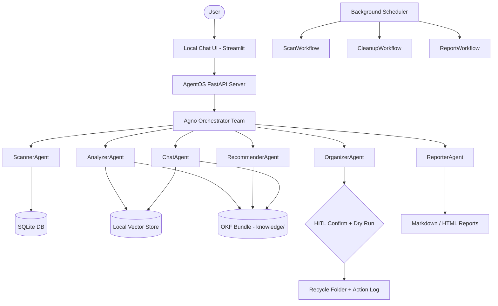

# Steward Architecture & Roadmap

Steward is a local-first, multi-agent AI assistant that monitors your machine, understands your files, keeps long-term curated memory in Open Knowledge Format (OKF v0.3), and helps keep storage clean safely.

## High-Level System Flow

## Memory & Storage Separation

| Store | Technology | Purpose |
| :--- | :--- | :--- |
| **Operational Metadata** | SQLite (`data/steward.db`) | Scanned file stats, SHA-256 hashes, scan runs, software inventory, download events, and reversible action logs. |
| **Raw Passage Search (RAG)** | Persistent ChromaDB (`documents`) + Ollama Embeddings | Chunked raw text from documents for passage-level semantic search. |
| **Curated Long-Term Memory** | OKF v0.3 (`knowledge/`) + NetworkX | Distilled summaries, projects, topics, user preferences, learned patterns, and decision history (no secrets or raw sensitive copies). |

## Build Phases

| Phase | Title | Status | Documentation | Manual Demo |
| :---: | :--- | :---: | :--- | :--- |
| **1** | Foundation and config | Done | [phase-1-foundation.md](phase-1-foundation.md) | [demo_phase1_foundation.py](../examples/demo_phase1_foundation.py) |
| **2** | File scanning and database | Done | [phase-2-scanning.md](phase-2-scanning.md) | [demo_phase2_scanning.py](../examples/demo_phase2_scanning.py) |
| **3** | Document reading and RAG | Done | [phase-3-rag.md](phase-3-rag.md) | [demo_phase3_rag.py](../examples/demo_phase3_rag.py) |
| **4** | OKF knowledge bundle, graph, and memory | Done | [phase-4-okf.md](phase-4-okf.md) | [demo_phase4_okf.py](../examples/demo_phase4_okf.py) |
| **5** | Agno tools, agents, team, and workflows | Done | [phase-5-agents.md](phase-5-agents.md) | [demo_phase5_agents.py](../examples/demo_phase5_agents.py) |
| **6** | Organizing and cleanup actions | Done | [phase-6-organizing.md](phase-6-organizing.md) | [demo_phase6_organizing.py](../examples/demo_phase6_organizing.py) |
| **7** | Recommendations and reports | Done | [phase-7-reports.md](phase-7-reports.md) | [demo_phase7_reports.py](../examples/demo_phase7_reports.py) |
| **8** | Chat UI (AgentOS plus local Streamlit UI) | Done | [phase-8-ui.md](phase-8-ui.md) | [demo_phase8_api.py](../examples/demo_phase8_api.py) |
| **9** | Docker deployment | Done | [phase-9-docker.md](phase-9-docker.md) | [demo_phase9_worker.py](../examples/demo_phase9_worker.py) |
