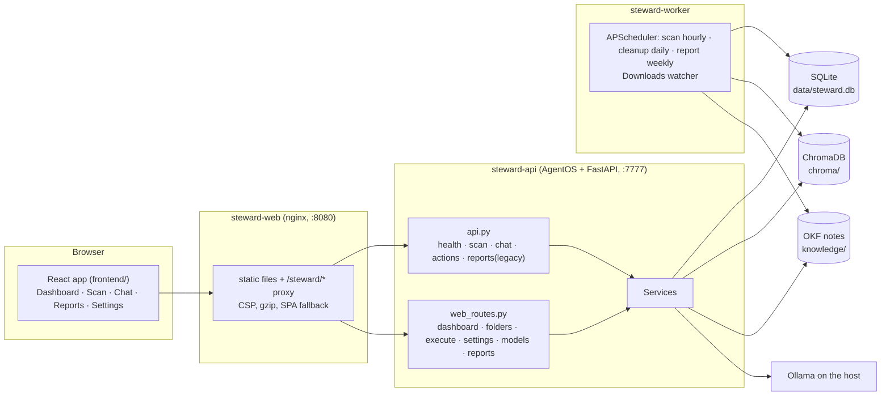
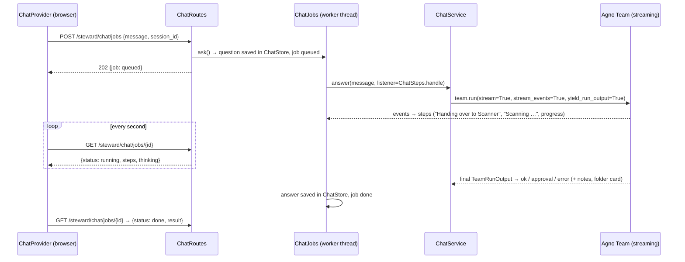
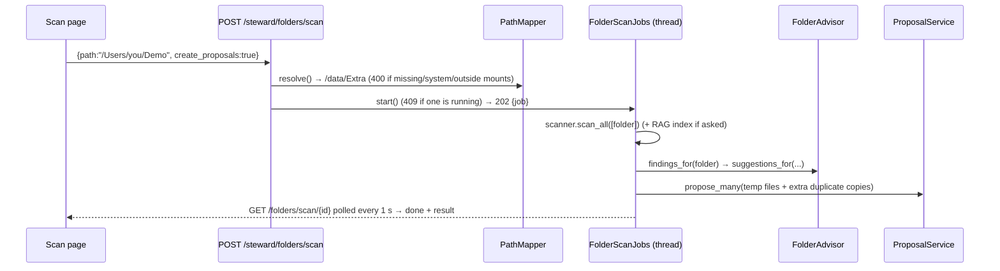
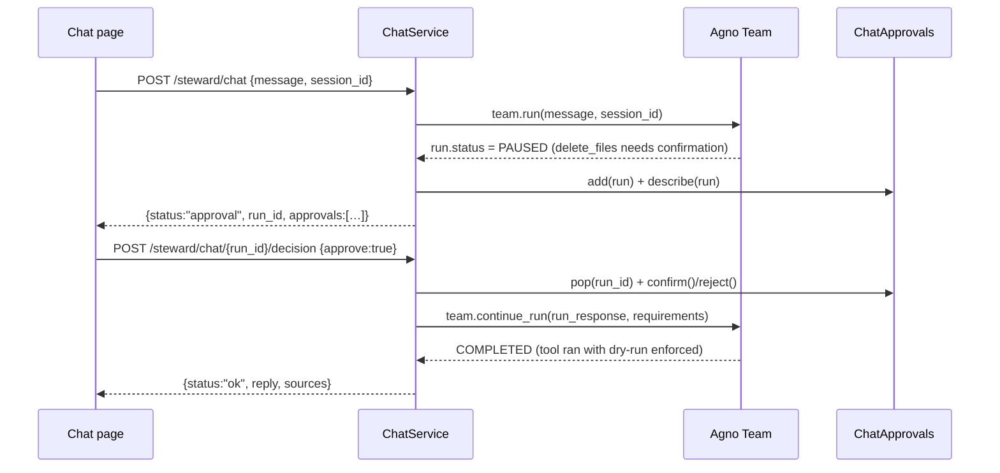
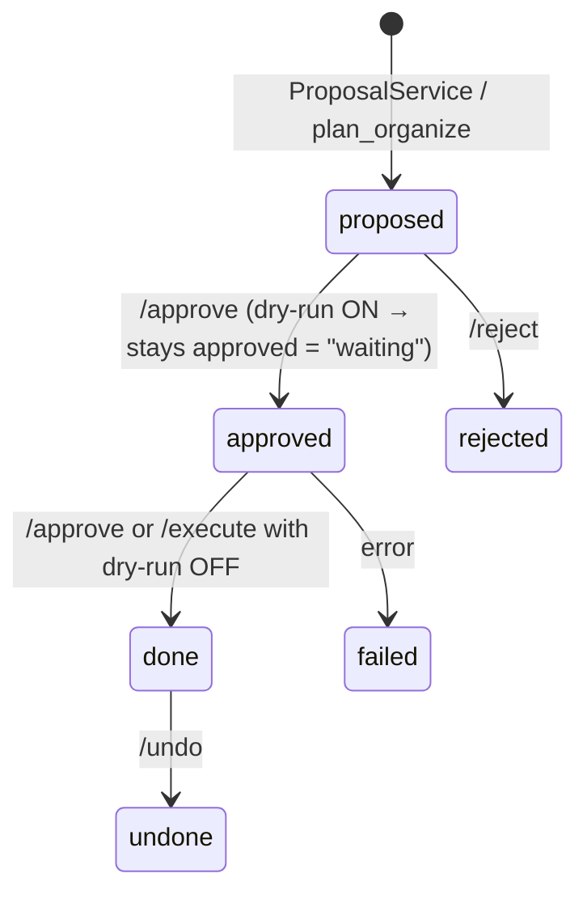

# Architecture

## Big picture

## Modules added for the web UI (0.10.0)

| Module | Class | Responsibility |
|:--|:--|:--|
| `steward/web_routes.py` | `WebRoutes` | Registers the web-UI routes; builds the services below |
| `steward/dashboard.py` | `DashboardService` | Status cards, to-do, approved-waiting, suggestions, categories, patterns |
| `steward/daily_stats.py` | `DailyStats` | Per-day series in the **browser's** time zone (`tz_offset`) |
| `steward/folder_advisor.py` | `FolderAdvisor` | Folder-scoped findings (skips deleted files), suggestions (union bytes), proposals |
| `steward/proposals.py` | `ProposalService` | Creates `proposed` actions only; skips protected paths; never duplicates |
| `steward/scan_jobs.py` | `FolderScanJobs` | One background folder scan at a time; steps + progress |
| `steward/scan_job_store.py` | `ScanJobStore` | Persists jobs in SQLite (`folder_scan_jobs`); interrupted jobs → failed |
| `steward/path_mapper.py` | `PathMapper` | Validates folder input; Mac path ⇄ Docker path (`/data/...`), `to_host_deep` for responses |
| `steward/chat_service.py` | `ChatService` | Runs the team per `session_id`; maps run status to `ok/error/approval` |
| `steward/chat_sources.py` | `ChatSources` | Sources from what agents actually used (references + tool calls) |
| `steward/chat_approvals.py` | `ChatApprovals` | Holds paused runs; describes steps; confirm/reject |
| `steward/settings_service.py` | `SettingsService` | Validates + saves UI settings to `data/settings.override.yaml`; `.env` locks |
| `steward/ollama_models.py` | `OllamaModels` | Installed models + capabilities (tools / embedding / cloud) |
| `steward/report_service.py` | `ReportService` | Report library, read, download (inside `reports_dir` only), generate |

Changed existing modules: `api.py` (wiring, chat routes, `_rebuild_agents`), `workflows.py`
(CleanupWorkflow proposes only), `agents.py` (routing instructions, Analyzer gets RAG),
`tools/organizer_tools.py` (`_safe_dry_run`), `rag.py` (`_safe_upsert`), `config.py`
(`load_ui_overrides`), `worker.py` (reload overrides before scans).

## Modules added for the live chat (0.11.0)

| Module | Class | Responsibility |
|:--|:--|:--|
| `steward/tools/tool_paths.py` | `ToolPaths` | Every tool path: Mac/`~` → container path, existence, write checks (`.env` switch must be exactly `rw`) |
| `steward/tools/action_targets.py` | `ActionTargets` | What a move/archive/delete touches (files or whole folders); pre-approval check; card text |
| `steward/folder_actions.py` | `FolderActions` | Files to zip in a folder (skips hidden/private/protected), protected-inside check, remove emptied folders |
| `steward/chat_notices.py` | `ChatNotices` | Steward's own notes from real tool results (practice mode, exact errors) |
| `steward/chat_steps.py` | `ChatSteps` | Agno stream events → plain steps (hand-overs, tools, progress, helper errors) |
| `steward/chat_jobs.py` | `ChatJobs` | One worker thread answers chat jobs in order; live steps; saves answers |
| `steward/chat_store.py` | `ChatStore` | Conversations + messages in SQLite (`chat_conversations`, `chat_messages`) |
| `steward/chat_routes.py` | `ChatRoutes` | `/steward/chat/jobs`, `/decisions`, `/conversations`, `/folder` |
| `steward/chat_insights.py` | `ChatInsights` | Folder stats card after a successful `scan_folder` (via `FolderAdvisor`) |

Changed: `ChatService` streams (`listener`), declines impossible steps before the card
(`ChatApprovals.reject_impossible`), adds notes and the folder card; `RecycleManager` recycles
folders as one item and reports archive progress; `OrganizerTools.progress` hook;
`PathMapper.to_local` and display-only `STEWARD_HOST_APP_DIR` mapping; agents get
`tool_call_limit` (team 6 hand-overs, helpers 8 tool calls). A live test once saw gemma4 hand
the same task over 98 times; the limits stop that.

### Live chat job

The browser state lives in `ChatProvider` (above the routes), so leaving the Chat page does not
stop polling; on load it reads `GET /steward/chat/conversations/{id}` and resumes `active_job`.

## Key flows

### Folder scan

### Chat with approval

**Dry-run is enforced in the tool**, not in the prompt: `OrganizerTools._safe_dry_run()` returns
`True` whenever `safety.dry_run` is on, whatever `dry_run` the model passed.

### Action life cycle

## Settings precedence

`defaults in config.py` < `config.yaml` (or `config.docker.yaml`) < `data/settings.override.yaml`
(written by the Settings page) < **`.env` / environment variables**. Settings fixed by a non-empty
env var are reported as `locked` and refused by `PUT /steward/settings`.

## Known limitations (see `review-system/08-issues-and-risks.md`)

Chat jobs live in memory (a restart drops a running answer; the question stays saved). Only one
chat answer runs at a time. Deleted files remain in SQLite/RAG/OKF (#4, partly mitigated), identical files share one RAG entry
(#5), OKF summaries are raw previews (#6), API and worker both write ChromaDB/SQLite (#12).
