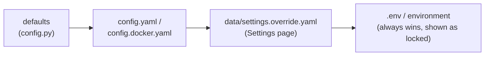

# Docker and configuration

## Services (`docker-compose.yml`)

| Service | Image / command | Port | Notes |
|:--|:--|:--|:--|
| `steward-api` | root `Dockerfile`, `python -m steward.api` | `127.0.0.1:7777` | Health-checked (`/steward/health`) |
| `steward-worker` | same image, `python -m steward.worker` | — | Scheduler + Downloads watcher; starts after the API is healthy |
| `steward-web` | `frontend/Dockerfile` (nginx) | `127.0.0.1:8080` | Serves the UI, proxies `/steward/*` to `steward-api:7777` |
| `steward-ui` | root image, Streamlit | `127.0.0.1:8501` | **Legacy**: only with `--profile legacy` |

Ollama runs **natively on the host**; containers reach it at `host.docker.internal:11434`.

## Volumes

| Host | Container | Mode | Used for |
|:--|:--|:--|:--|
| `${STEWARD_DOCUMENTS_DIR:-~/Documents}` | `/data/Documents` | `${STEWARD_DOCUMENTS_ACCESS:-ro}` | scanning (+ approved actions when `rw`) |
| `${STEWARD_DESKTOP_DIR:-~/Desktop}` | `/data/Desktop` | `${STEWARD_DESKTOP_ACCESS:-ro}` | scanning (+ approved actions when `rw`) |
| `${STEWARD_DOWNLOADS_DIR:-~/Downloads}` | `/data/Downloads` | rw | scanning + approved actions |
| `${STEWARD_EXTRA_DIR:-./host-inventory}` | `/data/Extra` | `${STEWARD_EXTRA_ACCESS:-ro}` | optional extra folder (API only) |

> **Docker accepts any mode except `ro` as writable** (`yes`, `false`, … all mount read-write).
> Compose therefore also passes the switches into the containers, and `ToolPaths.is_writable`
> only allows changes under `/data/Desktop`, `/data/Documents` and `/data/Extra` when the switch
> is exactly `rw` (case-insensitive). Any other value is treated as read-only, with a message.
| `./data` `./chroma` `./knowledge` `./reports` | `/app/...` | rw | SQLite, vectors, OKF notes, reports, **settings.override.yaml** |
| `./host-inventory` | `/app/host-inventory` | ro | app list exported by `scripts/export_host_inventory.py` |

## Environment variables

| Variable | Where | Default | Effect |
|:--|:--|:--|:--|
| `STEWARD_CONFIG_PATH` | all | `config.yaml` (Docker: `/app/config.docker.yaml`) | Which YAML config to load |
| `STEWARD_MODEL_PROVIDER` / `STEWARD_MODEL_ID` | `.env` | — | Override the model; **locks** it in the Settings page |
| `STEWARD_DRY_RUN` | `.env` | — | Override dry-run; **locks** it in Settings |
| `STEWARD_LOG_LEVEL` | `.env` | `INFO` | Log level |
| `OLLAMA_HOST` / `DOCKER_OLLAMA_HOST` | `.env` | `http://localhost:11434` / `http://host.docker.internal:11434` | Where Ollama runs |
| `OPENAI_API_KEY` / `ANTHROPIC_API_KEY` / `GEMINI_API_KEY` | `.env` | — | Needed before switching to that cloud provider |
| `STEWARD_DOCUMENTS_DIR` / `STEWARD_DESKTOP_DIR` / `STEWARD_DOWNLOADS_DIR` | `.env` | `~/…` | Which host folders are mounted (use absolute paths) |
| `STEWARD_EXTRA_DIR` | `.env` | — | One more folder to scan (shown by its Mac path) |
| `STEWARD_DOCUMENTS_ACCESS` / `STEWARD_DESKTOP_ACCESS` / `STEWARD_EXTRA_ACCESS` | `.env` | `ro` | Exactly `rw` lets Steward change files there (after approval); also checked in code |
| `STEWARD_HOST_APP_DIR` | compose → API | `${PWD}` | Project folder, so `/app/data`, `/app/reports`, … show as Mac paths (display only, never scannable) |
| `STEWARD_HOST_HOME`, `STEWARD_HOST_*_DIR` | compose → API | from `${HOME}` | Tell `PathMapper` which Mac path sits behind each mount |
| `STEWARD_API_HOST` / `STEWARD_API_PORT` | compose | `0.0.0.0` / `7777` | API bind address in the container |
| `STEWARD_CORS_ORIGINS` | API | `http://127.0.0.1:5173,http://localhost:5173` | Only for the Vite dev server |
| `STEWARD_API_URL` | Vite dev / Streamlit | `http://127.0.0.1:7777` | API the dev proxy forwards to |

## Settings precedence



The worker re-reads the override file before every scheduled scan; the API applies changes live
(model changes rebuild the agents).

## nginx (`frontend/nginx.conf`)

- SPA fallback (`try_files … /index.html`), `/assets/` cached 30 days, `index.html` never cached.
- `/steward/` → `http://steward-api:7777` via Docker DNS (`resolver 127.0.0.11`), 300 s timeouts for chat.
- Security headers on every response: CSP (`default-src 'self'`, `script-src 'self'`,
  `style-src 'self' 'unsafe-inline'`, `frame-ancestors 'none'`), `nosniff`, `no-referrer`.
  Don't put `add_header` inside a `location` block: nginx would drop these server-level headers.
- `/healthz` for the container health check.

## Common commands

```bash
docker compose up -d --build          # build + start api, worker, web
docker compose ps                     # health
docker compose logs -f steward-api    # logs
docker compose down                   # stop
docker compose --profile legacy up -d # also the Streamlit UI
docker compose up -d --remove-orphans # clean up containers from older compose files
```
