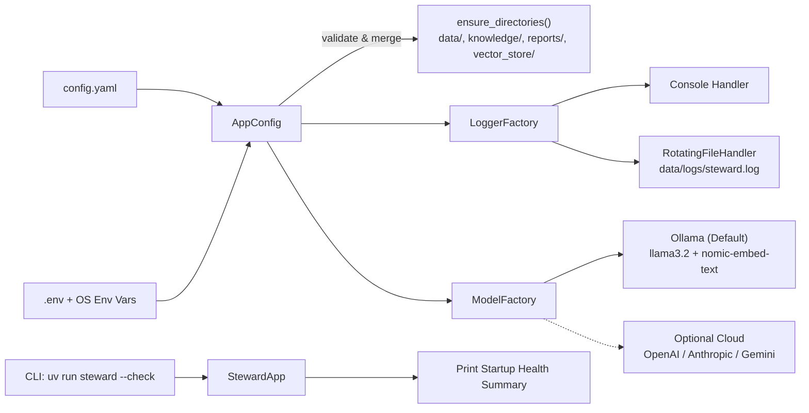

# Phase 1: Foundation and Config

## Goal
Create the `uv`-managed Python project skeleton with YAML + `.env` configuration, automatic directory setup, rotating file and console logging, an Agno-ready `ModelFactory`, and a CLI health-check entry point.

## Flow Diagram



## What Happened & What Changed

| File | Change | Responsibility |
| :--- | :--- | :--- |
| `pyproject.toml` & `uv.lock` | Added | Configures the `steward` package under `uv`, registers the `steward` CLI command, and locks `pyyaml`, `python-dotenv`, and `pytest`. |
| `config.yaml` | Added | Central defaults for paths, watched folders, scanner thresholds, Ollama models, safety rules (`dry_run: true`), scheduler, and server ports. |
| `.env.example` | Added | Safe template for environment overrides and optional cloud API keys (`.env` remains git-ignored). |
| `.gitignore` | Updated | Added `*.egg-info/` so local editable install metadata is never tracked. |
| `steward/config.py` | Added | `AppConfig` loads YAML defaults, applies environment variable overrides, validates values, expands `~` paths, and creates runtime directories. |
| `steward/logger.py` | Added | `LoggerFactory` attaches formatted console and rotating file handlers without duplicating handlers. |
| `steward/models.py` | Added | `ModelFactory` maps providers (`ollama`, `openai`, `anthropic`, `gemini`) to Agno chat and embedder classes with API-key checks. |
| `steward/main.py` | Added | `StewardApp` and `StewardCLI` bootstrap the system and display the health check report. |
| `tests/test_foundation.py` | Added | 9 pytest unit tests validating config loading, env overrides, logging, `ModelFactory`, and CLI health checks. |

## How to Run & Try Manually

```bash
# Sync dependencies
uv sync

# Run unit tests
uv run pytest tests/test_foundation.py -v

# Run CLI health check
uv run steward --check

# Run the manual Phase 1 walkthrough script
uv run python examples/demo_phase1_foundation.py
```
