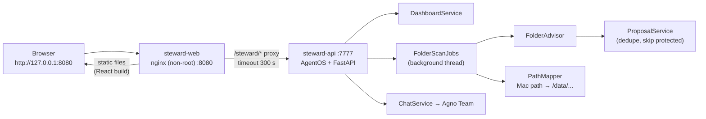

# Phase 10: Professional Web UI (Dashboard, Scan a folder, Chat)

Steward now has a proper web app in [`frontend/`](../frontend/), served by nginx in Docker at
**http://127.0.0.1:8080**. It replaces the Streamlit page as the main way in (Streamlit still
exists behind the `legacy` Docker profile).

## What you get

| Page | What it does |
| :--- | :--- |
| **Dashboard** | Last scan, files tracked, files checked today, items to review, space you can free, errors in the last 24 h. Daily scan chart (7/14/30 days). **To-do** list with Approve / Reject, "Approved, waiting to run" with **Run now**, "Recently completed" with **Undo**. Suggestions, file types, habits, recent scans. |
| **Scan a folder** | Type a folder path (or click a quick pick), choose "create proposals" and "searchable in chat", press **Scan**. Live step-by-step progress, then folder-only results: duplicates (with which copy is kept), temp/old/large files, suggestions, and the new proposals ready to approve. |
| **Chat** | Ask about your files. Answers are rendered as Markdown with source chips, a "Thinking… 12 s" timer, Retry on errors, and history kept in your browser. |

Safety rules the UI follows:

- It only talks to the Steward API (`/steward/*`), never to files or models (PRD p.14).
- New proposals are always `proposed`; nothing changes until you click Approve.
- With **dry-run ON**, Approve only previews. **Run now** is disabled until dry-run is turned off (PRD p.11: dry-run stops actions even after approval).
- Protected folders are scanned read-only and never get proposals.

## Architecture



### New backend modules

| File | Class | Job |
| :--- | :--- | :--- |
| [`steward/dashboard.py`](../steward/dashboard.py) | `DashboardService` | Status cards, daily series, to-do, suggestions, categories, recent scans |
| [`steward/folder_advisor.py`](../steward/folder_advisor.py) | `FolderAdvisor` | Folder-scoped findings, suggestions (each file counted once), proposals |
| [`steward/proposals.py`](../steward/proposals.py) | `ProposalService` | Creates `proposed` actions only; skips protected paths and duplicates |
| [`steward/scan_jobs.py`](../steward/scan_jobs.py) | `FolderScanJobs` | One background folder scan at a time, with steps and progress |
| [`steward/path_mapper.py`](../steward/path_mapper.py) | `PathMapper` | Validates folder input; maps Mac paths to Docker mounts |
| [`steward/chat_service.py`](../steward/chat_service.py) | `ChatService` | Runs chat through the team; reports `error` / `paused` honestly |
| [`steward/web_routes.py`](../steward/web_routes.py) | `WebRoutes` | Registers the routes below |

### New API routes

| Route | Method | Purpose |
| :--- | :--- | :--- |
| `/steward/dashboard?days=14` | GET | Everything the dashboard shows (`days` must be 1–90) |
| `/steward/folders/roots` | GET | Folders Steward can scan (quick picks), and whether it runs in Docker |
| `/steward/folders/scan` | POST | Start a folder scan `{path, create_proposals, index_for_chat}` → 202 + job; 400 bad path; 409 already running |
| `/steward/folders/scan/{job_id}` | GET | Job status, step, progress and results |
| `/steward/folders/scans` | GET | Recent folder scan jobs |
| `/steward/actions/{id}/execute` | POST | Run an action that is already approved (respects dry-run) |
| `/steward/chat` | POST | Now returns `status: ok \| error \| paused` |

Fixed along the way: the scheduled **CleanupWorkflow no longer approves its own proposals**
and no longer re-creates the same proposals every run (review issues #1 and #3).

## Run it (Docker, recommended)

```bash
ollama serve                                   # Ollama on your Mac (needs gemma4 + nomic-embed-text)
docker compose up -d --build                   # steward-api, steward-worker, steward-web
open http://127.0.0.1:8080
docker compose --profile legacy up -d          # optional: old Streamlit UI on :8501
```

### Scanning folders from Docker

Inside Docker, Steward only sees mounted folders. You can type the normal Mac path; Steward
translates it:

| You type | Steward scans | Set by |
| :--- | :--- | :--- |
| `/Users/you/Documents/Acme` | `/data/Documents/Acme` (read-only) | `STEWARD_DOCUMENTS_DIR` (default `~/Documents`) |
| `/Users/you/Downloads` | `/data/Downloads` | `STEWARD_DOWNLOADS_DIR` |
| `/Users/you/Desktop` | `/data/Desktop` (read-only) | `STEWARD_DESKTOP_DIR` |
| any folder you choose | `/data/Extra` (read-only) | `STEWARD_EXTRA_DIR` in `.env`, then `docker compose up -d` |

A path outside these gives a clear message listing what Steward can see. Use absolute paths
(not `~`) in `.env`.

## Develop it (without Docker)

```bash
uv run python -m steward.api                   # API on 127.0.0.1:7777
cd frontend && npm install && npm run dev      # UI on http://127.0.0.1:5173 (proxies /steward to :7777)
npm test                                       # Vitest unit tests
npm run build                                  # production build into frontend/dist
```

Frontend layout: `src/api/` (one function per route), `src/hooks/` (`useApi`, `usePolling`),
`src/components/{layout,ui,dashboard,scan,chat}/`, `src/pages/`, `src/styles/` (design tokens with
light/dark mode). Plain JavaScript (no TypeScript) to match the project's no-type-hints style.

## Troubleshooting

| Symptom | Fix |
| :--- | :--- |
| Red "Steward API is not reachable" banner | `docker compose ps`; check `steward-api` is healthy; `docker compose logs steward-api` |
| Chat shows "Failed to connect to Ollama" + Retry | Start Ollama on the Mac (`ollama serve`), then click Retry |
| Chat says "This action needs your approval…" | Approvals from chat are not supported yet; use Scan a folder → Dashboard to-do |
| "Folder not found … can only see these folders" | Mount it with `STEWARD_EXTRA_DIR` (see above) |
| Approve does nothing to files | Dry-run is ON (badge in the top bar); turn it off in config to really move files |
| Times look like UTC days on the chart | Days are grouped in UTC for now |

## Tests

- Python: [`tests/test_folder_scan.py`](../tests/test_folder_scan.py), [`tests/test_web_api.py`](../tests/test_web_api.py) (offline, no Ollama)
- Frontend: `frontend/src/**/*.test.js` (Vitest)
- Manually verified in headless Chrome against the demo folder and through the Docker/nginx stack.

## Later additions in 0.10.0

Added after this page was first written: **Reports** and **Settings** pages, **approve from chat**,
real chat sources, Mac paths in every response, local-time dashboard days, saved folder-scan
history, and dry-run enforced inside the file tools. See the
[User Guide](user-guide/README.md) and the [Developer Guide](developer-guide/README.md).

## Known limitations (next steps)

- Deleted/moved files still have rows in SQLite, the search index and the knowledge notes (review #4).
- Identical files share one search entry (review #5); knowledge-note summaries are raw previews (#6).
- The Downloads watcher logs suggestions but doesn't create proposals yet (#7).
- The API and the worker both write the same databases (#12).
