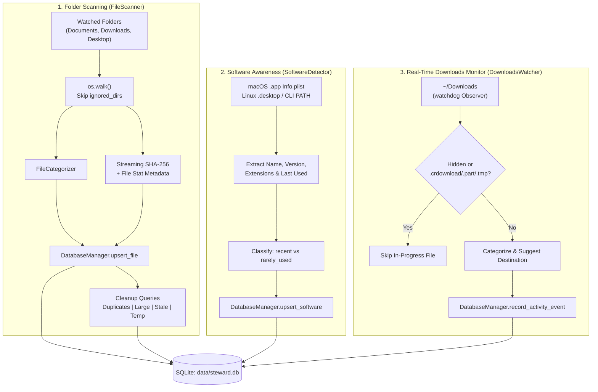

# Phase 2: File Scanning and Database

## Goal
Build the local inspection and persistence layer so Steward can scan configured folders, detect duplicates/large/stale/temporary files, discover installed software and file-type associations, watch the Downloads folder in real time, and persist everything in SQLite.

## Flow Diagram



## SQLite Tables Created (`data/steward.db`)

| Table | Purpose |
| :--- | :--- |
| `files` | One row per scanned file: path, name, folder, extension, category, size, SHA-256, timestamps, `is_temp`. |
| `scan_runs` | Audit log of every scan run (timestamps, folders scanned, files seen, duplicates found, errors). |
| `activity_events` | Downloads and file-arrival events with suggested destinations. |
| `software` | Installed applications, versions, supported file extensions (JSON), last-used timestamp, and `recent`/`rarely_used` status. |
| `actions` | Audit table ready for Phase 6 organize/archive/delete actions and undo history. |

## What Happened & What Changed

| File | Change | Responsibility |
| :--- | :--- | :--- |
| `pyproject.toml` & `uv.lock` | Updated | Added `watchdog>=6.0` and restricted setuptools package discovery to `["steward*"]`. |
| `steward/database.py` | Added | `DatabaseManager` initializes SQLite tables/indexes and provides CRUD + duplicate, large, stale, and temp file queries. |
| `steward/scanner.py` | Added | `FileCategorizer` and `FileScanner` recursively scan folders, compute streaming SHA-256 hashes, and flag cleanup candidates. |
| `steward/software.py` | Added | `SoftwareDetector` reads macOS `.app/Contents/Info.plist`, Linux `.desktop` files, or CLI fallback tools to map apps to file extensions. |
| `steward/watcher.py` | Added | `DownloadsEventHandler` and `DownloadsWatcher` watch Downloads in real time via `watchdog`, filter partial downloads, and log suggested destinations. |
| `steward/main.py` & `steward/__init__.py` | Updated | Wired Phase 2 services into `StewardApp` and added `--scan`, `--software`, and `--watch-downloads` CLI commands. |
| `tests/test_phase2.py` | Added | 5 pytest tests covering scanning, anomaly detection, `.app` bundle parsing, partial-download filtering, and live `watchdog` events. |

## How to Run & Try Manually

```bash
# Run all tests (Phase 1 + Phase 2)
uv run pytest -v

# Run the self-contained manual demo (safe sandbox inside data/demo_phase2/)
uv run python examples/demo_phase2_scanning.py

# Run against your real configured folders
uv run steward --scan
uv run steward --software
uv run steward --watch-downloads
```
