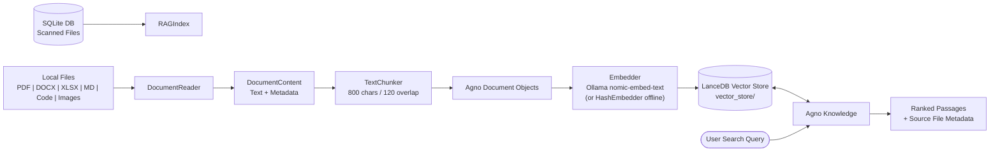

# Phase 3: Document Reading and RAG

## Goal
Enable Steward to read and extract content from common local document formats (PDF, DOCX, XLSX, TXT, Markdown, source code, and image EXIF/dimensions), split extracted text into overlapping passages, and index them into a local LanceDB vector store managed by Agno `Knowledge` for passage-level semantic search.

## Flow Diagram



## Supported Formats

| Format | Extensions | Library | What Gets Extracted |
| :--- | :--- | :--- | :--- |
| **PDF** | `.pdf` | `pypdf` | Page-by-page text, page count, PDF title & author metadata |
| **Word** | `.docx` | `python-docx` | Paragraphs and table cells, paragraph/table counts |
| **Excel** | `.xlsx` | `openpyxl` | Sheet names and non-empty cell rows (`read_only`, `data_only`) |
| **Text / Markdown / Code** | `.txt`, `.md`, `.py`, `.js`, `.json`, `.yaml`, `.sql`, etc. | stdlib | UTF-8 text (with replacement fallback), line count |
| **Images** | `.png`, `.jpg`, `.jpeg`, `.webp`, `.gif`, `.bmp`, `.tiff` | `Pillow` | Format, color mode, width/height, and EXIF tags formatted as searchable text |

## What Happened & What Changed

| File | Change | Responsibility |
| :--- | :--- | :--- |
| `pyproject.toml` & `uv.lock` | Updated | Added `pypdf`, `python-docx`, `openpyxl`, `pillow`, `agno`, `lancedb`, and `ollama` via `uv add`. |
| `config.yaml` & `steward/config.py` | Updated | Added `models.embedding_dimensions: 768` and `rag` settings (`table_name`, `chunk_size`, `chunk_overlap`, `max_file_chars`, `default_top_k`). |
| `steward/models.py` | Updated | Passes `dimensions` to `OllamaEmbedder` so `nomic-embed-text` (768-dim) matches LanceDB's schema cleanly. |
| `steward/reader.py` | Added | `DocumentContent` and `DocumentReader` extract text and metadata from PDF, DOCX, XLSX, text/code, and image files. |
| `steward/chunker.py` | Added | `TextChunker` creates overlapping passage chunks; `HashEmbedder` provides an offline Agno `Embedder` for tests and Ollama-free demos. |
| `steward/rag.py` | Added | `RAGIndex` integrates Agno `Knowledge` + `LanceDb`, tracks indexed file hashes to skip unchanged files, and runs passage-level semantic search. |
| `steward/main.py` & `steward/__init__.py` | Updated | Added `--read <path>`, `--index`, and `--search <query>` CLI commands and exported Phase 3 classes (`v0.3.0`). |
| `tests/test_phase3.py` | Added | Automated pytest tests covering all 6 file formats, chunking, incremental indexing, and semantic retrieval. |
| `examples/demo_phase3_rag.py` | Added | Hardcoded self-contained manual demo that creates real DOCX/XLSX/MD/PY/PNG files, indexes them into LanceDB, and runs search queries. |

## How to Run & Try Manually

```bash
# Sync dependencies with uv
uv sync

# Run all unit tests (Phases 1–3)
uv run pytest -v

# Run the offline manual Phase 3 demo (no Ollama server needed)
uv run python examples/demo_phase3_rag.py

# Use the real CLI (with Ollama running locally: ollama pull nomic-embed-text)
uv run steward --read README.md
uv run steward --scan
uv run steward --index
uv run steward --search "quarterly budget"
```
