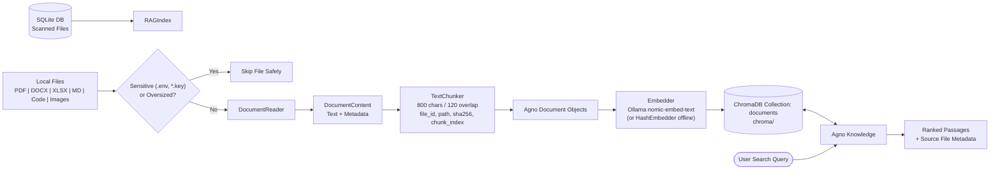

# Phase 3: Document Reading and RAG

## Goal
Enable Steward to safely extract text and metadata from common local document formats (PDF, DOCX, XLSX, TXT, Markdown, source code, and image EXIF/dimensions), skip sensitive or oversized files, split extracted text into overlapping passages, and index them into a persistent **ChromaDB** collection (`documents`) managed by **Agno `Knowledge`** for passage-level semantic search.

## Flow Diagram



## Supported Formats & Privacy Guards

| Format | Extensions | Library | What Gets Extracted |
| :--- | :--- | :--- | :--- |
| **PDF** | `.pdf` | `pypdf` | Page-by-page text, page count, PDF title & author metadata |
| **Word** | `.docx` | `python-docx` | Paragraphs and table cells, paragraph/table counts |
| **Excel** | `.xlsx` | `openpyxl` | Sheet names and non-empty cell rows (`read_only`, `data_only`) |
| **Text / Markdown / Code** | `.txt`, `.md`, `.py`, `.js`, `.json`, `.yaml`, `.sql`, etc. | stdlib | UTF-8 text (with replacement fallback), line count |
| **Images** | `.png`, `.jpg`, `.jpeg`, `.webp`, `.gif`, `.bmp`, `.tiff` | `Pillow` | Format, color mode, width/height, and EXIF tags formatted as searchable text |
| **Privacy & Size Guard** | `.env`, `.env.*`, `*.pem`, `*.key`, `id_rsa*`, `*password*`, `> max_read_mb` | `fnmatch` | Skipped before reading or embedding so secrets never enter ChromaDB |

## What Happened & What Changed

| File | Change | Responsibility |
| :--- | :--- | :--- |
| `pyproject.toml` & `uv.lock` | Updated | Added `pypdf`, `python-docx`, `openpyxl`, `pillow`, `agno`, `chromadb`, and `ollama` via `uv`. |
| `config.yaml` & `steward/config.py` | Updated | Configured ChromaDB (`paths.vector_store_dir: chroma`, `rag.collection_name: documents`), `sensitive_patterns`, `max_read_mb`, `safety.protected_paths`, and AgentOS port `7777`. |
| `steward/database.py` | Updated | Added `files.status`, `scan_runs.checkpoint_path`/`hashed_files`/`unchanged_files`, `actions.decided_at`, and `reports` table with automatic column migrations. |
| `steward/scanner.py` & `steward/watcher.py` | Updated | Made folder scans truly incremental (skipping SHA-256 on unchanged files), marked unreadable files, and added size-stability debouncing to DownloadsWatcher. |
| `steward/reader.py` | Added | `DocumentContent` and `DocumentReader` extract text and metadata while enforcing sensitive-file and max-size guards. |
| `steward/chunker.py` | Added | `TextChunker` attaches `file_id`, `path`, `sha256`, `chunk_index`; `HashEmbedder` enables offline tests/demos. |
| `steward/rag.py` | Added | `RAGIndex` integrates Agno `Knowledge` + persistent `ChromaDb` (`collection: documents`), deletes stale chunks when a file's SHA-256 changes, and runs passage search. |
| `steward/main.py` & `steward/__init__.py` | Updated | Added `--read <path>`, `--index`, and `--search <query>` CLI commands and exported Phase 3 classes (`v0.3.0`). |
| `tests/test_phase3.py` | Added | Verifies all 6 formats, `.env`/`*.key`/oversized skips, incremental ChromaDB updates (replacing stale chunks), and semantic retrieval. |
| `examples/demo_phase3_rag.py` | Added | Hardcoded self-contained manual demo showcasing multi-format reading, `.env` skipping, ChromaDB indexing, and passage search. |

## How to Run & Try Manually

```bash
# Sync dependencies with uv
uv sync

# Run all unit tests (Phases 1–3)
uv run pytest -v

# Run the manual Phase 3 demo with REAL Ollama embeddings (make sure `ollama pull nomic-embed-text` is pulled)
uv run python examples/demo_phase3_rag.py

# Or run the same demo offline without Ollama using HashEmbedder
uv run python examples/demo_phase3_rag.py --offline

# Use the real CLI (with Ollama running locally: ollama pull nomic-embed-text)
uv run steward --read README.md
uv run steward --scan
uv run steward --index
uv run steward --search "quarterly budget"
```
