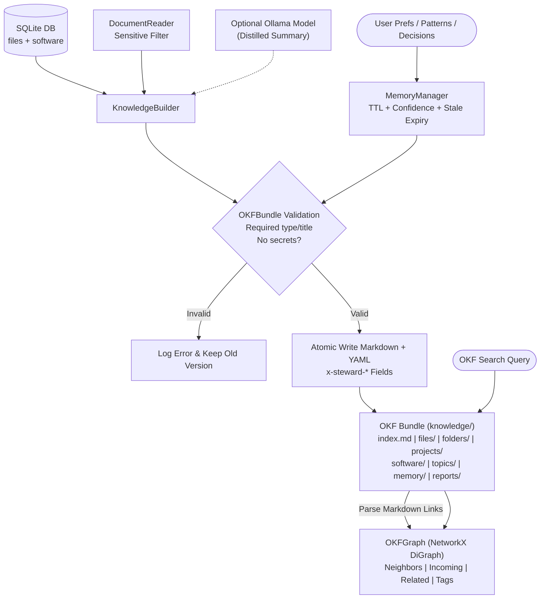

# Phase 4: OKF Knowledge Bundle, Graph, and Memory

## Goal
Build Steward's curated long-term memory and knowledge graph using **Google's Open Knowledge Format (OKF v0.3)**: human-readable Markdown files with YAML frontmatter under `knowledge/`, parsed into an in-memory **NetworkX** directed graph, with a dedicated `MemoryManager` (preferences, learned patterns, action decisions, stale expiry) and `KnowledgeBuilder` that turns SQLite scans and software inventory into linked concepts—strictly separated from raw ChromaDB RAG chunks and protected against secrets.

## Flow Diagram



## OKF Bundle Layout (`knowledge/`)

```text
knowledge/
├── index.md                # Auto-generated entry point linking every curated concept
├── files/                  # One concept per important file (summary, SHA-256, links)
├── folders/                # Folder purpose & contained file links
├── projects/               # Inferred projects grouping related files
├── software/               # Installed apps & file extensions they handle
├── topics/                 # Recurring subjects across documents
├── memory/
│   ├── preferences/        # Stated user preferences (e.g. never touch ~/Work/Clients)
│   ├── patterns/           # Learned work patterns with observation counts & TTL
│   └── decisions/          # Organize/archive/delete decisions and outcomes
└── reports/                # Periodic reports stored as concepts (Phase 7)
```

## What Happened & What Changed

| File | Change | Responsibility |
| :--- | :--- | :--- |
| `pyproject.toml` & `uv.lock` | Updated | Added `networkx>=3.7` via `uv add networkx`. |
| `steward/okf_bundle.py` | Added | `OKFBundle` & `OKFValidationError`: manages bundle layout, validates required fields + blocks secrets, writes atomically (keeping old file on validation failure), searches concepts, and regenerates `index.md`. |
| `steward/okf_graph.py` | Added | `OKFGraph`: parses relative Markdown links into a NetworkX `DiGraph` with `rebuild()`, `update_node()`, `get_neighbors()`, `get_incoming()`, `find_related()`, `find_by_tag()`, and `find_by_type()`. |
| `steward/memory.py` | Added | `MemoryManager`: decides what becomes memory, records preferences/patterns/decisions with `x-steward-*` freshness & TTL metadata, reinforces repeated observations, and expires stale entries. |
| `steward/knowledge_builder.py` | Added | `KnowledgeBuilder`: transforms SQLite files, software inventory, and distilled summaries (supporting a real Ollama summarizer callback) into linked OKF concepts while skipping temp/unreadable/sensitive files. |
| `steward/main.py` & `steward/__init__.py` | Updated | Wired OKF services into `StewardApp`, added `--build-okf` and `--okf-search <query>` CLI flags (`v0.4.0`). |
| `tests/test_phase4.py` | Added | Automated pytest tests for validation/secret blocking, atomic preservation, NetworkX link traversal, memory TTL expiry, and SQLite-to-OKF builds. |
| `examples/demo_phase4_okf.py` | Added | Runnable manual demo that scans real files, summarizes via real Ollama (`gemma3:4b` or `--fast`), builds the OKF bundle + NetworkX graph, records/expires memories, and prints a real generated `.md` concept file. |

## How to Run & Try Manually

```bash
# Sync dependencies with uv
uv sync

# Run all unit tests (Phases 1–4)
uv run pytest -v

# Run the manual Phase 4 demo (uses real Ollama for distilled file summaries; pass --fast to skip LLM calls)
uv run python examples/demo_phase4_okf.py
uv run python examples/demo_phase4_okf.py --fast

# Build and search your real OKF knowledge bundle via CLI
uv run steward --scan
uv run steward --software
uv run steward --build-okf
uv run steward --okf-search "invoice"
```
