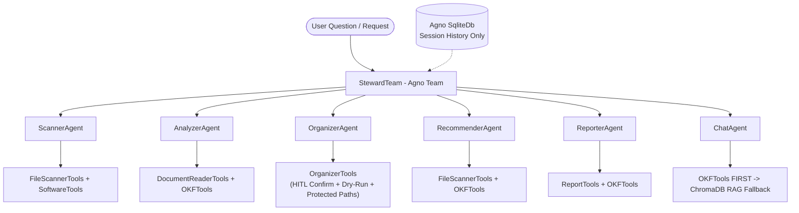
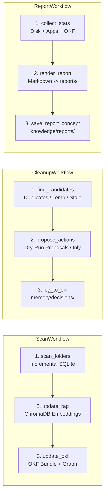

# Phase 5: Agno Tools, Agents, Team, and Workflows

## Goal
Wire Steward's core services into the **Agno framework**: 6 reusable `Toolkit` classes (with human-in-the-loop confirmation on destructive actions), 6 single-purpose `Agent`s backed by `ModelFactory` and `SqliteDb` session history (keeping long-term memory strictly in OKF), a routing **Orchestrator `Team`**, and 3 deterministic, step-based **Agno `Workflow`s**.

## Flow Diagrams

### 1. Agno Orchestrator Team & Toolkits


### 2. Three Deterministic Agno Workflows


## Agno Toolkits & Confirmation Policy

| Toolkit | Methods | HITL Confirmation? |
| :--- | :--- | :---: |
| `FileScannerTools` | `scan_folder`, `get_file_info`, `find_duplicates`, `find_large_files`, `find_stale_files` | No |
| `DocumentReaderTools` | `read_document`, `extract_text` | No |
| `SoftwareTools` | `list_apps`, `apps_for_extension` | No |
| `OKFTools` | `read_concept`, `write_concept`, `link_concepts`, `search_concepts`, `neighbors` | No |
| `ReportTools` | `collect_stats`, `render_report` | No |
| `OrganizerTools` | `propose_move`, `move_file`, `archive_files`, `delete_files`, `undo_action` | **Yes** (`move_file`, `archive_files`, `delete_files`) |

## What Happened & What Changed

| File | Change | Responsibility |
| :--- | :--- | :--- |
| `pyproject.toml` & `uv.lock` | Updated | Added `sqlalchemy` and `greenlet` required by Agno's `SqliteDb`. |
| `steward/tools/inspection_tools.py` | Added | `FileScannerTools`, `DocumentReaderTools`, and `SoftwareTools` Agno Toolkits. |
| `steward/tools/knowledge_tools.py` | Added | `OKFTools` and `ReportTools` Agno Toolkits. |
| `steward/tools/organizer_tools.py` | Added | `OrganizerTools` with `requires_confirmation_tools`, dry-run default, protected-path blocking, recycle-bin delete, and undo. |
| `steward/agents.py` | Added | `StewardAgents` building the 6 specialist Agents (`update_memory_on_run=False`) and `StewardTeam` with `SqliteDb`. |
| `steward/workflows.py` | Added | `StewardWorkflows` building deterministic `ScanWorkflow`, `CleanupWorkflow`, and `ReportWorkflow`. |
| `steward/main.py` & `steward/__init__.py` | Updated | Added `--workflow <scan|cleanup|report>` and `--chat "<question>"` CLI flags (`v0.5.0`). |
| `tests/test_phase5.py` | Added | Verifies all 6 Toolkits, HITL confirmation flags, protected-path guards, 6 Agents + Team, and all 3 Workflows. |
| `examples/demo_phase5_agents.py` | Added | Runs all 3 real Agno Workflows (real Ollama embeddings + ChromaDB + OKF) and asks a live question to `ChatAgent`/`StewardTeam` (`gemma3:4b`). |

## How to Run & Try Manually

```bash
# Sync dependencies with uv
uv sync

# Run all unit tests (Phases 1–5)
uv run pytest -v

# Run the Phase 5 manual demo with real Ollama (gemma3:4b + nomic-embed-text)
uv run python examples/demo_phase5_agents.py

# Run deterministic Agno Workflows or chat via CLI
uv run steward --workflow scan
uv run steward --workflow cleanup
uv run steward --workflow report
uv run steward --chat "Which duplicate files did Steward find?"
```
