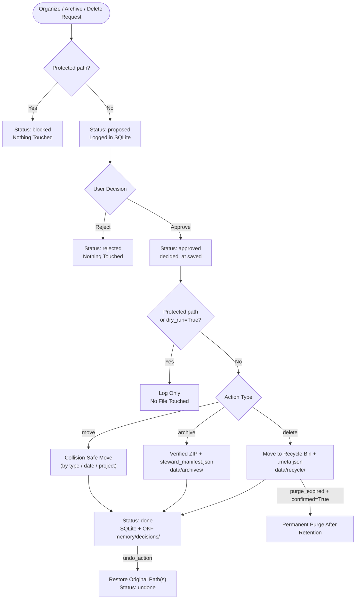

# Phase 6: Organizing and Cleanup Actions

## Goal
Build Steward's full, reversible file management engine with strict safety guardrails: organizing files by **type**, **date (`YYYY/MM`)**, or **project**; compressing old files into verified **manifest-backed `.zip` archives**; routing all deletions through a recoverable **recycle bin** (with retention-based purge requiring explicit confirmation); and enforcing the full approval state machine (`proposed -> approved / rejected -> done / failed -> undone`) logged in both SQLite and OKF `memory/decisions/`.

## Flow Diagram



## Organizing Strategies & Safety Controls

| Feature | Behavior |
| :--- | :--- |
| `plan_organize(..., strategy="type")` | Groups files into category folders (`document`, `image`, `code`, `spreadsheet`, etc.). |
| `plan_organize(..., strategy="date")` | Groups files into `YYYY/MM` subfolders using modification timestamps. |
| `plan_organize(..., strategy="project")` | Groups files by project / parent folder name. |
| **Collision Safety** | Automatically appends `_1`, `_2`, ... instead of ever overwriting existing files. |
| **Approval Gate** | `execute_action()` refuses any action not in `approved` status. |
| **ZIP Archiving** | Embeds `steward_manifest.json` and runs `ZipFile.testzip()` before removing originals; `undo_action()` extracts everything back. |
| **Recycle Bin & Purge** | Deletes move to `data/recycle/` with `.meta.json`; `purge_expired(older_than_days=30, confirmed=True)` refuses without confirmation. |

## What Happened & What Changed

| File | Change | Responsibility |
| :--- | :--- | :--- |
| `steward/recycle.py` | Added | `RecycleManager`: recoverable recycle moves, sidecar `.meta.json`, retention-gated purge, and verified manifest-backed ZIP archive creation/restore. |
| `steward/organizer.py` | Added | `FileOrganizer`: `type`/`date`/`project` planning, full `proposed -> approved/rejected -> done/failed -> undone` state machine, protected-path guards, dry-run mode, and OKF decision logging. |
| `steward/tools/organizer_tools.py` | Updated | Delegates all HITL-gated Agno tool calls (`propose_move`, `organize_folder`, `move_file`, `archive_files`, `delete_files`, `undo_action`) to `FileOrganizer`. |
| `steward/main.py`, `agents.py`, `workflows.py`, `config.yaml` | Updated | Wired `FileOrganizer` and `RecycleManager` into `StewardApp`, added `safety.recycle_retention_days: 30` and `--undo <action_id>` CLI flag (`v0.6.0`). |
| `tests/test_phase6.py` | Added | Automated pytest tests covering all 3 strategies, approval gating, protected paths, dry-run, ZIP archive + undo, recycle + undo, and confirmed purge. |
| `examples/demo_phase6_organizing.py` | Added | Runnable manual sandbox demo exercising every Phase 6 safety rule, ZIP archive, recycle bin, and undo end-to-end. |

## How to Run & Try Manually

```bash
# Run all unit tests (Phases 1–6)
uv run pytest -v

# Run the safe Phase 6 manual walkthrough (inside data/demo_phase6/)
uv run python examples/demo_phase6_organizing.py

# Undo a completed action by ID via CLI
uv run steward --undo 1
```
