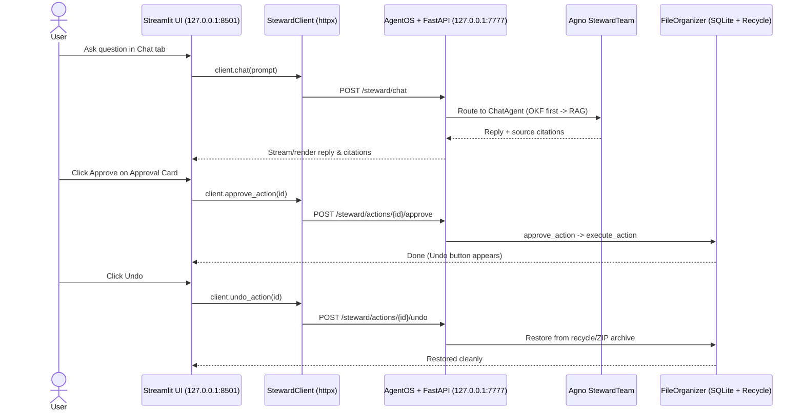

# Phase 8: Chat UI (AgentOS FastAPI + Local Streamlit UI)

## Goal
Serve Steward's Agno agents, team, and workflows through **Agno `AgentOS` (FastAPI)** on `127.0.0.1:7777` alongside Steward's custom `/steward/*` management endpoints, and provide a fully offline **Streamlit** local UI that communicates **exclusively** through `StewardClient` (never touching files or models directly).

## Flow Diagram



## API Endpoints (`127.0.0.1:7777`)

| Route | Method | Purpose |
| :--- | :--- | :--- |
| `/steward/health` | `GET` | Liveness check (DB, ChromaDB, OKF graph stats, pending approvals) |
| `/steward/scan` | `POST` | Trigger `ScanWorkflow` on demand |
| `/steward/chat` | `POST` | Chat with `StewardTeam` (returns `reply` + cited `sources`) |
| `/steward/actions` | `GET` | List proposed, approved, completed, rejected, and undone actions |
| `/steward/actions/{id}/approve` | `POST` | Approve and optionally execute a proposed action |
| `/steward/actions/{id}/reject` | `POST` | Reject a proposed action without touching disk |
| `/steward/actions/{id}/undo` | `POST` | Reverse a completed move, ZIP archive, or recycle-bin delete |
| `/steward/reports` | `GET`, `POST` | List generated reports or trigger a new Markdown/HTML report |
| `/steward/recommendations` | `GET` | Fetch learned work patterns and proactive cleanup suggestions |
| `/steward/settings` | `GET`, `PUT` | Read or update model provider/ID, `dry_run`, and watched folders |
| *(Agno AgentOS routes)* | Built-in | Native Agno AgentOS endpoints for agents, teams, workflows, and sessions |

## What Happened & What Changed

| File | Change | Responsibility |
| :--- | :--- | :--- |
| `pyproject.toml` & `uv.lock` | Updated | Added `fastapi`, `streamlit`, and `apscheduler` via `uv`. |
| `steward/api.py` | Added | `StewardAPIServer` & `create_api_app()`: mounts Agno `AgentOS` + all `/steward/*` FastAPI routes on `127.0.0.1:7777`. |
| `steward/client.py` | Added | `StewardClient`: clean `httpx` wrapper so the UI stays strictly isolated from files and models. |
| `steward/ui.py` | Added | `StewardUI`: Streamlit app with Sidebar status panel, Chat tab, Approval Cards (Approve/Reject/Undo), Reports & Suggestions tab, and Settings form. |
| `examples/demo_phase8_api.py` | Added | Manual API demo exercising health, scan, approve/undo, reports, settings, and chat end-to-end. |

## How to Run Locally (Two Terminals)

```bash
# Terminal 1: Start AgentOS FastAPI server on http://127.0.0.1:7777
uv run python -m steward.api

# Terminal 2: Start Local Streamlit UI on http://127.0.0.1:8501
uv run streamlit run steward/ui.py

# Or run the automated Phase 8 API walkthrough script
uv run python examples/demo_phase8_api.py
```
