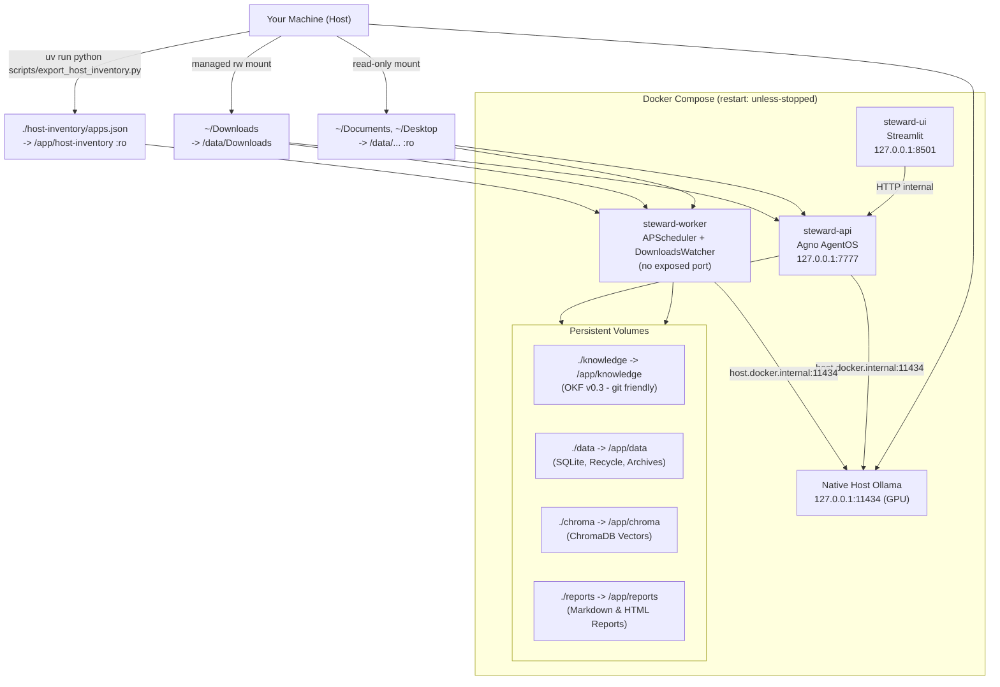

# Phase 9: Docker Deployment, Background Scheduler & Host Inventory

## Goal
Package Steward for always-on background execution via **Docker Compose** with 3 isolated services (`steward-api`, `steward-worker`, `steward-ui`) connecting to your native host **Ollama** (`http://host.docker.internal:11434` for full Metal/GPU speed), localhost-only port bindings (`127.0.0.1`), read-only default folder mounts, persistent OKF memory volumes, an **APScheduler** background worker (`steward/worker.py`), and a host-side software inventory exporter (`scripts/export_host_inventory.py`).

## Flow Diagram



## How to Run with Docker

```bash
# 1. Make sure native Ollama is running on your host with your models pulled
ollama pull gemma4
ollama pull nomic-embed-text

# 2. (Optional) Export your host installed apps for Docker software awareness
uv run python scripts/export_host_inventory.py

# 3. Build and start the 3 Steward services in the background
docker compose up -d --build

# 4. Open Steward in your browser
#    - Local Chat UI : http://127.0.0.1:8501
#    - AgentOS API   : http://127.0.0.1:7777/steward/health

# 5. Stop everything cleanly
docker compose down
```
