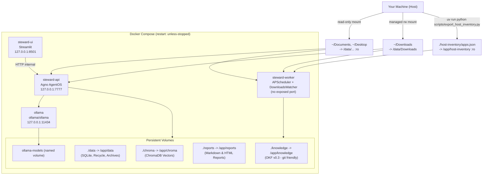

# Phase 9: Docker Deployment, Background Scheduler & Host Inventory

## Goal
Package Steward for always-on background execution via **Docker Compose** with 4 isolated services (`ollama`, `steward-api`, `steward-worker`, `steward-ui`), localhost-only port bindings (`127.0.0.1`), read-only default folder mounts, persistent OKF memory volumes, an **APScheduler** background worker (`steward/worker.py`), and a host-side software inventory exporter (`scripts/export_host_inventory.py`).

## Flow Diagram



## What Happened & What Changed

| File | Change | Responsibility |
| :--- | :--- | :--- |
| `steward/worker.py` | Added | `StewardWorker`: schedules periodic `ScanWorkflow`, `CleanupWorkflow`, and `ReportWorkflow` via APScheduler + runs `DownloadsWatcher` with clean SIGINT/SIGTERM shutdown. |
| `steward/software.py` | Updated | Reads mounted `host-inventory/apps.json` first when running inside Docker before falling back to local OS scanning. |
| `scripts/export_host_inventory.py` | Added | `HostInventoryExporter`: exports host installed apps to `host-inventory/apps.json` for read-only mounting into Docker. |
| `Dockerfile` & `.dockerignore` | Added | Single `python:3.12-slim` + `uv` image reused by `steward-api`, `steward-worker`, and `steward-ui`. |
| `docker-compose.yml` & `config.docker.yaml` | Added | 4-service Docker Compose stack (`ollama`, `steward-api`, `steward-worker`, `steward-ui`) bound strictly to `127.0.0.1` with health checks and persistent volumes. |
| `tests/test_phase8_9.py` | Added | Verifies AgentOS FastAPI routes, `StewardWorker` scheduled jobs + `run_once()`, host inventory JSON loading, and Docker Compose security invariants. |
| `examples/demo_phase9_worker.py` | Added | Manual demo exercising host inventory export + `StewardWorker` scheduled jobs and one complete background cycle. |

## How to Run with Docker

```bash
# 1. (Optional) Export your host installed apps for Docker software awareness
uv run python scripts/export_host_inventory.py

# 2. Build and start all 4 services in the background
docker compose up -d --build

# 3. Pull your local Ollama models inside the ollama container (first time only)
docker compose exec ollama ollama pull gemma3:4b
docker compose exec ollama ollama pull nomic-embed-text

# 4. Open Steward in your browser
#    - Local Chat UI : http://127.0.0.1:8501
#    - AgentOS API   : http://127.0.0.1:7777/steward/health

# 5. Stop everything cleanly
docker compose down
```
