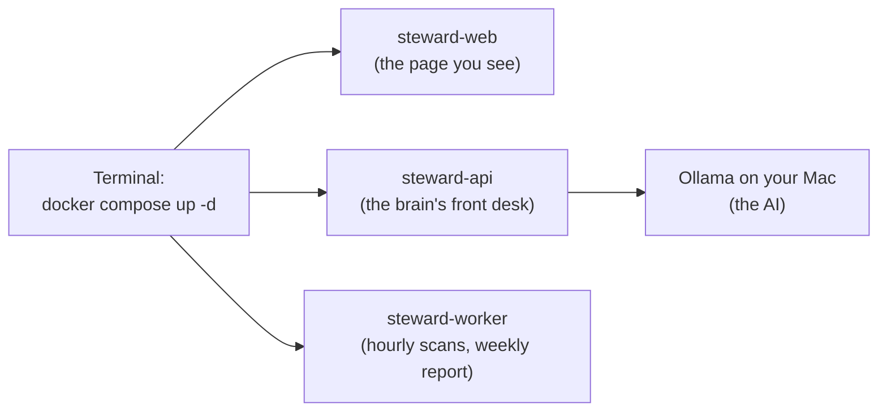

# 1. Getting started

Steward runs in **Docker** (a tool that keeps apps running quietly in the background) and uses
**Ollama** (a free app that runs the AI on your own computer). You install both once.

## What you need (one time)

| Need | How to get it | How to check |
|:--|:--|:--|
| **Docker Desktop** | Download from docker.com and open it | The whale icon is in your menu bar |
| **Ollama** | Download from ollama.com and open it | Running `ollama list` in Terminal shows a list |
| **The AI models** | In Terminal: `ollama pull gemma4` and `ollama pull nomic-embed-text` | Both names appear in `ollama list` |

> **Why gemma4?** Steward's helpers need a model that can *use tools* (search your documents,
> propose clean-ups). `gemma4` can; `gemma3:4b`, for example, cannot. The Settings page marks
> every installed model as **can use tools** or **no tools**, so you can't pick a wrong one.

## Start Steward

Open **Terminal**, go to the Steward folder, and run:

```bash
docker compose up -d --build
```

The first time takes a few minutes. Then open **<http://127.0.0.1:8080>** in your browser.



You should see the dashboard with a green **Connected** dot in the top-right corner.

| You see | Meaning |
|:--|:--|
| 🟢 **Connected** | Everything is running |
| 🔴 **API unreachable** + a red box | Steward's background part is not running. Run `docker compose up -d` again, wait 30 seconds; the page retries by itself |
| **Dry-run ON** (green badge) | Practice mode: nothing will change on disk. This is the safe default |
| **2 to review** (orange badge) | Suggestions are waiting for you on the Dashboard |

## Which folders can Steward see?

For safety, Steward (inside Docker) can only see folders you **share** with it:

| Folder on your Mac | Shared as | Can Steward change files there? |
|:--|:--|:--|
| Documents | yes | Read-only, unless you turn it on (below) |
| Desktop | yes | Read-only, unless you turn it on |
| Downloads | yes | Yes, after your approval |
| One extra folder of your choice | optional | Read-only, unless you turn it on |

**Read-only** means Steward can scan the folder and suggest clean-ups, but it cannot move,
archive or recycle anything there. Settings shows a **read-only** or **writable** badge next to
each watched folder.

To share **one more folder**, or to **let Steward change files** in Documents, Desktop or that
extra folder, add lines like these to the `.env` file in the Steward folder and run
`docker compose up -d` again:

```bash
STEWARD_EXTRA_DIR=/Users/you/Projects   # share one more folder
STEWARD_DESKTOP_ACCESS=rw               # allow changes on the Desktop
STEWARD_DOCUMENTS_ACCESS=rw             # allow changes in Documents
STEWARD_EXTRA_ACCESS=rw                 # allow changes in the extra folder
```

Only the exact value `rw` turns changes on; anything else keeps the folder read-only. Even
with `rw`, every change still needs your **Approve** and can be undone.

## Stop, restart, update

| To… | Run |
|:--|:--|
| Stop Steward | `docker compose down` |
| Start it again | `docker compose up -d` |
| Update after getting new code | `docker compose up -d --build` |
| See what it's doing | `docker compose logs -f steward-api` |
| Use the old Streamlit page (optional) | `docker compose --profile legacy up -d`, then open http://127.0.0.1:8501 |

Steward restarts on its own after your computer reboots (as long as Docker Desktop starts).

➡️ Next: [The Dashboard](02-dashboard.md)
