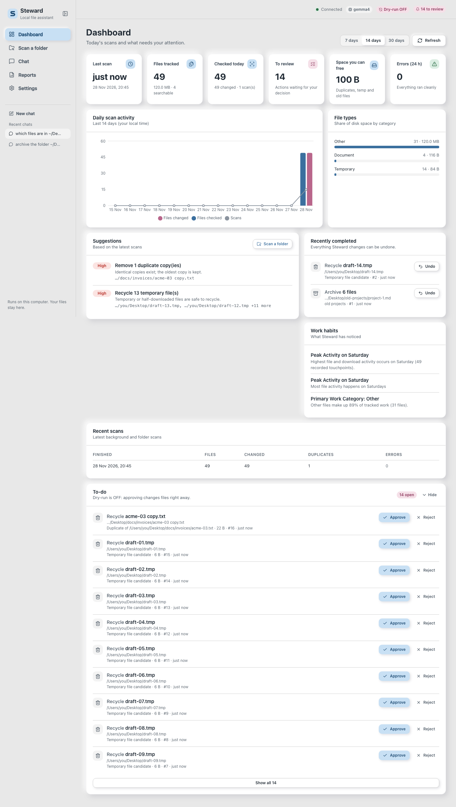
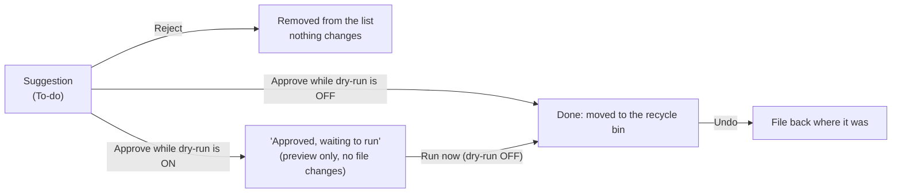
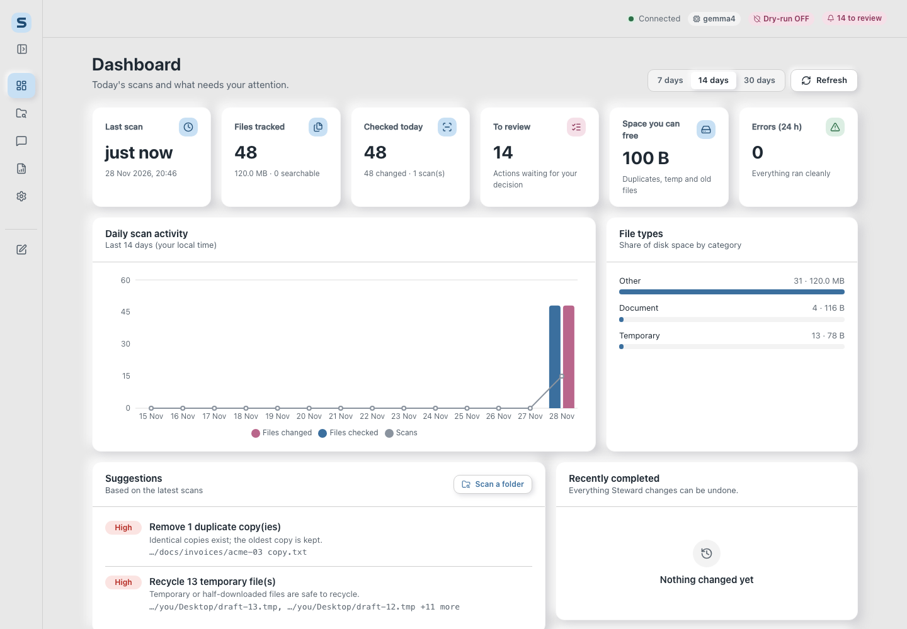
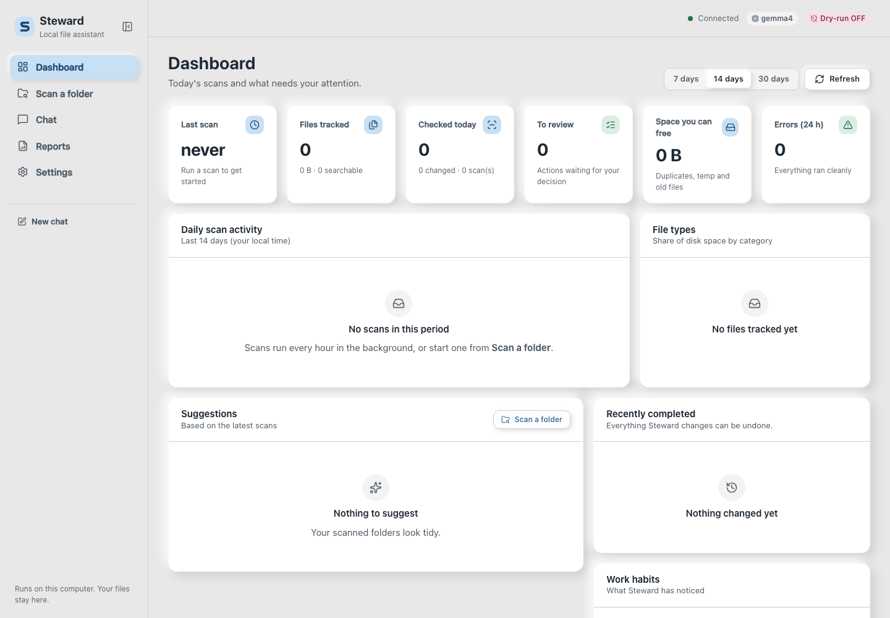

# 2. The Dashboard

The Dashboard answers two questions: **"What has Steward looked at?"** and **"What needs my
attention?"** It refreshes by itself every minute. From top to bottom: the six numbers, the scan
chart and file types, suggestions, recent scans, and your to-do list last.

## The six numbers at the top

| Card | What it means |
|:--|:--|
| **Last scan** | When Steward last looked through your folders ("just now", "5 min ago") |
| **Files tracked** | How many files Steward knows about, their total size, and how many are searchable in Chat |
| **Checked today** | Files looked at today (your local day) and how many were new or changed |
| **To review** | Suggestions waiting for your decision, plus any approved but not run yet |
| **Space you can free** | Space used by duplicates, temporary and old files (each file counted once) |
| **Errors (24 h)** | Files that couldn't be read or actions that failed; normally 0 |

## Daily scan activity and file types

| Card | What it shows |
|:--|:--|
| **Daily scan activity** | A chart of files checked and changed per day (7, 14 or 30 days, switch at the top) |
| **File types** | Which kinds of files use the most space |

## Suggestions

Grouped by priority:

| Badge | Examples |
|:--|:--|
| **High** | Duplicate copies, temporary or half-downloaded files |
| **Medium** | Files untouched for more than 90 days (archive them), very large files (review them) |
| **Low** | Folders with many kinds of files mixed together (organize by type) |

Suggestions are *advice*. Only items in the To-do list can be approved. To turn a suggestion into
to-do items, use [Scan a folder](03-scan-a-folder.md) on that folder.

Next to the suggestions:

| Card | What it shows |
|:--|:--|
| **Recently completed** | Actions Steward really did, each with an **Undo** button |
| **Work habits** | Patterns Steward has noticed (busiest day, main type of work) |
| **Recent scans** | The last scans with files, changes, duplicates and errors |

## The To-do list: your decisions (at the bottom)

The To-do list is the last card, because it can get long. It shows the **first 10** suggestions;
**Show all** lists the rest. **Hide** folds the whole card into one line (and **Show** opens it
again); Steward remembers your choice. The **"… to review"** badge at the top of every page jumps
straight to this list and opens it.

Each row is one suggested action:

- **Recycle pasta-copy.md**: the action and the file
- the folder it's in, **why** (for example *Duplicate file candidate*), its size, and when it was suggested
- **Approve** or **Reject**

The line under the To-do title tells you which mode you're in:
- *"Dry-run is ON: approving previews an action without changing files."*
- *"Dry-run is OFF: approving changes files right away."* (You'll be asked to confirm first.)

**Approved, waiting to run** lists actions you approved while in practice mode. Its **Run now**
button stays greyed out until you switch dry-run off in [Settings](06-settings.md). That's on
purpose: practice mode always wins.

## Getting around: a smaller sidebar

The **«** button next to "Steward" (top left) folds the sidebar into a narrow strip of icons, so
the pages get more room. Point at an icon to see its name; the pulsing dot on the Chat icon still
shows a running answer, and the pencil icon starts a new chat. Click **»** to bring the full sidebar
back. Steward remembers your choice in this browser. (On a phone the menu is always the top strip.)

## Starting over

To empty the Dashboard completely, use [Settings → Data & cleanup → Delete everything](06-settings.md#delete-everything).
Steward then starts fresh: the next scan (every hour, or from *Scan a folder*) fills it again.

➡️ Next: [Scan a folder](03-scan-a-folder.md)
