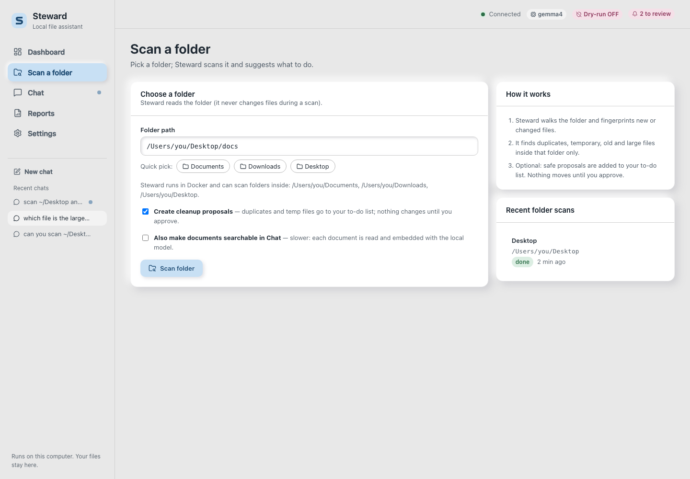
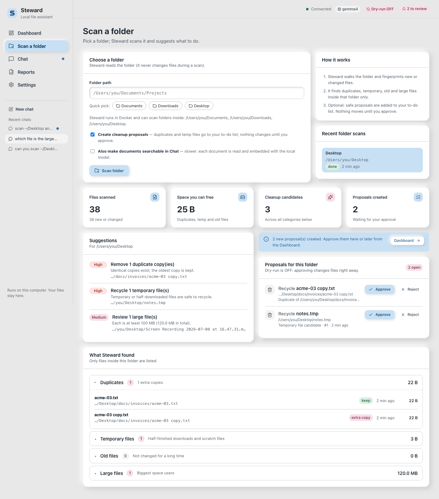

# 3. Scan a folder

Use this page when you want Steward to look at **one particular folder right now** and tell you
what to do with it.

## Step by step

1. **Type the folder path** as you know it, for example `/Users/you/Documents/Projects`, or click a
   **Quick pick** button.
2. Choose the options:
   - **Create cleanup proposals** (on by default): duplicate copies and temporary files are added to
     your To-do list. *Nothing changes until you approve.*
   - **Also make documents searchable in Chat** (off by default): Steward reads each document so you
     can ask about it in Chat. Slower, because the local AI processes each file.
3. Click **Scan folder**.

While it runs you'll see each step light up: *Scanning files → (Indexing for chat) → Finding
duplicates & clutter → Creating proposals → Done*, with a timer.

> Scanning **only reads**. It never moves, renames or deletes anything.

## Reading the results

| Part | What it tells you |
|:--|:--|
| **Files scanned** | How many files were looked at, and how many were new or changed |
| **Space you can free** | Duplicates + temporary + old files inside this folder |
| **Cleanup candidates** | How many files are worth a look |
| **Proposals created** | New To-do items (with **Approve / Reject** right on this page) |
| **Suggestions** | Advice for this folder only |
| **What Steward found** | Click a section to open it. Duplicates show which copy is **kept** (the oldest) and which is the **extra copy** |

You can leave the page and come back: the results stay at the same web address, and **Recent
folder scans** on the right lets you reopen earlier ones (even after a restart).

## Messages you might see

| Message | What to do |
|:--|:--|
| *Folder not found* | Check the spelling. In Docker, Steward can only see shared folders; the message lists them. See [Getting started](01-getting-started.md#which-folders-can-steward-see) |
| *'/' is too broad to scan* / *is a system folder* | Pick a more specific folder. System folders are never scanned |
| *A folder scan is already running* | Wait for it to finish (one scan at a time keeps your computer responsive) |
| **Protected folder** (yellow box) | This folder is on your protected list: it was scanned read-only and **no proposals** were made |
| *N files inside protected folders were skipped* | Some sub-folders are protected; their files got no proposals |

➡️ Next: [Chat](04-chat.md)
