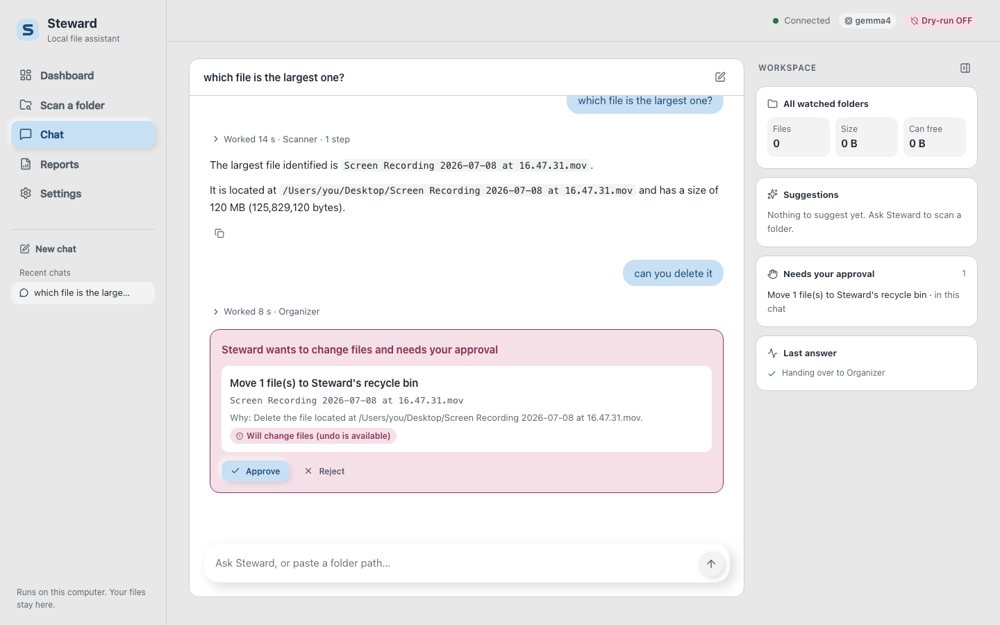
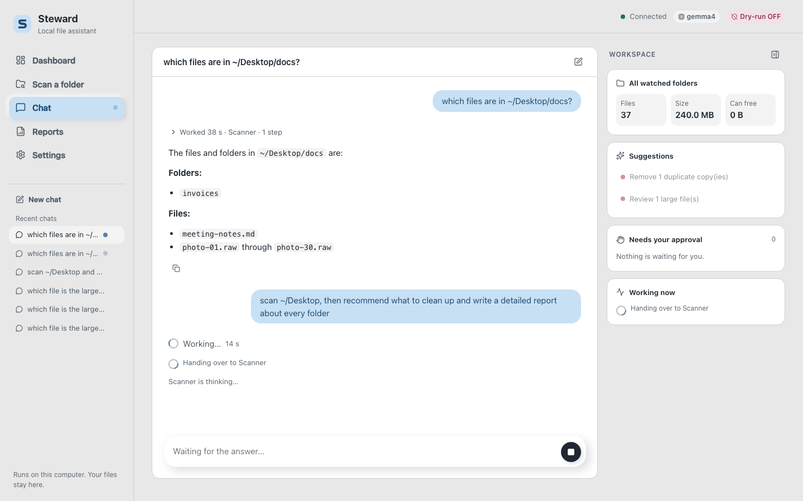
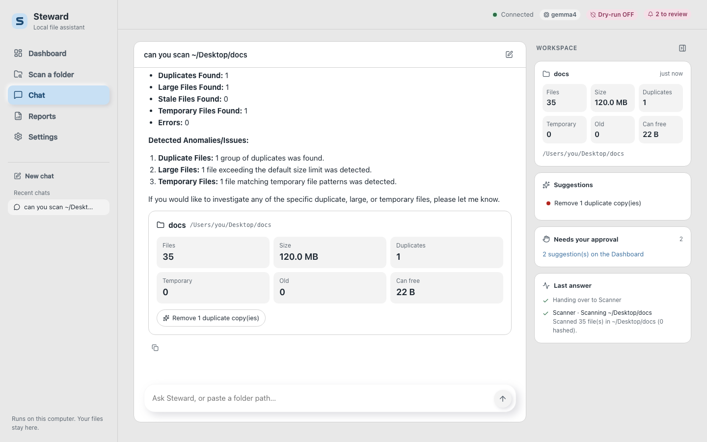
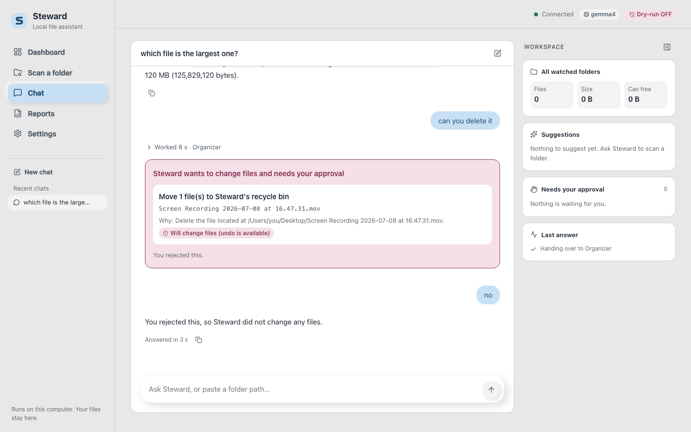
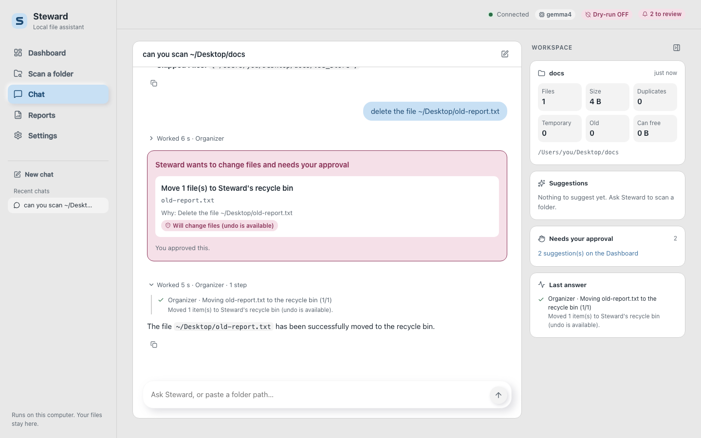
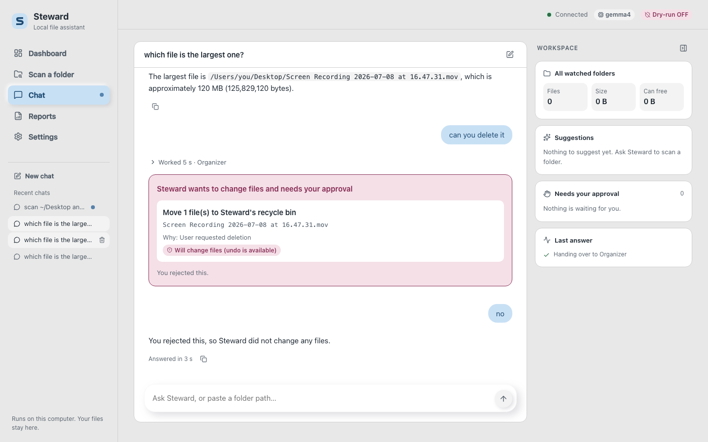

# 4. Chat

Talk to Steward in plain English: find a file, scan a folder, ask what is in your documents, and let
it archive, move or recycle files, **always after you approve**. The AI runs on **your computer**
(with Ollama), so your documents are not sent anywhere, unless you pick a cloud model in Settings.
In that case a yellow warning appears at the top of every page.

## Start a conversation

Type in the big box and press **Enter**. **Shift+Enter** starts a new line. Or click one of the
suggestions under the box. You can paste a normal Mac path, such as `~/Desktop/docs` or
`/Users/you/Downloads/old-stuff`.

Good things to ask:

| You type | Steward does |
|:--|:--|
| *can you search for a file named invoice* | Finds files by name (also `*.pdf`) in your watched folders, even before the first scan |
| *which files are in ~/Desktop/docs?* | Lists what is inside that folder |
| *which file is the largest one?* | Names your biggest files, with their full path |
| *can you scan ~/Desktop/docs* | Scans the folder and shows its numbers |
| *how much is the Globex invoice?* | Reads your documents and answers, naming the file |
| *can you delete it* / *can you archive it* | Works on the file or folder you were just talking about, after your approval |
| *can you recover it* / *undo that* | Puts back the last change made in this chat |

## Steward remembers the conversation

You don't need to repeat paths. After *"which file is the largest one?"*, a simple *"can you delete
it"* is enough: the approval card names exactly that file.

Behind the scenes Steward keeps short notes on each chat: the files the last answer named, the
folder you scanned, what you approved or rejected, and what really changed on disk. They come from
Steward's own records, not from the AI's memory, so *"where is the zip?"* gets a true answer, also
when you said no and nothing was zipped.

## Watch it work, or stop it

You never stare at a blank "thinking" message. While Steward works you see **each step as it
happens**: which helper took over, what it is doing, and what it found.

Steward has a few specialist helpers. The **Scanner** finds, lists and scans files, the
**Organizer** archives, moves and recycles, and **Chat** reads your documents. You'll see their
names in the steps. Long actions show their progress, for example **"Archiving docs (13/33)"**:

Changed your mind? While Steward works, the send button becomes a **■ Stop** button. Steward stops
at the next step and says *"Stopped. Steward did not finish this answer."* with a **Retry** button.
A file change that already started always finishes, so you never get a half-made zip. An answer
that runs longer than 5 minutes is stopped automatically.

You can switch to another page, or even reload. The answer keeps running on the server, and a
small pulsing dot next to **Chat** in the sidebar shows that Steward is still working.

## After a scan: the numbers

When Steward scans a folder, the answer includes a **stats card**: files, size, duplicate copies,
temporary files, old files, and the space you could free. These numbers come straight from
Steward's database, not from the AI's wording, so they are exact. The buttons underneath are
suggested next steps. Click one and Steward is asked to do exactly that, for exactly those files.

## The workspace panel (right side)

| Card | Shows |
|:--|:--|
| **Folder** | The folder you are working on, with its current numbers (refreshed after every answer) |
| **Suggestions** | What to do next. Click one to ask Steward to do it |
| **Needs your approval** | File changes waiting for you in this chat, plus suggestions waiting on the Dashboard |
| **Working now / Last answer** | The steps of the current (or last) answer |

Hide the panel with the button at its top right, and bring it back with the button in the chat
header. On a small screen it opens as a slide-over panel.

## Approving changes

When you ask Steward to change files, it stops and shows an **approval card** first:

- The card says exactly what will happen, for example **"Zip folder docs (33 files) into an
  archive"**, with the file names and the AI's reason.
- **Approve** lets Steward go ahead; **Reject** stops it. You can also just type **"no"**,
  **"don't"** or **"cancel"**: the waiting card is rejected.
- After a rejection Steward answers itself: *"You rejected this, so Steward did not change any
  files."* If the AI tries the same change again, Steward declines it without asking you.
- Hidden files (`.DS_Store`) and private files (`.env`, keys) are never archived. They stay where they are.
- If the change cannot work, for example because the folder is read-only or the file does not
  exist, Steward **does not ask**. It tells you why straight away and how to fix it.

## Undo from the chat

Type **"undo that"**, **"revert back"**, **"can you recover it"** or **"bring it back"** and Steward
puts back the last change made in this chat: a recycled file returns to its folder, a zip is
unpacked, a moved file goes back. It works once per change. In practice mode nothing was changed,
so there is nothing to undo, and Steward says so.

Everything Steward changes can also be undone on the [Dashboard](02-dashboard.md), under *Recently completed*.

## The steps behind every answer

Above each answer there is a short line such as **"Worked 6 s · Organizer · 1 step"**. Click it to
see every step and what each tool reported:

Under some answers you'll also see:

| Item | Meaning |
|:--|:--|
| **Looked at:** 📄 file / 📖 note chips | The documents or Steward knowledge notes the AI really opened |
| A highlighted **Steward:** note | Steward's own note based on what really happened. For example, *"Practice mode is on, so no files were changed"*, or the exact reason something was refused |

## Several chats, and deleting them

Every conversation is saved on this computer. Use **New chat** in the sidebar (or the pencil icon
in the chat header) to start fresh, and pick an earlier chat under **Recent chats** to continue it.

**Two chats can answer at the same time.** Start a long question in one chat, open another one and
keep going. A pulsing dot in **Recent chats** shows which chats are still working, and each answer
appears in its own chat.

To **delete a chat**, point at it in **Recent chats** and click the 🗑 icon. Steward asks first,
then deletes its messages and the AI's memory of it. A chat that is still answering can't be
deleted until it finishes (or you press **Stop**). To clear all chats at once, use
[Settings → Data & cleanup](06-settings.md#data--cleanup).

> **Tip:** small local models sometimes misunderstand. If an answer looks wrong, rephrase it or
> mention the exact path. In our new-user test (find a file, the largest file, delete it, recover
> it, archive it, a second chat at the same time, delete a chat) every step worked with gemma4.

➡️ Next: [Reports](05-reports.md)
