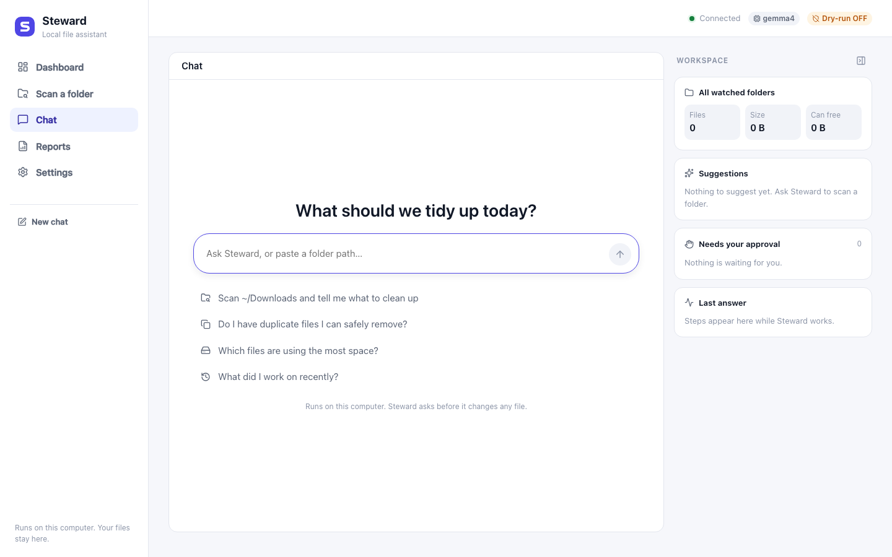
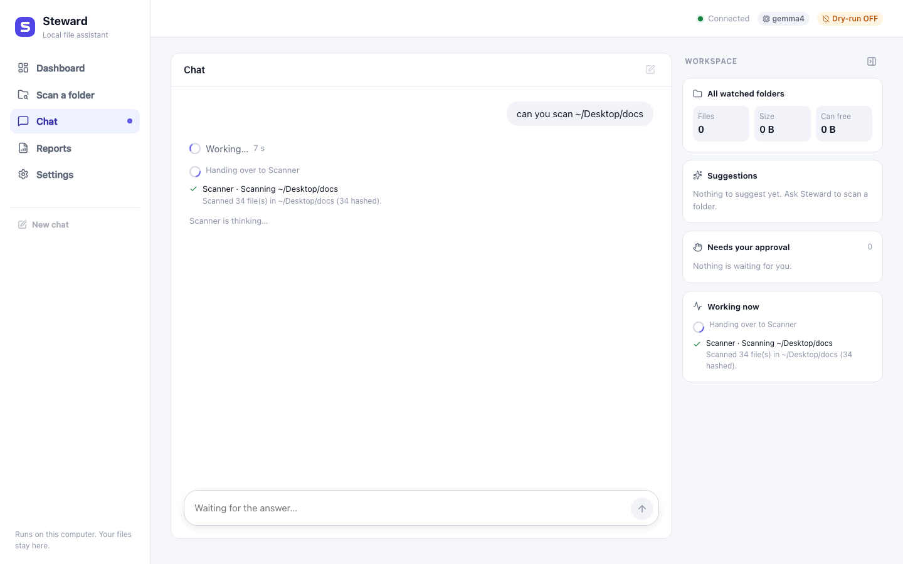
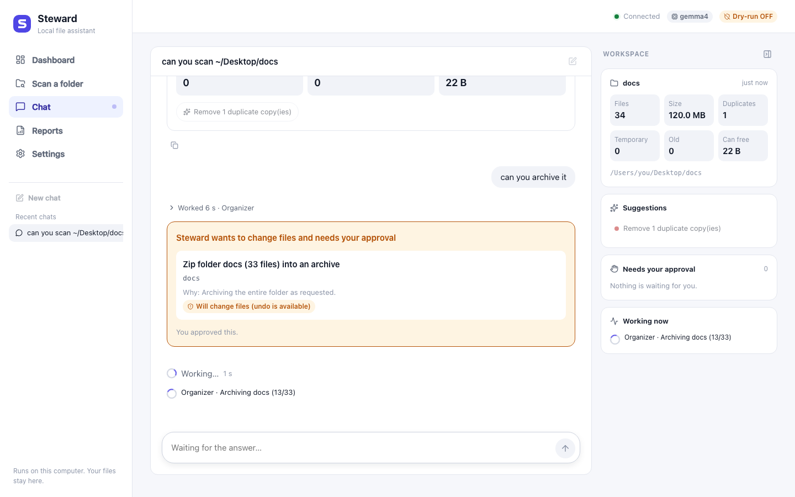
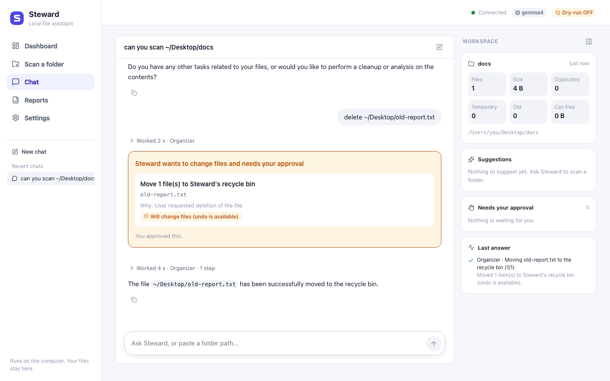

# 4. Chat

Talk to Steward in plain English: scan a folder, ask what is in your documents, and let it
archive, move or recycle files, **always after you approve**. The AI runs on **your computer**
(with Ollama), so your documents are not sent anywhere, unless you pick a cloud model in Settings.
In that case a yellow warning appears at the top of every page.

## Start a conversation

Type in the big box and press **Enter**. **Shift+Enter** starts a new line. Or click one of the
suggestions under the box. You can paste a normal Mac path, such as `~/Desktop/docs` or
`/Users/you/Downloads/old-stuff`.

Good things to ask:

| You type | Steward does |
|:--|:--|
| *can you scan ~/Desktop/docs* | Scans the folder and shows its numbers |
| *how much is the Globex invoice?* | Reads your documents and answers, naming the file |
| *can you archive it* | Zips the folder you just talked about (it remembers the conversation) |
| *delete ~/Desktop/old-report.txt* | Moves that file to Steward's recycle bin, after your approval |
| *move ~/Downloads/plan.pdf to ~/Documents/Projects* | Moves the file, after your approval |

## Watch it work

You never stare at a blank "thinking" message. While Steward works you see **each step as it
happens**: which helper took over, what it is doing, and what it found.

Steward has a few specialist helpers. The **Scanner** looks at folders, the **Organizer**
archives, moves and recycles, and **Chat** reads your documents. You'll see their names in the steps.

Long actions show their progress, for example **"Archiving docs (13/33)"**:

You can switch to another page, or even reload. The answer keeps running on the server, and a
small pulsing dot next to **Chat** in the sidebar shows that Steward is still working.

## After a scan: the numbers

When Steward scans a folder, the answer includes a **stats card**: files, size, duplicate copies,
temporary files, old files, and the space you could free. These numbers come straight from
Steward's database, not from the AI's wording, so they are exact. The buttons underneath are
suggested next steps. Click one and Steward is asked to do exactly that, for exactly those files.

## The workspace panel (right side)

| Card | Shows |
|:--|:--|
| **Folder** | The folder you are working on, with its current numbers (refreshed after every answer) |
| **Suggestions** | What to do next. Click one to ask Steward to do it |
| **Needs your approval** | File changes waiting for you in this chat, plus suggestions waiting on the Dashboard |
| **Working now / Last answer** | The steps of the current (or last) answer |

Hide the panel with the button at its top right, and bring it back with the button in the chat
header. On a small screen it opens as a slide-over panel.

## Approving changes

When you ask Steward to change files, it stops and shows an **approval card** first:

- The card says exactly what will happen, for example **"Zip folder docs (33 files) into an
  archive"**, with the file names and the AI's reason.
- **Approve** lets Steward go ahead; **Reject** stops it. The card then says *"You approved this"*.
- Hidden files (`.DS_Store`) and private files (`.env`, keys) are never archived. They stay where they are.
- If the change cannot work, for example because the folder is read-only or the file does not
  exist, Steward **does not ask**. It tells you why straight away and how to fix it.

Everything Steward changes can be undone on the [Dashboard](02-dashboard.md), under *Recently completed*.

## The steps behind every answer

Above each answer there is a short line such as **"Worked 6 s · Organizer · 1 step"**. Click it to
see every step and what each tool reported:

Under some answers you'll also see:

| Item | Meaning |
|:--|:--|
| **Looked at:** 📄 file / 📖 note chips | The documents or Steward knowledge notes the AI really opened |
| A highlighted **Steward:** note | Steward's own note based on what really happened. For example, *"Practice mode is on, so no files were changed"*, or the exact reason something was refused |

## Recent chats

Every conversation is saved on this computer. Use **New chat** in the sidebar (or the pencil
icon in the chat header) to start fresh, and pick an earlier chat under **Recent chats** to
continue it.

> **Tip:** small local models sometimes misunderstand. If an answer looks wrong, rephrase it or
> mention the exact path. In our test of the scan, archive and delete steps above, Steward got
> all of them right in 3 runs out of 3, answering in 2–23 seconds per step.

➡️ Next: [Reports](05-reports.md)
