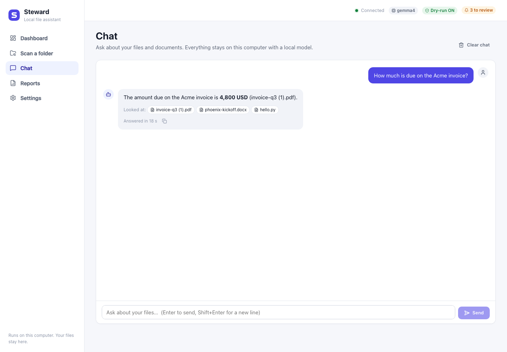
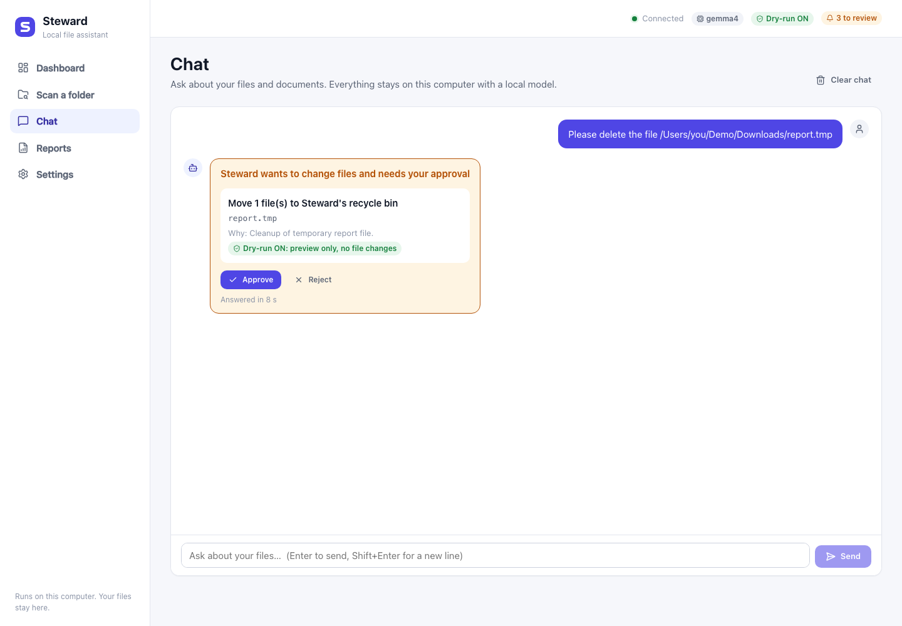

# 4. Chat

Ask Steward about your files in plain English. The AI runs on **your computer** (with Ollama), so
your documents are not sent anywhere, unless you pick a cloud model in Settings, in which case a
yellow warning appears at the top of every page.

## Asking questions

Type a question and press **Enter** (**Shift+Enter** starts a new line). Good questions:

- *How much is due on the Acme invoice?*
- *What is the Phoenix project deadline?*
- *Which files are using the most space?*
- *Do I have duplicate files I can safely remove?*

While Steward thinks you'll see **"Thinking… 12 s"**. Local models usually answer in 10–40 seconds.

## "Looked at": where the answer came from

Under each answer, **Looked at** lists exactly what the AI opened or searched:

| Chip | Meaning |
|:--|:--|
| 📄 file chip (solid border) | A document on your computer |
| 📖 note chip (dashed border) | One of Steward's own knowledge notes about your files |
| *Answered without looking up your files* | The AI answered from general knowledge or the earlier conversation; double-check anything important |

Hover over a chip to see the full path.

## Approving changes from the chat

If you ask Steward to change files ("delete Downloads/report.tmp", "move this into Projects"), it
stops and shows an **approval card**:

- Each step is described in plain words, with the file names and the AI's reason.
- The green badge **Dry-run ON: preview only** means approving will *not* change any file.
- **Approve** lets the AI continue; **Reject** stops it. The card then says *"You approved this"* or
  *"You rejected this"*, and the AI replies with what happened.

Approved actions also appear on the [Dashboard](02-dashboard.md) (under *Approved, waiting to run*
in practice mode, or *Recently completed* with **Undo** otherwise).

## Other buttons

| Button | What it does |
|:--|:--|
| **Retry** (on a red error message) | Asks the same question again, e.g. after starting Ollama |
| **Copy** (small icon) | Copies the answer |
| **Clear chat** | Starts a brand-new conversation (the AI no longer sees the earlier messages) |

Your conversation is kept in this browser, so it survives a page refresh.

> **Tip:** small local models sometimes misunderstand. If an answer looks wrong, rephrase the
> question or mention the file name. In testing, the demo invoice question was answered correctly
> about 7 times out of 8.

➡️ Next: [Reports](05-reports.md)
