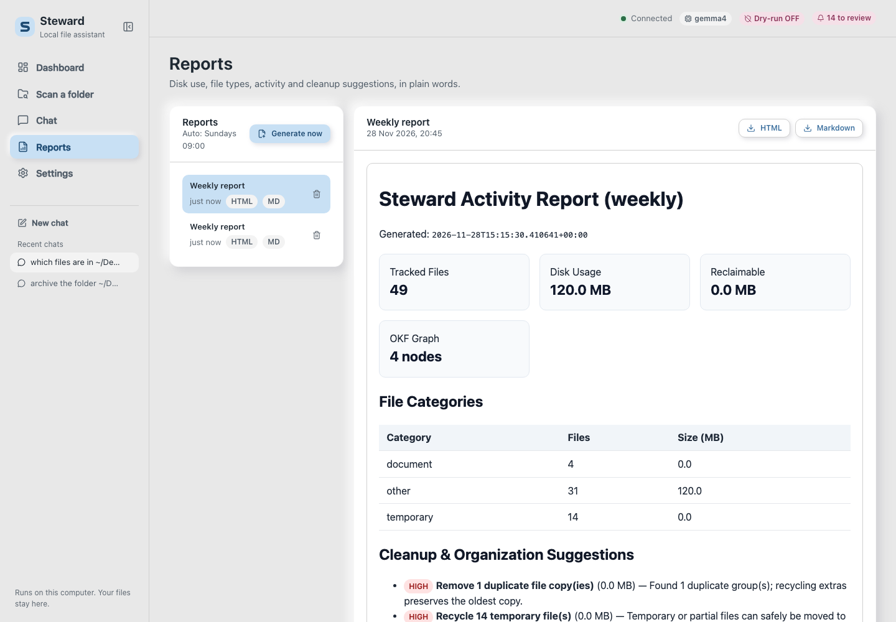

# 5. Reports

A report is a one-page summary of your computer: how much space is used and by what, what changed
recently, the habits Steward noticed, and its clean-up suggestions.

## Using the page

- **Reports are created automatically** every Sunday at 09:00 (change this in `config.yaml`).
- Click **Generate now** for a fresh one at any time.
- The list on the left shows every report, newest first. **HTML** and **MD** show which versions
  exist (a red badge means the file was deleted).
- Click a report to read it on the right.
- **Download** it as **HTML** (opens in any browser, nice to share) or **Markdown** (plain text).
- **Delete** a report with the 🗑 next to it. Steward asks first, then deletes its HTML and Markdown
  files; the next report opens. To delete all reports at once, use
  [Settings → Data & cleanup](06-settings.md#data--cleanup).

## What's inside a report

| Section | Tells you |
|:--|:--|
| Tracked files / disk usage / reclaimable / knowledge notes | The headline numbers |
| File categories | Count and size per type (documents, images, installers, …) |
| Top folders by disk usage | Where the space goes |
| Activity over time | Files changed and downloads per day |
| Learned work patterns | e.g. "Peak activity on Friday" |
| Cleanup & organization suggestions | The same advice as on the Dashboard |

> The report is shown in a locked frame: it can only be looked at. Nothing in it can run or change anything.

➡️ Next: [Settings](06-settings.md)
