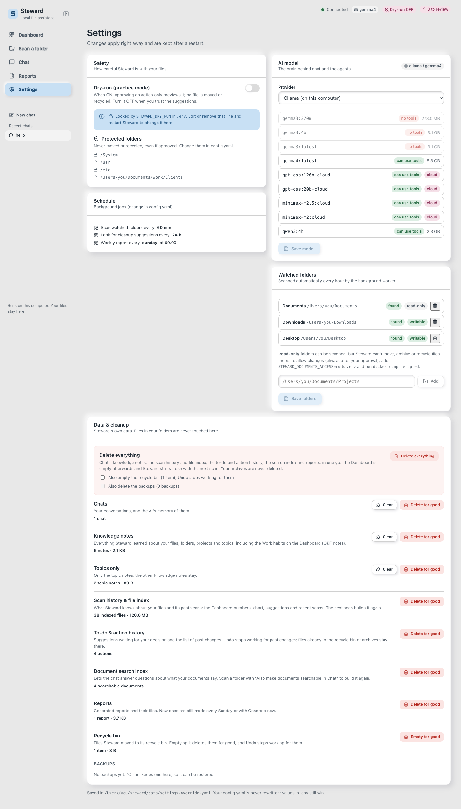
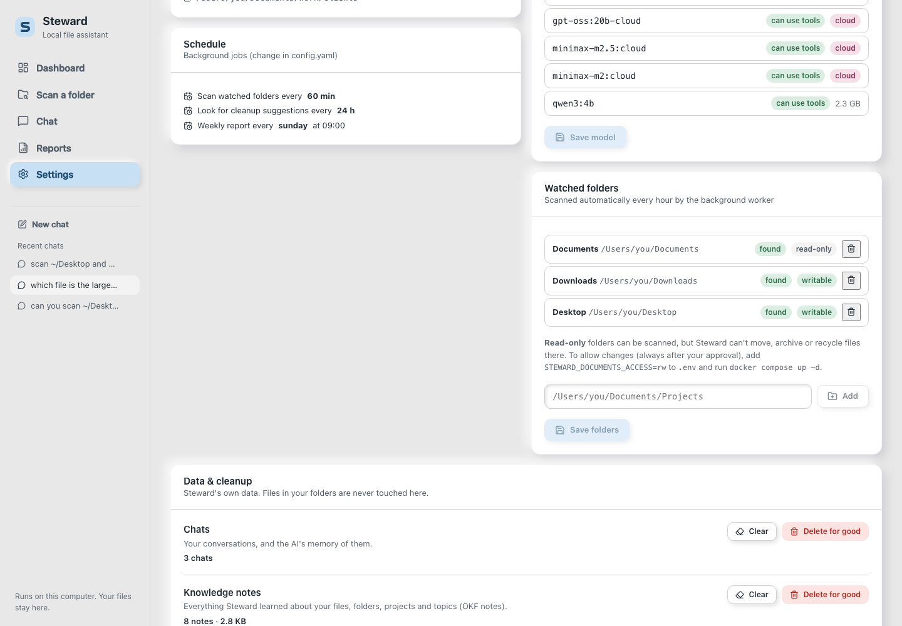
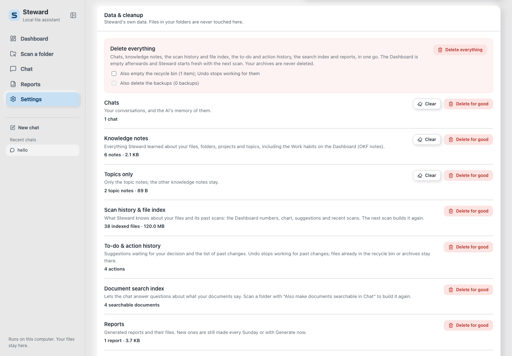
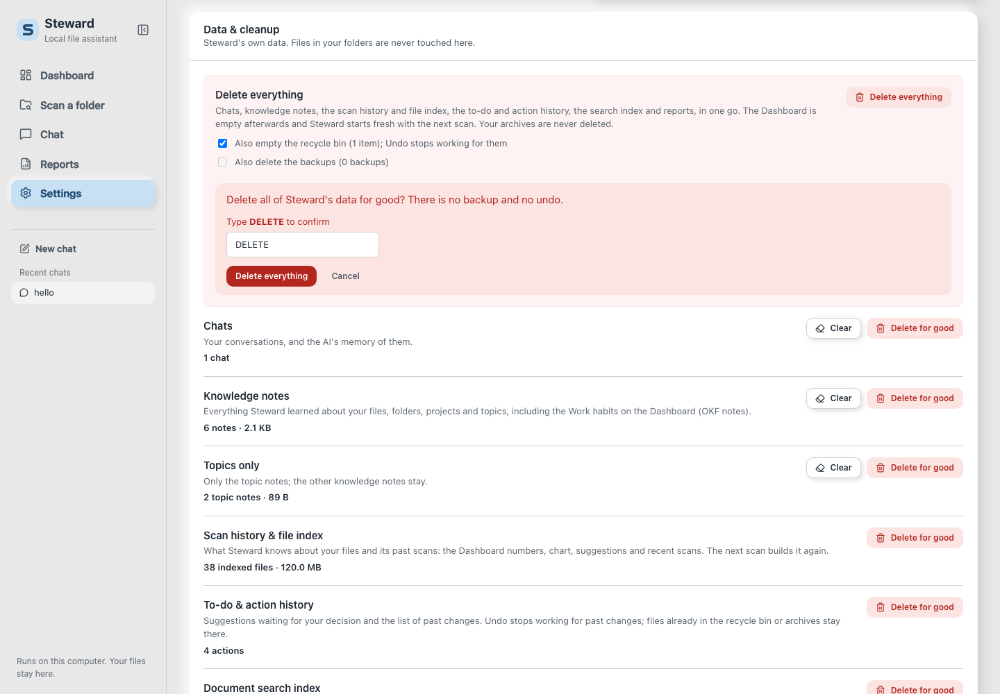

# 6. Settings

Change how careful Steward is, which AI it uses and which folders it watches, and clear Steward's
own data. Changes apply
**immediately** and are **kept after a restart**.

## Safety

**Dry-run (practice mode)** switch:

| Switch | What happens when you approve something |
|:--|:--|
| 🟢 **ON** (default) | Steward only previews it; no file is moved or recycled |
| ⚪ **OFF** | Steward really does it (deleted files go to the recycle bin and can be undone) |

Turning it **off** asks you to confirm first. Even with dry-run off, Steward **never** changes a
file without your approval.

**Protected folders** are listed underneath. Files in them are never moved or recycled, even if
approved. (They are set in `config.yaml`.)

## AI model

1. Pick the **provider**: *Ollama (on this computer)* keeps everything private. *Cloud* providers
   (OpenAI, Anthropic, Gemini) need an API key in `.env` and send your questions off the computer.
2. Pick a **model** from the list of models installed in Ollama:
   - **can use tools** (green) works with Steward
   - **no tools** (red, greyed out) can't be selected; Steward's helpers would fail with it
   - **cloud** (orange) runs on Ollama's servers, so your questions leave the computer
3. Click **Save model**. Steward switches straight away.

Recommended: **gemma4** (good answers, about 10–30 s) or **qwen3:4b** (smaller, a bit slower).

## Watched folders

These folders are scanned automatically every hour.

- Each shows its name, its location, **found** / **missing**, and **writable** / **read-only**.
  Read-only folders can be scanned, but Steward can't move, archive or recycle files there. The
  page tells you the `.env` line that allows changes (for example `STEWARD_DESKTOP_ACCESS=rw`);
  see [Getting started](01-getting-started.md#which-folders-can-steward-see).

- **Add** a folder by typing its path, remove one with the 🗑 button, then click **Save folders**.
- Steward checks each folder the same way as [Scan a folder](03-scan-a-folder.md), and refuses a
  folder that is already inside another watched folder (it would be scanned twice).

## Schedule

Shows when the hourly scan, the daily clean-up check and the weekly report run. To change it, edit
the `scheduler:` section in `config.yaml`.

## Data & cleanup

At the bottom of Settings you can delete **Steward's own data**. Files in your folders are never
touched here, and neither are your archives (the zips of files you archived).

| Item | What it is | Buttons |
|:--|:--|:--|
| **Chats** | Your conversations, and the AI's memory of them | Clear · Delete for good |
| **Knowledge notes** | Everything Steward learned about your files, projects and topics, including the *Work habits* on the Dashboard | Clear · Delete for good |
| **Topics only** | Just the topic notes; the other knowledge notes stay | Clear · Delete for good |
| **Scan history & file index** | The Dashboard numbers, chart, file types, suggestions and recent scans. The next scan builds it again | Delete for good |
| **To-do & action history** | Suggestions waiting for you and the list of past changes. Undo stops working for past changes; files already in the recycle bin or archives stay there | Delete for good |
| **Document search index** | Lets the chat answer questions about what your documents say. Build it again by scanning a folder with *Also make documents searchable in Chat* | Delete for good |
| **Reports** | All generated reports and their files (one report: 🗑 on the [Reports](05-reports.md) page) | Delete for good |
| **Recycle bin** | Files Steward moved to its recycle bin | Empty for good |

- **Clear** asks once, then keeps a **backup**. It appears under **Backups**, where **Restore** puts
  everything back (chats that exist already are left alone).
- **Delete for good** and **Empty for good** keep no backup and can't be undone. The button only
  works after you type **`DELETE`** in the box.
- While a chat is still answering (or a folder scan is running), Steward waits: let it finish or
  press **Stop**, then try again.
- To delete just one chat, use the 🗑 icon in **Recent chats** ([Chat](04-chat.md#several-chats-and-deleting-them)).

### Delete everything

The red **Delete everything** panel at the top does a complete reset in one go: chats, knowledge
notes, the scan history and file index, the to-do and action history, the search index and reports.
Tick **Also empty the recycle bin** or **Also delete the backups** if you want those gone too (both
are off by default). Type `DELETE` and press **Delete everything**.

Afterwards the Dashboard, Reports and Chat are empty and the "to review" badge disappears at once.
**Steward then starts fresh:** the next scan (every hour, or from *Scan a folder*) fills the
Dashboard again with what is in your folders now. Your archives are never deleted.

## "Locked by .env"

If a setting shows **Locked by `STEWARD_DRY_RUN` in `.env`** (or `STEWARD_MODEL_ID`, …), that value
is fixed in the `.env` file, which always wins. Edit or remove that line in `.env` and run
`docker compose up -d` to change it here.

> **Where are my settings saved?** In `data/settings.override.yaml`. Your `config.yaml` is never
> rewritten. To undo all changes made on this page, delete that file and restart Steward.

➡️ Next: [Safety and undo](07-safety-and-undo.md)
