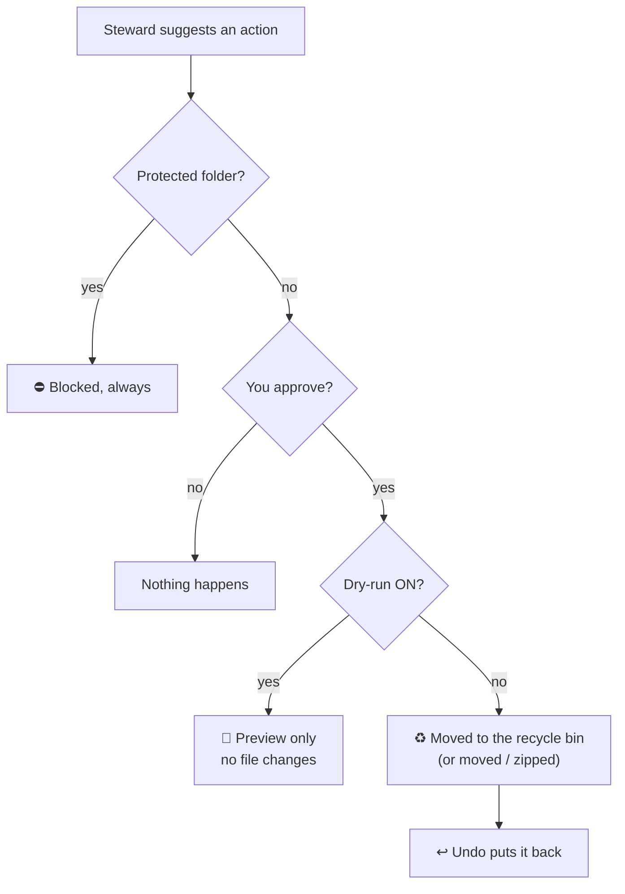

# 7. Safety and undo

Steward is built on one rule: **it can be wrong without causing harm.**

## The safety layers

| Layer | What it guarantees |
|:--|:--|
| **Approval** | Nothing changes until you click Approve (on the Dashboard, a scan result, or a chat approval card) |
| **Checked before asking** | A chat change that cannot work (missing file, read-only folder, protected folder inside) is refused with the reason, before any approval card |
| **"No" means no** | Reject a card, or just type "no": the change never happens, Steward says so itself, and a second try by the AI is declined automatically |
| **Stop any time** | The **■ Stop** button ends an answer at the next step; a file change that already started always finishes, so nothing is left half-done |
| **Honest answers** | Under a chat answer, a **Steward:** note says what really happened (for example "practice mode, nothing changed"), even if the AI words it differently |
| **Dry-run** | While ON, even approved actions are only previews. The AI cannot switch it off; only you can, in Settings |
| **Protected folders** | Never touched, even if approved |
| **Recycle bin** | "Delete" never really deletes; files go to Steward's recycle bin with a note of where they came from |
| **Undo** | Every completed action has an **Undo** button (Dashboard, *Recently completed*) |
| **Read-only sharing** | In Docker, Documents and Desktop are shared read-only by default, so changes there are impossible until you set `STEWARD_DOCUMENTS_ACCESS=rw` / `STEWARD_DESKTOP_ACCESS=rw` yourself |
| **Private files skipped** | Files like `.env`, keys, and anything named *password* or *secret* are never read, and never zipped when you archive a folder |
| **Whole folders, one Undo** | Archiving, recycling or moving a folder is one action, so a single **Undo** brings everything back |
| **On your computer** | With Ollama, nothing leaves your machine. A warning appears if a cloud model is active |

## Getting a file back

1. In the chat, type **"undo that"** or **"can you recover it"**: the last change made in that chat
   is put back.
2. Or open the **Dashboard**, find the action under **Recently completed**, and click **Undo**.
   The file goes back to its original place (if a file with the same name is there now, Steward
   adds `_1` to the name).
3. Recycled files are also kept in Steward's `data/recycle/` folder, each with a small
   `.meta.json` note saying where it came from.
4. Zipped archives are in `data/archives/`. **Undo** unzips everything back to the original places.

## Emptying the recycle bin

Steward never empties it by itself. Files stay until you decide to remove them in
[Settings → Data & cleanup](06-settings.md#data--cleanup) with **Empty for good** (you have to type
`DELETE`). After that, Undo no longer works for those files.

## Clearing Steward's own data

Chats, knowledge notes, the scan history, the to-do list, the search index and reports can be
deleted in [Settings → Data & cleanup](06-settings.md#data--cleanup), one by one or all at once with
**Delete everything**. **Clear** keeps a backup you can restore; everything marked *for good* needs
`DELETE` typed. None of this touches the files in your folders, and **your archives are never
deleted**, not even by Delete everything. Steward starts fresh afterwards, with the next scan.

➡️ Next: [Troubleshooting and FAQ](08-troubleshooting.md)
