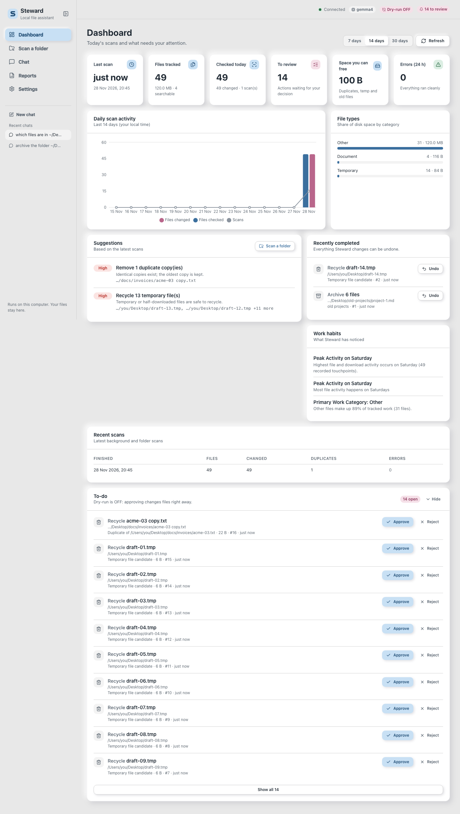
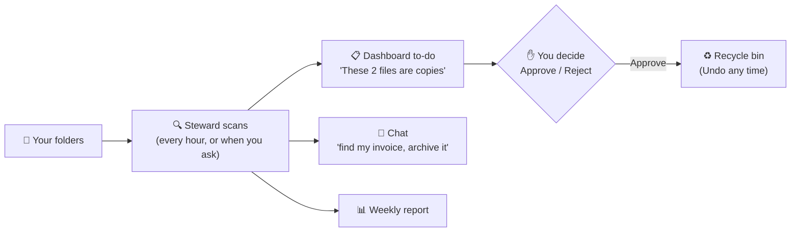

# Steward User Guide

**Steward is a private assistant that lives on your computer.** It looks through your folders,
finds clutter (duplicate copies, half-finished downloads, old files, space hogs), suggests what to
do, and answers questions about your documents. It **never changes a file without your approval**,
and anything it changes can be undone.

This guide shows every page of the web app with real screenshots. No technical knowledge needed.

## Pages in this guide

| # | Page | What you'll learn |
|:-:|:--|:--|
| 1 | [Getting started](01-getting-started.md) | Install once, start Steward, open it in your browser |
| 2 | [Dashboard](02-dashboard.md) | Read today's numbers, clear your to-do list, fold the sidebar |
| 3 | [Scan a folder](03-scan-a-folder.md) | Point Steward at any folder and get suggestions for it |
| 4 | [Chat](04-chat.md) | Find, scan, archive, delete and undo from the chat; Stop, memory, several chats |
| 5 | [Reports](05-reports.md) | Read, download and delete weekly reports |
| 6 | [Settings](06-settings.md) | Practice mode, the AI model, watched folders, clearing data and Delete everything |
| 7 | [Safety and undo](07-safety-and-undo.md) | How Steward protects your files, and how to undo anything |
| 8 | [Troubleshooting and FAQ](08-troubleshooting.md) | What to do when something doesn't look right |

## The 30-second tour

> **Words you'll see**
> - **Dry-run (practice mode):** Steward only *shows* what it would do; no file changes. On by default.
> - **Proposal:** a suggested action (for example "recycle this duplicate") waiting for your decision.
> - **Recycle bin:** where Steward puts files it "deletes", so you can get them back.
> - **Watched folders:** the folders Steward scans automatically every hour.

*Screenshots were taken from a demo home folder shown as `/Users/you`. Your own folder names will appear instead.*
