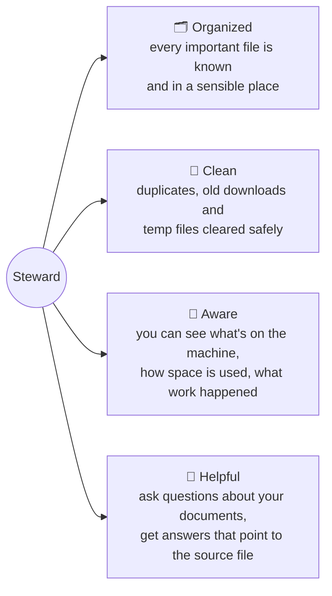

# 1. What is Steward? (plain-language version)

## The one-sentence answer

**Steward is a private assistant that lives on your computer, reads through your folders, remembers what's in them, keeps them tidy with your permission, and answers your questions about your own files.**

## An everyday analogy: a careful house-keeper with a notebook

Imagine you hire a house-keeper for your filing cabinets.

| The house-keeper… | Steward does… |
|:--|:--|
| Walks through every room once an hour and notes what's there | **Scans** your Documents, Downloads, and Desktop folders every hour |
| Writes a fingerprint on each paper, so two identical copies are easy to spot | Computes a **SHA-256 hash** (a digital fingerprint) for each file |
| Keeps a **logbook** of every item: name, size, age | Stores file details in a **database** (SQLite) |
| Reads the papers and cuts out paragraphs into an index-card box, so they can find a sentence fast | **Reads and chunks** documents into a **search index** (ChromaDB, "RAG") |
| Keeps a neat **notebook** with one page per topic or project, linked together | Writes a **knowledge notebook** of Markdown files (the **OKF bundle**) |
| Never throws anything away without asking. Puts things in a box by the door first, so you can take them back | **Asks for approval**, then moves files to a **recycle bin**, with **undo** |
| Has a list of rooms they must never touch | **Protected paths** (for example `~/Work/Clients`) |
| Doesn't read your diary or your passwords | **Skips sensitive files** (`.env`, keys, files with "password" or "secret" in the name) |
| Gives you a weekly summary of the house | Writes **weekly reports** (Markdown and HTML) |
| Answers "where's that invoice?" by checking the notebook first, then the index cards | **Chat**: checks the knowledge notebook first, then the search index |

And the most important point: **the house-keeper never leaves the house.** By default the "brain" (the AI model) runs on your own machine through **Ollama**, so your files are never sent to the internet.

## Steward's four goals (from the PRD)

## What it can do today (in plain words)

- ✅ Find **duplicate files**, **big files**, **old untouched files**, and **temporary junk**
- ✅ Read **PDF, Word, Excel, text, Markdown, code**, and **photo details**
- ✅ List the **apps installed** on your Mac and which file types they open
- ✅ Notice **new downloads** the moment they arrive and suggest where they belong
- ✅ Answer questions like *"How much is due on the Acme invoice?"* and say which file the answer came from
- ✅ Suggest clean-ups and **organise a folder** by type, date, or project
- ✅ Move files to a **recycle bin** (never deleting outright) and **undo** any action
- ✅ Write **weekly reports**
- ⚠️ Learn your **work habits**, but only in a basic way so far (see [08-issues-and-risks.md](08-issues-and-risks.md))

## Glossary: the words you'll see

| Word | What it means |
|:--|:--|
| **Agent** | A small AI worker with one job and a few tools (like "the Scanner"). Steward has 6. |
| **Team / Orchestrator** | The "receptionist" AI that reads your request and passes it to the right agent. |
| **Tool / Toolkit** | A normal piece of Python code an agent is allowed to call (for example "find duplicates"). Agents never touch files directly, only through tools. |
| **Workflow** | A fixed checklist that runs the same steps every time (no AI guessing). Used for scheduled jobs. |
| **LLM / Model** | The AI "brain" that understands language, for example `gemma4` running in Ollama. |
| **Ollama** | A free app that runs AI models on your own computer. |
| **Embedding** | Turning a paragraph into a list of numbers so that paragraphs with *similar meaning* get similar numbers. This is how search can find "money owed" when the text says "amount due". |
| **RAG** | "Retrieval-Augmented Generation": look up relevant paragraphs first, then let the AI answer using them. |
| **ChromaDB** | The local database that stores those paragraph-numbers for fast search. |
| **SQLite** | A simple database in one file (`data/steward.db`): the house-keeper's logbook. |
| **OKF bundle** | "Open Knowledge Format": a folder of plain Markdown notes, one per file, folder, project, topic, or app, linked to each other. You can open and read them yourself. |
| **Knowledge graph** | The web of links between those notes (built with NetworkX). |
| **Hash / SHA-256** | A fingerprint of a file's content. Identical files have identical fingerprints. |
| **Dry-run** | Practice mode: Steward *says* what it would do but doesn't touch any file. **On by default.** |
| **HITL** | "Human-in-the-loop": the AI must stop and get a human "yes" before doing anything risky. |
| **AgentOS** | Agno's ready-made web server that exposes the agents as an API. |
| **Streamlit** | The tool used to build Steward's simple web page (chat + approval buttons). |
| **Docker** | A way to package Steward so it runs in the background and restarts on its own. |

## Technology at a glance

| Job | Tool used |
|:--|:--|
| Programming language | Python 3.11+ (managed with `uv`) |
| AI agents, team, workflows, API | **Agno** 3.2.1 (+ AgentOS / FastAPI) |
| Local AI models | **Ollama**: `gemma4` (chat, **recommended**), `nomic-embed-text` (embeddings) |
| Optional cloud models | OpenAI, Anthropic (Claude), Google Gemini |
| File logbook | SQLite |
| Paragraph search | ChromaDB 1.5.9 |
| Knowledge notebook | OKF v0.3 Markdown + YAML, graph via NetworkX |
| Reading files | pypdf, python-docx, openpyxl, Pillow |
| Watching Downloads | watchdog |
| Scheduling | APScheduler |
| Reports | Jinja2 templates |
| Web page | Streamlit |
| Always-on deployment | Docker Compose (3 services + Ollama on your Mac) |

➡️ Next: [02-architecture.md](02-architecture.md), the big picture.
