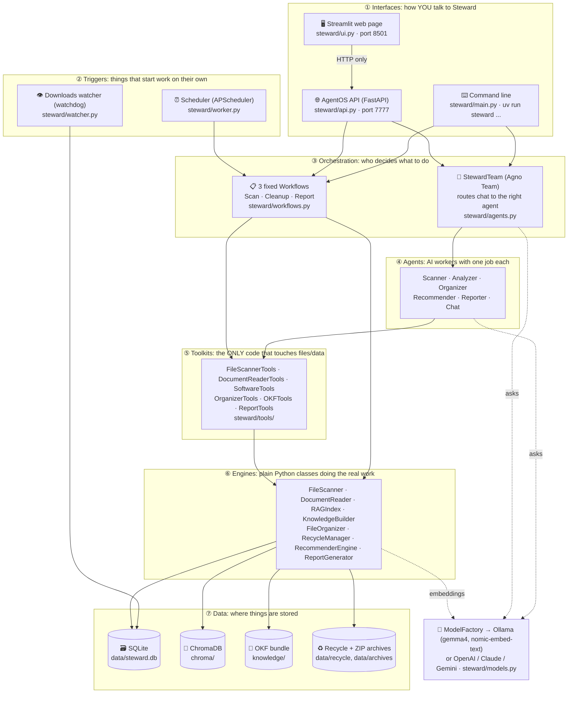
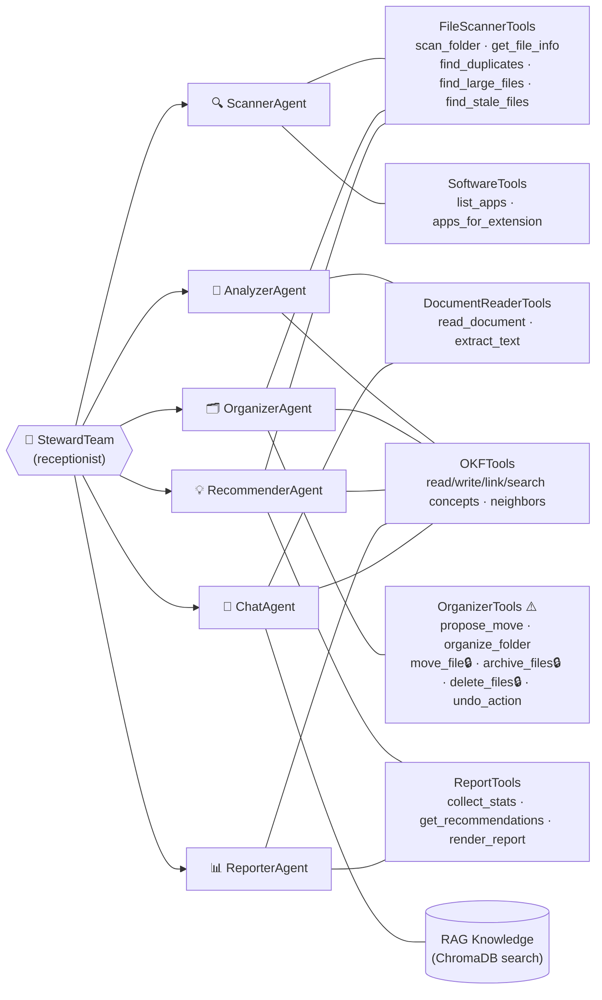
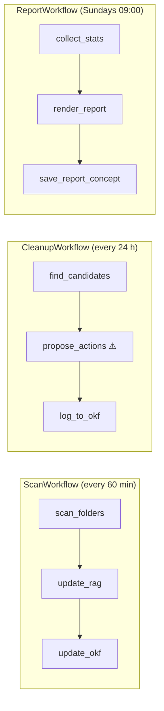
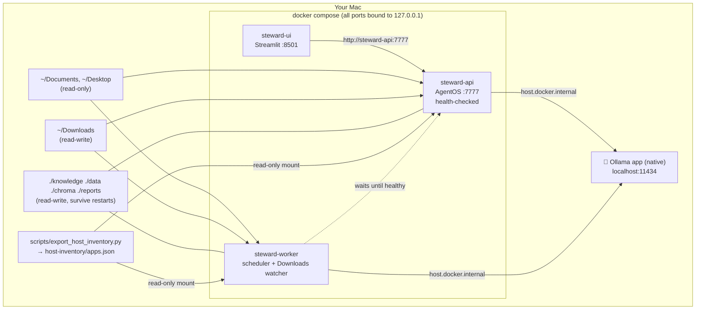

# 2. Architecture: the big picture

## 2.1 The layer cake

Steward is built in **layers**. Requests flow *down*: you talk to the interface, the interface talks to the AI team, the AI team uses tools, and **only tools touch your files and databases**. This rule matters most for safety, because an AI agent can never "reach around" a tool to delete something.



> **Plain words:** the web page is just a remote control. The API is the front desk. The Team is the receptionist. The Agents are specialists. The Toolkits are their hand tools, and the Data layer is the filing cabinets.

> **Reviewer's note:** the PRD says workflows go through toolkits. In the code, the **Scan workflow calls the engines directly** ([workflows.py:76-97](../steward/workflows.py#L76-L97)). That's fine in practice, but it means the Analyzer *agent* is never used in the scan, so no AI summaries are written. See [08-issues-and-risks.md](08-issues-and-risks.md) #9.

## 2.2 The six agents and their tools



🔒 = needs human confirmation (Agno HITL) before it runs. The confirmation is configured in [organizer_tools.py:30](../steward/tools/organizer_tools.py#L30).

| Agent | Its one job | Defined at |
|:--|:--|:--|
| ScannerAgent | Scan folders, list duplicates, big/old files, installed apps | [agents.py:59](../steward/agents.py#L59) |
| AnalyzerAgent | Read documents, write summaries into the OKF notebook | [agents.py:72](../steward/agents.py#L72) |
| OrganizerAgent | Propose and (after approval) do moves, archives, deletes | [agents.py:86](../steward/agents.py#L86) |
| RecommenderAgent | Look at habits and suggest what to do next | [agents.py:99](../steward/agents.py#L99) |
| ReporterAgent | Build usage reports | [agents.py:112](../steward/agents.py#L112) |
| ChatAgent | Answer questions, OKF first, then RAG, with citations | [agents.py:125](../steward/agents.py#L125) |
| StewardTeam | Route each message to the single best agent | [agents.py:143](../steward/agents.py#L143) |

All agents share **one model** (built once by `ModelFactory`) and **one session database** (`data/agno_sessions.db`). Agno's own long-term "user memory" is **switched off** (`update_memory_on_run: False`), as the PRD requires, so OKF is the only long-term memory.

## 2.3 The three workflows (fixed checklists)



⚠️ The PRD's cleanup is *find → recommend → **wait for my confirmation** → act → log*. The code has **no "wait" or "act" step**, and step 2 marks proposals as *approved* by itself. See [08](08-issues-and-risks.md) #1.

## 2.4 Three stores, three kinds of memory

```mermaid
flowchart LR
    F["📄 A file on disk<br/>invoice-q3.pdf"]
    F -->|"metadata + SHA-256"| DB[("🗃️ SQLite<br/>FACTS that change often<br/>name, size, dates, hash,<br/>category, actions, events")]
    F -->|"raw text cut into chunks<br/>+ embeddings"| VS[("🔎 ChromaDB<br/>RAW TEXT for search<br/>'Total amount due: 4,800 USD'")]
    F -->|"curated note + links"| OKF[("📓 OKF bundle<br/>CHECKED KNOWLEDGE<br/>file → folder → project → topic → app")]
    DB -. "same sha256 links all three" .- VS
    VS -. .- OKF
```

| Store | Holds | Written by | Read by |
|:--|:--|:--|:--|
| **SQLite** `data/steward.db` | file list, scan runs, activity events, apps, actions, reports | Scanner, Watcher, Organizer, Reporter | almost everything |
| **ChromaDB** `chroma/` | text chunks + embeddings | `RAGIndex` | ChatAgent (via Agno Knowledge) |
| **OKF** `knowledge/` | one Markdown note per file / folder / project / topic / app / pattern / decision / report | `KnowledgeBuilder`, `MemoryManager`, `ReportGenerator` | ChatAgent and others via `OKFTools` |
| **Agno sessions** `data/agno_sessions.db` | chat history, workflow runs | Agno | Agno |
| **Recycle / archives** `data/recycle`, `data/archives` | files you "deleted" or zipped, with sidecar metadata for undo | `RecycleManager` | undo |

More detail and real examples are in [04-data-and-memory.md](04-data-and-memory.md).

## 2.5 How Docker runs it (always-on mode)



- One `Dockerfile`, three services with different start commands, all `restart: unless-stopped`.
- Ollama runs **natively on your Mac**, not in a container (a deliberate change from the PRD, commit `2bff203`), so the GPU is used and models aren't downloaded twice.
- ⚠️ `steward-api` and `steward-worker` are **two processes writing the same ChromaDB folder and the same SQLite file** at the same time. See [08](08-issues-and-risks.md) #12.

## 2.6 Code map: which file does what

| File | Lines | Class(es) | Responsibility |
|:--|--:|:--|:--|
| [config.py](../steward/config.py) | 180 | `AppConfig` | Loads `config.yaml` + `.env`, defaults, validation, path helpers, protected-path check |
| [logger.py](../steward/logger.py) | 102 | `LoggerFactory` | Console + rotating file logs (`data/logs/steward.log`) |
| [models.py](../steward/models.py) | 173 | `ModelFactory` | Builds the chat model / embedder for ollama, openai, anthropic, gemini |
| [database.py](../steward/database.py) | 200 | `DatabaseManager` | SQLite schema, migrations, queries |
| [scanner.py](../steward/scanner.py) | 191 | `FileCategorizer`, `FileScanner` | Walk folders, hash changed files, categorise, find dup/large/stale/temp |
| [software.py](../steward/software.py) | 206 | `SoftwareDetector` | Read `/Applications` `Info.plist` or the host inventory JSON |
| [watcher.py](../steward/watcher.py) | 171 | `DownloadsWatcher` | Real-time Downloads events, wait until a file stops growing, suggest destination |
| [reader.py](../steward/reader.py) | 178 | `DocumentReader` | Extract text from PDF/DOCX/XLSX/text/code + image EXIF, size and secret guards |
| [chunker.py](../steward/chunker.py) | 153 | `TextChunker`, `HashEmbedder` | Split text into 800-char chunks with 120 overlap. Offline test embedder |
| [rag.py](../steward/rag.py) | 180 | `RAGIndex` | ChromaDB via Agno Knowledge: index, re-index on change, search |
| [okf_bundle.py](../steward/okf_bundle.py) | 191 | `OKFBundle` | Read, write, validate (incl. secret regex), search OKF notes, `index.md` |
| [okf_graph.py](../steward/okf_graph.py) | 183 | `OKFGraph` | Parse Markdown links into a NetworkX graph: neighbours, related, by tag |
| [memory.py](../steward/memory.py) | 176 | `MemoryManager` | Preferences, patterns, decisions with expiry dates |
| [knowledge_builder.py](../steward/knowledge_builder.py) | 199 | `KnowledgeBuilder` | Turn SQLite rows into linked OKF notes |
| [tools/*.py](../steward/tools/) | 376 | 6 Toolkits | What agents are allowed to call |
| [agents.py](../steward/agents.py) | 176 | `StewardAgents` | 6 agents + the team |
| [workflows.py](../steward/workflows.py) | 194 | `StewardWorkflows` | Scan / Cleanup / Report workflows |
| [organizer.py](../steward/organizer.py) | 204 | `FileOrganizer` | Action life-cycle proposed → approved → done → undone, protected paths, dry-run |
| [recycle.py](../steward/recycle.py) | 185 | `RecycleManager` | Recycle bin, verified ZIP archives, restore, confirmed purge |
| [recommender.py](../steward/recommender.py) | 213 | `PatternMiner`, `RecommenderEngine` | Rule-based habit mining + prioritised suggestions |
| [reporter.py](../steward/reporter.py) | 224 | `ReportGenerator` | Stats → Jinja2 Markdown/HTML report → OKF note |
| [main.py](../steward/main.py) | 251 | `StewardApp`, `StewardCLI` | Wires every service together, CLI commands |
| [api.py](../steward/api.py) | 177 | `StewardAPIServer` | AgentOS + `/steward/*` routes |
| [client.py](../steward/client.py) | 95 | `StewardClient` | HTTP client used by the UI |
| [ui.py](../steward/ui.py) | 182 | `StewardUI` | Chat, approval cards, reports, settings tabs |
| [worker.py](../steward/worker.py) | 142 | `StewardWorker` | APScheduler jobs + watcher, clean shutdown |

**How the pieces get wired:** `StewardApp.__init__` ([main.py:29-51](../steward/main.py#L29-L51)) creates every engine once and shares them. The RAG index, agents, and workflows are created lazily, only when first needed. This is a clean design (simple manual dependency injection) and it's easy to follow.

➡️ Next: [03-how-it-works-step-by-step.md](03-how-it-works-step-by-step.md)
