# 3. How it works, step by step

Each section below follows one job from start to finish: first in **plain words**, then as a **flow diagram**, then **what the code really does** (with links). Where the code differs from the PRD, there is a ⚠️ note.

---

## 3.1 Start-up: what happens when Steward launches

**Plain words:** Steward reads its settings, makes sure its folders exist, opens its logbook, and prepares (but doesn't yet start) its AI brain.

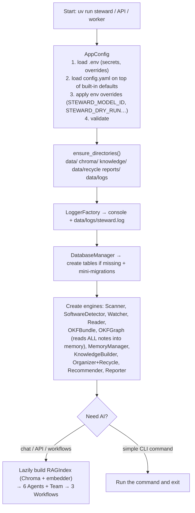

Code: [main.py:29-51](../steward/main.py#L29-L51), [config.py:66-75](../steward/config.py#L66-L75).

> ⚠️ `OKFGraph` reads **every** Markdown note at start-up ([okf_graph.py:22](../steward/okf_graph.py#L22)). Your real `knowledge/` folder already has **~10,600 notes**, so every CLI command pays that cost, even `--check`.

---

## 3.2 Scanning folders (the hourly walk-through)

**Plain words:** Steward walks through each watched folder. For each file it checks *"is the size and modified-time the same as last time?"* If yes, it skips the expensive fingerprint. If no, it fingerprints (hashes) the file. Then it records everything in the logbook and asks the logbook for duplicates, big, old, and temp files.

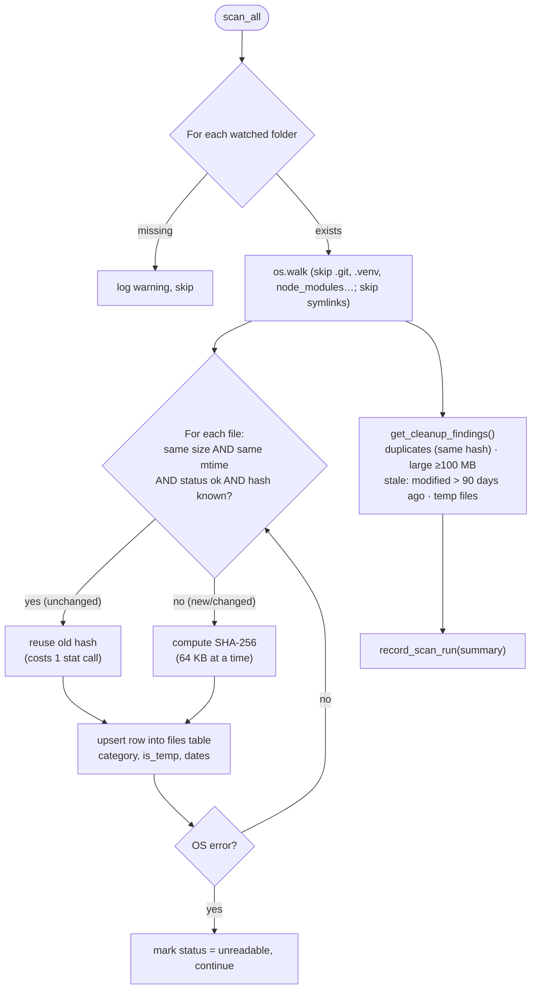

Code: [scanner.py:72-150](../steward/scanner.py#L72-L150). **Tested:** the first scan hashed 13 of 13 files. The second scan hashed **0** and reused 13. ✅ This meets the PRD Phase 2 "done when" rule.

**How categories are decided:** purely by file extension ([scanner.py:12-24](../steward/scanner.py#L12-L24)): `.pdf/.docx/.md` → document, `.xlsx/.csv` → spreadsheet, `.py/.json` → code, `.png` → image, `.dmg` → installer, `.tmp/.part` or names starting with `~$` → temporary.

> ⚠️ **Deleted or moved files are never removed** from the `files` table, so they show up as "ghost" duplicates forever. See [08](08-issues-and-risks.md) #4.
> ⚠️ The `checkpoint_path` is saved only *after* the scan finishes. There is no "running" state and no resume, so the PRD's "a crash mid-scan resumes from the last checkpoint" isn't implemented. See #13.

---

## 3.3 Reading documents and building the search index (RAG)

**Plain words:** For every file in the logbook that Steward can read, it pulls out the text, cuts it into overlapping paragraphs of ~800 characters, turns each paragraph into numbers (an *embedding*) using `nomic-embed-text` in Ollama, and stores them in ChromaDB. Next time, if the fingerprint hasn't changed, it skips the file.

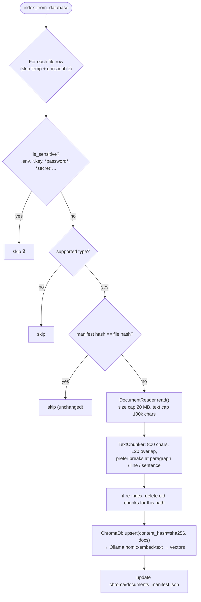

**How a question is searched:** `RAGIndex.search()` → Agno `Knowledge.search()` → the question is embedded → ChromaDB returns the closest chunks with metadata `path, file_name, file_type, sha256, chunk_index`.

**What each file type gives you:**

| Type | What's extracted ([reader.py](../steward/reader.py)) |
|:--|:--|
| PDF | Text per page labelled `[Page N]`, plus title/author metadata |
| DOCX | Paragraphs + table rows (`cell | cell`) |
| XLSX | `[Sheet: name]` + each row joined by ` | ` |
| Text / Markdown / code | The raw text (UTF-8, bad bytes replaced) |
| Images | Format, size and EXIF tags as text (no picture understanding) |

**Tested:** indexing used real Ollama embeddings. *"how much money is due on the invoice"* returned the invoice PDF first. ✅

> 🐞 **Bug found live:** two identical files (same hash) **erase each other**. `upsert(content_hash=…)` in Agno deletes every chunk with that hash, so after indexing, ChromaDB held **8** entries while the manifest claimed **10** files. See [08](08-issues-and-risks.md) #5.

---

## 3.4 Building the knowledge notebook (OKF)

**Plain words:** For each file, Steward writes a small note: what it is, a short description, which folder and "project" it belongs to, which apps can open it, and a few topic words. It links all the notes together, so that from an invoice you can hop to *Acme Project*, then to other Acme files, then to the *Invoice* topic.

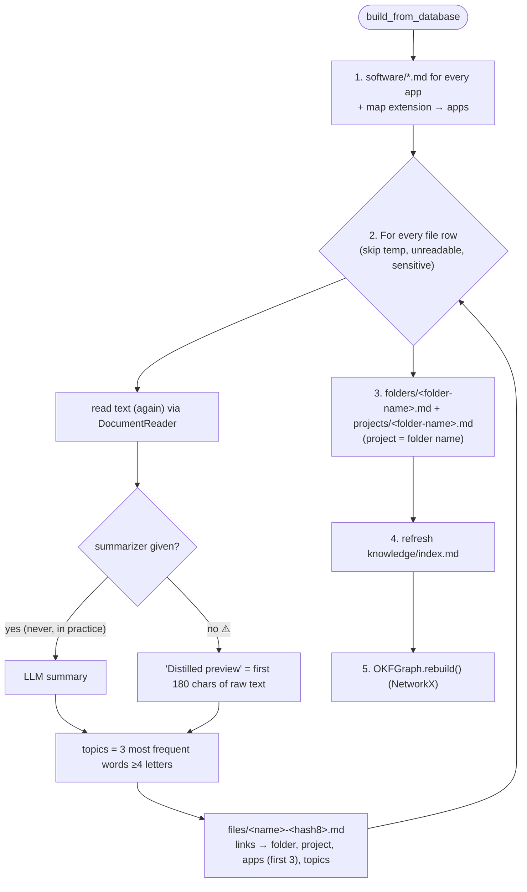

**Safety checks on every write** ([okf_bundle.py:41-77](../steward/okf_bundle.py#L41-L77)): the note must have `type` and `title`. It's rejected if it contains something that looks like a private key, an `sk-…` API key, or `password: xxxxxxxx`. It's written to a temp file first and swapped in, so a failed write keeps the old version. ✅

**Example note produced in the test** (`knowledge/files/invoice-q3-1-5bd48da3.md`):

```markdown
---
type: file
title: invoice-q3 (1).pdf
description: 'Distilled preview of invoice-q3 (1).pdf: [Page 1] Acme Corporation - Invoice Q3 2026 ... Total amount due: 4,800 USD. Payment ter'
tags: [acme, amount, document, invoice]
x-steward-sha256: 636927a0...
x-steward-size-bytes: 765
---
# invoice-q3 (1).pdf
...
- Folder: [Downloads](../folders/downloads.md)
- Project: [Downloads](../projects/downloads.md)
- Opened with: [ChatGPT Atlas](../software/chatgpt-atlas.md), [Claude](../software/claude.md), [DuckDuckGo](../software/duckduckgo.md)
```

> ⚠️ Look closely: the *summary* is copied text, *"Downloads"* is treated as a project, and *"Opened with"* lists the first 3 apps alphabetically that claim `.pdf`, not your real PDF app. See [08](08-issues-and-risks.md) #6, #10.
> ⚠️ This whole build runs from zero **every hour** in the ScanWorkflow and re-reads every document. With your ~8,000 real files, that's heavy. See #8.

---

## 3.5 Chat: asking a question

**Plain words:** You type a question. The receptionist (Team) decides which specialist should answer, usually the ChatAgent. The ChatAgent is told to look in the curated notebook first, then search the raw paragraphs, and to say which file the answer came from.

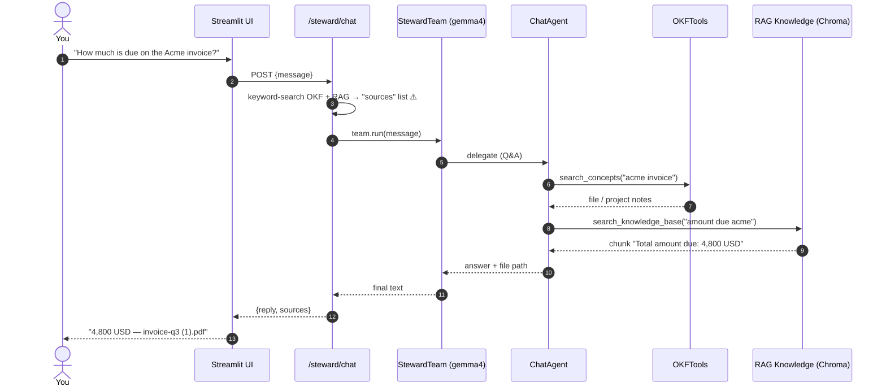

**Tested live:**

| Model | Result | Time |
|:--|:--|--:|
| `gemma3:4b` (current default in `config.yaml`) | ❌ `does not support tools (status code: 400)` | 2 s |
| `qwen3:4b` | ✅ Correct, cited path + quote | ~100 s |
| **`gemma4`** (recommended, default in `config.docker.yaml`) | ✅ Correct: *"4,800 USD … `invoice-q3 (1).pdf`"* | **~34 s** |

> ⚠️ The `sources` shown under the answer in the UI come from a **separate keyword search** the API runs ([api.py:124-126](../steward/api.py#L124-L126)), not from what the agent actually used, so they can disagree with the citation in the answer.
> ⚠️ If the model has no tool support, the API detects the error text and retries with a plain prompt ([api.py:131-135](../steward/api.py#L131-L135)). That's a workaround. The real fix is to use a tool-capable model.

---

## 3.6 Chat: asking Steward to DO something (approval needed)

**What the PRD designed:** the agent proposes, Agno **pauses** the run, the UI shows a confirmation card, you click Approve, the run **continues**, and the file moves to the recycle bin.

**What actually happens today (tested with gemma4):**

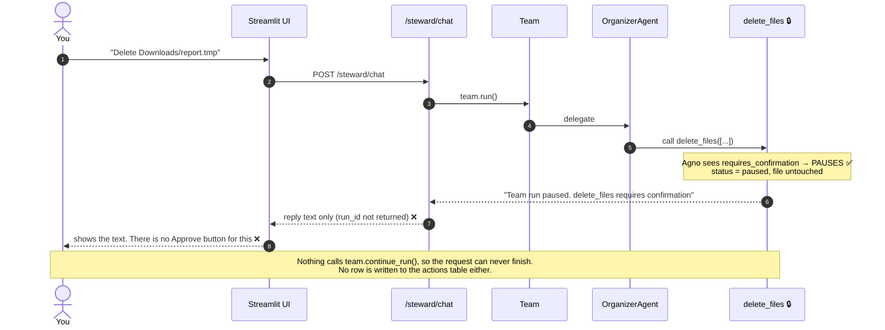

> ✅ The safety pause works: nothing is deleted without confirmation.
> ❌ The feature is unusable, because there is no path to confirm. See [08](08-issues-and-risks.md) #2.
> Also note: even if confirmed, the tool's code does **propose + approve + execute in one call** ([organizer_tools.py:53-88](../steward/tools/organizer_tools.py#L53-L88)), so the Agno confirmation is the *only* real gate on that path.

---

## 3.7 The scheduled cleanup

**What the PRD designed:** *find candidates → recommend → **wait for my confirmation** → act → log to OKF.*

**What the code does** ([workflows.py:99-146](../steward/workflows.py#L99-L146)):

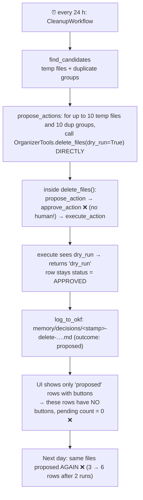

Because the workflow calls the tool function directly (not through an agent), **Agno's confirmation never triggers**. The tool then calls `approve_action` itself. Result: rows in the database say *approved* although you never saw them. Today `dry_run` is on, so no file is touched. But this design breaks the PRD rule *"nothing reaches done without passing approved [by the user]."* See [08](08-issues-and-risks.md) #1, #3.

---

## 3.8 The approval life-cycle (the part that works well)

When an action is created properly (for example by `organize_folder`, `propose_move`, or `plan_organize`), the state machine in [organizer.py](../steward/organizer.py) is solid:

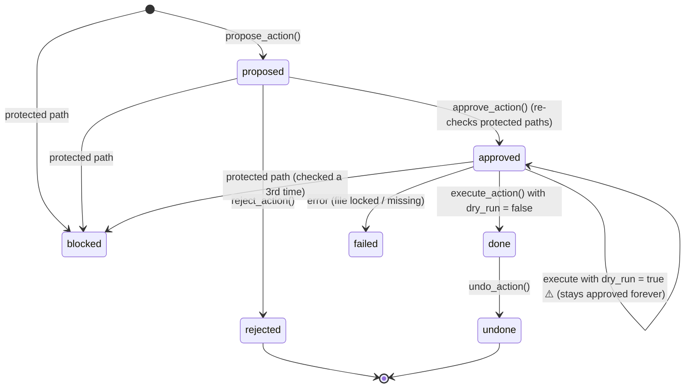

What each action does on disk:

| Action | Do | Undo |
|:--|:--|:--|
| `move` | `shutil.move` to the target (adds `_1`, `_2` if the name is taken) | move back to the original path |
| `delete` | **never deletes**: moves to `data/recycle/<timestamp>_<name>` plus a `.meta.json` with the original path | restore from the recycle bin |
| `archive` | ZIP with a manifest → **verify** with `testzip()` → only then delete the originals | extract each file back to its original path |
| purge | permanently delete recycle items older than 30 days, **only with `confirmed=True`** | (not undoable, by design) |

**Tested live through the API:** propose → approve (real) → file in recycle → undo → file back ✅. A protected client contract was **blocked** ✅. Approve in dry-run → row stuck at `approved` ⚠️.

---

## 3.9 New downloads (real-time)

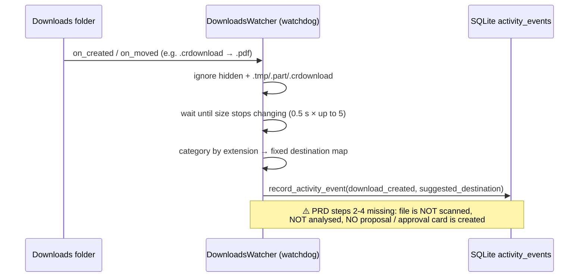

**Tested:** a new `new-contract-scan.pdf` was logged within 3 seconds ✅. But the suggestion was **`/Users/you/Documents/Documents`**: the destination map is hard-coded to your *real* home folder ([scanner.py:25-31](../steward/scanner.py#L25-L31)), even when testing a sandbox, and inside Docker it points to a folder that doesn't exist. No proposal was created and the file wasn't added to the `files` table. See [08](08-issues-and-risks.md) #7.

---

## 3.10 Recommendations ("learning your habits")

**Plain words:** Steward looks at the logbook and applies a few simple rules. It's not machine learning (yet).

| Rule | How it's computed ([recommender.py](../steward/recommender.py)) | Saved to |
|:--|:--|:--|
| Peak activity day | count weekdays of file *modified* dates + download events | `memory/patterns/peak-activity-on-<day>.md` |
| Main work category | most common category | `memory/patterns/primary-work-category-….md` |
| Inactive folders | folders where *every* file is older than 90 days | `memory/patterns/inactive-folder-….md` |
| Rarely used apps | apps whose bundle wasn't touched in 90 days | `memory/patterns/rarely-used-applications.md` |

Then it turns scanner findings into prioritised suggestions: **HIGH** dedupe and temp clean-up, **MEDIUM** archive stale and review large files, **LOW** organise folders with 3 or more file types.

> ⚠️ Steward never records **which files you open**. Habits come only from *modified* dates, so in the test, "Peak activity on Thursday" simply meant *"the sample files were created today."*
> ⚠️ Each time recommendations are generated, every pattern's "observations" counter goes up by one, even if nothing new happened (2 runs → 2 observations). See [08](08-issues-and-risks.md) #11.
> ⚠️ "Reclaimable MB" adds dup + temp + stale + large together, so a file that is both big and old is counted twice.

---

## 3.11 Reports

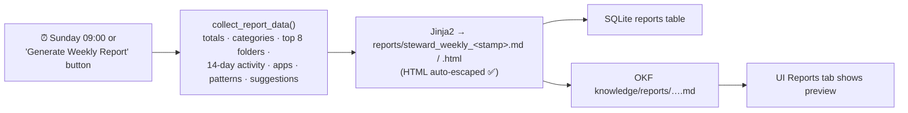

The report is template-only. The PRD's *"Reporter agent writes the summary in plain language"* step isn't used. The ReportWorkflow also collects stats twice (step 1, then again inside step 2).

---

## 3.12 A day in the life (scheduler timeline)

```mermaid
gantt
    title What the worker does on its own (default config)
    dateFormat HH:mm
    axisFormat %H:%M
    section Every hour
    ScanWorkflow (scan → RAG → full OKF rebuild) :a1, 00:00, 10m
    ScanWorkflow :a2, 01:00, 10m
    ScanWorkflow :a3, 02:00, 10m
    section Every 24 h
    CleanupWorkflow (auto-"approved" dry-run proposals) :b1, 00:00, 5m
    section Sundays 09:00
    ReportWorkflow (md + html) :c1, 09:00, 5m
    section Always
    Downloads watcher (log + suggest) :d1, 00:00, 600m
```

> ⚠️ The first scan runs only **after the first interval** (60 min), not at start-up. On a fresh install nothing happens for an hour.

➡️ Next: [04-data-and-memory.md](04-data-and-memory.md)
