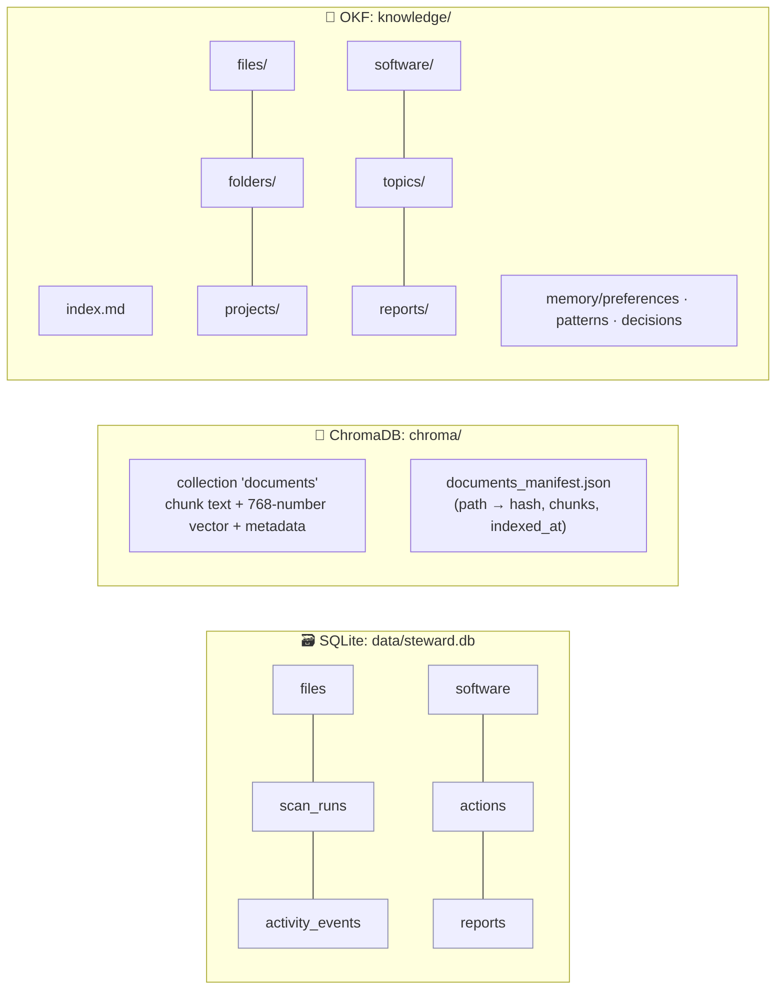
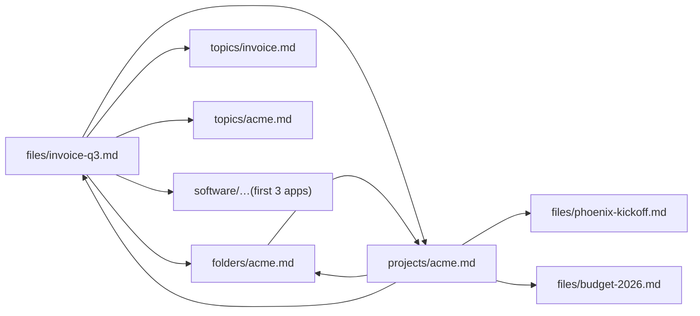
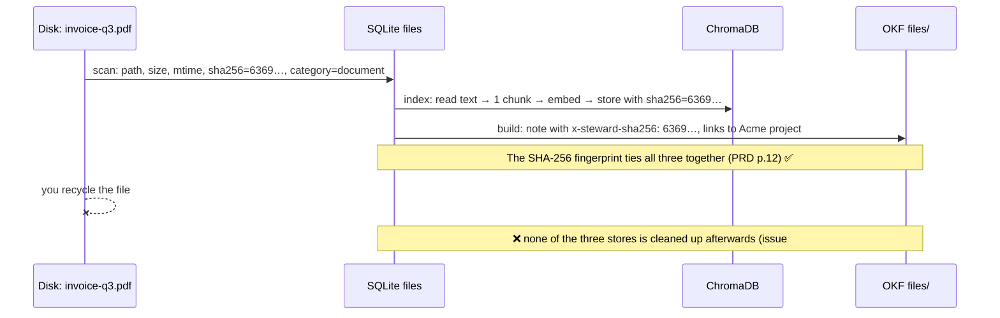

# 4. Data and memory: where Steward keeps things (and how to look inside)

Steward keeps **three kinds of memory**, like a person who has a **logbook** (facts), a **box of index cards** (raw quotes), and a **neat notebook** (what they've understood).



---

## 4.1 SQLite: the logbook (`data/steward.db`)

Schema: [database.py:11-34](../steward/database.py#L11-L34).

| Table | One row = | Key columns | Written by |
|:--|:--|:--|:--|
| `files` | one file on disk | `path` (primary key), `name`, `folder`, `extension`, `category`, `size_bytes`, `sha256`, `created_at`, `modified_at`, `accessed_at`, `is_temp`, `status` (ok / unreadable), `last_scanned_at` | Scanner |
| `scan_runs` | one scan | `started_at`, `completed_at`, `status`, `checkpoint_path`, `files_seen`, `hashed_files`, `unchanged_files`, `duplicates_found`, `errors` | Scanner |
| `activity_events` | one Downloads event | `timestamp`, `event_type`, `path`, `category`, `suggested_destination`, `details` | Watcher |
| `software` | one installed app | `name` (primary key), `path`, `version`, `extensions_json`, `last_used_at`, `status` (recent / rarely_used) | SoftwareDetector |
| `actions` | one proposed/done file action | `id`, `action_type` (move / delete / archive), `source_path`, `target_path`, `status`, `dry_run`, `reason`, `timestamp`, `decided_at` | Organizer |
| `reports` | one generated report file | `period`, `path`, `created_at` | Reporter |

**Differences from the PRD data model** (page 12):
- `files` uses `path` as its key, with no numeric `id`. So `activity_events` and `actions` can't link to a file by id (the PRD has `file_id`).
- The PRD's `activity` table has an `app` column (which app opened the file). The code has no app tracking.
- The table names differ (`apps` vs `software`, `scans` vs `scan_runs`, `from_path/to_path` vs `source_path/target_path`). That's cosmetic and fine.

### How to look inside

```bash
# from the project root (or review-system/demo for the sandbox)
sqlite3 data/steward.db ".tables"
sqlite3 -header -column data/steward.db "SELECT name, category, size_bytes, status FROM files LIMIT 20;"
sqlite3 -header -column data/steward.db "SELECT * FROM scan_runs ORDER BY id DESC LIMIT 5;"
sqlite3 -header -column data/steward.db "SELECT id, action_type, status, dry_run, source_path FROM actions ORDER BY id DESC;"
sqlite3 -header -column data/steward.db "SELECT sha256, COUNT(*) n FROM files WHERE sha256<>'' GROUP BY sha256 HAVING n>1;"   -- duplicates
```

Prefer clicking? Open `data/steward.db` with **DB Browser for SQLite** (free) or **DBeaver** (already installed on your Mac).

**Real snapshot from the sandbox test** (`review-system/demo/data/steward.db`):

```text
id | action_type | status   | dry_run | source (end)                       | reason
1  | delete      | approved | 1       | …/Downloads/report.tmp             | Temporary file candidate   ← auto-"approved" by CleanupWorkflow
2  | delete      | approved | 1       | …/Recipes/pasta-copy.md            | Duplicate file candidate
3  | delete      | approved | 1       | …/Downloads/invoice-q3 (1).pdf     | Duplicate file candidate
4-6| (same three again, from the 2nd cleanup run)
```

---

## 4.2 ChromaDB: the index-card box (`chroma/`)

- **One collection**, `documents`. Each item = one chunk of ~800 characters.
- **Metadata per chunk:** `file_id` (hash of the path), `path`, `source_path`, `file_name`, `file_type`, `chunk_index`, `total_chunks`, `sha256`.
- **Vector:** 768 numbers from `nomic-embed-text` (Ollama).
- **Manifest** `chroma/documents_manifest.json` remembers which file was indexed with which hash, so unchanged files are skipped.

### How to look inside

```bash
uv run steward --search "your question here"            # semantic search, top 5
uv run python - <<'EOF'
import chromadb
col = chromadb.PersistentClient(path="chroma").get_collection("documents")
print("chunks stored:", col.count())
for m in col.get(include=["metadatas"], limit=10)["metadatas"]:
    print(m["file_name"], m["chunk_index"])
EOF
```

> 🐞 In the sandbox, the manifest listed **10** files but ChromaDB held only **8**. The two duplicates (`invoice-q3.pdf`, `pasta-copy.md`) had been erased by their twins. See [08](08-issues-and-risks.md) #5.

---

## 4.3 OKF: the notebook (`knowledge/`)

It's **plain Markdown that you can open in any editor** (VS Code, Obsidian, …). Every note has a YAML header ("frontmatter") and a body with links.

```text
knowledge/
├── index.md                 ← table of contents of every note
├── files/                   ← one note per file      (e.g. invoice-q3-9ea16736.md)
├── folders/                 ← one note per folder NAME
├── projects/                ← "projects" = folder names (see issue #10)
├── software/                ← one note per installed app
├── topics/                  ← top keywords found in documents
├── reports/                 ← one note per generated report
└── memory/
    ├── preferences/         ← your rules ("never touch X"). Nothing writes here yet
    ├── patterns/            ← learned habits (peak day, main category, inactive folders…)
    └── decisions/           ← every proposed / done / undone action, with reason
```

**Required fields:** `type` and `title`. **Usually present:** `description`, `tags`, `timestamp`, `sources`. **Steward's own fields** use the `x-steward-` prefix, as the OKF rules require: `x-steward-path`, `x-steward-sha256`, `x-steward-size-bytes`, `x-steward-category`, `x-steward-freshness`, `x-steward-confidence`, `x-steward-observations`, `x-steward-ttl-days`, `x-steward-expires-at`, …

**Trust and freshness (PRD rule):** memory notes get an expiry date (preferences 365 days, patterns 60, decisions 180). `MemoryManager.expire_stale_memories()` can mark them `stale`, but **nothing schedules it**, so nothing ever goes stale in practice. File notes are always `fresh`.

**The graph:** every `[label](../other/note.md)` link becomes an edge in a NetworkX graph.



Sandbox result: **75 nodes, 111 edges**. Your real bundle: about **10,600 notes**. Of those, 7,951 are file notes and 2,017 are topics. There are 326 "projects", including names like `src`, `tests`, `utils`, `.ipynb-checkpoints`, which shows that a folder name isn't a good stand-in for a project.

### How to look inside

```bash
open knowledge/index.md                                  # or open the folder in VS Code / Obsidian
uv run steward --okf-search "acme"                       # keyword search + linked neighbours
ls knowledge/memory/decisions | tail                     # audit trail of actions
```

Tip: open `knowledge/` as an **Obsidian vault**. Its *Graph view* draws the links for you, which is a great way to *show* a non-technical person the "brain".

---

## 4.4 Other places worth knowing

| Path | What's in it | How to view |
|:--|:--|:--|
| `data/logs/steward.log` | everything Steward did (rotates at 5 MB, 3 backups) | `tail -f data/logs/steward.log` |
| `data/recycle/` | "deleted" files: `<timestamp>_<name>` + `<…>.meta.json` (original path) | Finder |
| `data/archives/` | ZIP archives, each with `steward_manifest.json` inside | Finder / `unzip -l` |
| `reports/` | `steward_weekly_<stamp>.md` / `.html` | double-click the `.html` |
| `data/agno_sessions.db` | Agno chat sessions and workflow runs | `sqlite3 data/agno_sessions.db ".tables"` |
| `host-inventory/apps.json` | app list exported for Docker | any editor |

---

## 4.5 How one file travels through all three stores



➡️ Next: [05-how-to-use.md](05-how-to-use.md)
