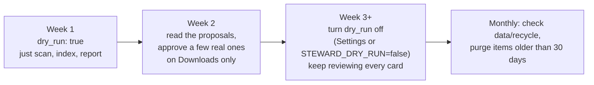

# 5. How to use Steward

## 5.1 What you need first

| Need | Check with | Install |
|:--|:--|:--|
| Python 3.11+ and `uv` | `uv --version` | `brew install uv` |
| Ollama running | `curl -s localhost:11434/api/tags` | <https://ollama.com>, then `ollama serve` |
| A chat model **that supports tools** | `ollama show gemma4` lists `tools` under *Capabilities* | `ollama pull gemma4` |
| The embedding model | `ollama list` shows `nomic-embed-text` | `ollama pull nomic-embed-text` |
| Docker (only for always-on mode) | `docker info` | Docker Desktop |

> ⚠️ **Change the model first.** `config.yaml` currently says `model_id: "gemma3:4b"`. That model **can't call tools**, so every agent fails with `does not support tools (status code: 400)`. Use **`gemma4`** (tested: correct answers in about 34 s):
>
> ```yaml
> # config.yaml
> models:
>   model_id: "gemma4"
> ```
>
> Also check your `.env`. `STEWARD_MODEL_ID` in `.env` **overrides** `config.yaml` (and `.env.example` sets it to `llama3.2`). Either delete that line or set `STEWARD_MODEL_ID=gemma4`.

## 5.2 Install and first check

```bash
cd ~/project-steward
uv sync                      # installs everything into .venv
cp .env.example .env         # only if you don't have one yet; then set STEWARD_MODEL_ID=gemma4
uv run steward --check       # prints config, DB, OKF graph size, model, dry-run status
uv run pytest -q             # 37 tests should pass
```

## 5.3 Try it safely on the sample folder first (recommended)

I added a sandbox that **never touches your real folders**:

```bash
cd ~/project-steward
bash review-system/demo/run_demo.sh          # builds sample_home/ and runs every feature
```

Everything it creates stays inside `review-system/demo/` (`sample_home/`, `data/`, `chroma/`, `knowledge/`, `reports/`). Open those folders afterwards to *see* what Steward produced. To run single commands against the sandbox:

```bash
cd review-system/demo
uv run --project ../.. steward --config config.demo.yaml --scan
```

## 5.4 Everyday commands (CLI)

| I want to… | Command | What you'll see |
|:--|:--|:--|
| Check that everything is set up | `uv run steward --check` | config paths, model, dry-run, number of OKF nodes |
| Scan my folders | `uv run steward --scan` | `Scanned N files (X hashed, Y unchanged) dup=… large=… stale=… temp=…` |
| List my apps | `uv run steward --software` | `Detected 30 apps (recent=14, rarely_used=16)` |
| Read one file | `uv run steward --read ~/Documents/x.pdf` | type, char count, metadata, first 400 characters |
| Build the search index | `uv run steward --index` | `indexed=…, skipped=…, chunks=…` |
| Search inside documents | `uv run steward --search "budget"` | ranked passages with file names |
| Build the knowledge notebook | `uv run steward --build-okf` | counts + graph size |
| Search the notebook | `uv run steward --okf-search "acme"` | matching notes + linked neighbours |
| Run the full hourly job once | `uv run steward --workflow scan` | scan → index → notebook |
| Get clean-up proposals | `uv run steward --workflow cleanup` | ⚠️ creates auto-"approved" rows (issue #1) |
| Make a report | `uv run steward --report both` | paths of the `.md` and `.html` |
| See suggestions | `uv run steward --recommend` | prioritised list + reclaimable MB |
| Ask a question | `uv run steward --chat "What did I work on last week?"` | AI answer (about 30–60 s on gemma4) |
| Undo an action | `uv run steward --undo 12` | `{'status': 'undone', 'restored': [...]}` |
| Watch Downloads live | `uv run steward --watch-downloads` | a log line per new download (Ctrl+C to stop) |

> ℹ️ There's **no CLI command to approve, reject, or list actions**, and none to empty the recycle bin. Use the web UI, the API (below), or Python.

## 5.5 The web app (0.10.0)

> **Updated 27 Nov 2026.** Steward now has a full web app: **Dashboard, Scan a folder, Chat,
> Reports and Settings**. It replaces the Streamlit page described in the original review.

```bash
docker compose up -d --build      # then open http://127.0.0.1:8080
```

Step-by-step instructions with screenshots: **[User Guide](../docs/user-guide/README.md)**.

| I want to… | Where |
|:--|:--|
| See today's scans and decide on suggestions | **Dashboard** → To-do (Approve / Reject), Recently completed (Undo) |
| Check one folder right now | **Scan a folder** → type the path → Scan |
| Ask about my documents, or ask Steward to tidy up | **Chat** (file changes show an approval card) |
| Read or download a report | **Reports** |
| Turn practice mode off, change the AI model, change watched folders | **Settings** |

For development without Docker: `uv run python -m steward.api` and `cd frontend && npm run dev`
(http://127.0.0.1:5173). The old Streamlit page still exists: `docker compose --profile legacy up -d`.

## 5.6 Always-on with Docker

```bash
ollama serve                                         # on your Mac (if not already running)
uv run python scripts/export_host_inventory.py       # writes host-inventory/apps.json
docker compose up -d --build                         # steward-api, steward-worker, steward-ui
docker compose ps                                    # api should be "healthy"
docker compose logs -f steward-worker                # watch the scheduler
open http://127.0.0.1:8501
docker compose down                                  # stop
```

Good to know:
- Docker uses `config.docker.yaml` (already on **`gemma4`** ✅). Folders appear inside as `/data/Documents`, `/data/Downloads`, `/data/Desktop`.
- **Documents and Desktop are mounted read-only.** Moves or deletes there will end as `failed`. Only Downloads can actually be changed. That's safe by design.
- To scan different folders, set `STEWARD_DOCUMENTS_DIR=/path` etc. in `.env`.
- ⚠️ The Docker setup shares `./data` and `./chroma` with your local runs. Paths inside Docker (`/data/Documents/...`) and outside (`/Users/you/Documents/...`) end up **mixed in the same database**. Pick one mode, or use separate folders.
- ⚠️ Settings changed in the UI are written to `/app/config.docker.yaml` *inside the image*, so they're **lost when the container is rebuilt**.

## 5.7 A safe routine for the first weeks



1. Add every folder you never want touched to `safety.protected_paths` in `config.yaml`.
2. Keep `dry_run: true` and run `--workflow scan` and `--report both`. Read the report.
3. Approve a few proposals with `dry_run: false` and check that `data/recycle/` and **Undo** work.
4. Empty the recycle bin only on purpose:

   ```bash
   uv run python -c "from steward.main import StewardApp as A; r=A().recycle_manager; print(r.purge_expired(30))"          # preview
   uv run python -c "from steward.main import StewardApp as A; r=A().recycle_manager; print(r.purge_expired(30, confirmed=True))"  # really delete
   ```

## 5.8 "How can I see everything?" checklist

| To see… | Look at |
|:--|:--|
| What Steward did, step by step | `tail -f data/logs/steward.log` (or `docker compose logs -f`) |
| Every file it knows about | `sqlite3 -header -column data/steward.db "select * from files limit 50"` or DBeaver |
| Every action and its status | UI → Approvals tab, or `GET /steward/actions` |
| Why an action happened | `knowledge/memory/decisions/*.md` |
| What it has "understood" | open `knowledge/` in VS Code or **Obsidian** (Graph view) |
| What it can search | `uv run steward --search "…"` |
| Learned habits | `knowledge/memory/patterns/*.md` |
| Reports | `reports/*.html` (double-click) |
| Deleted files (still recoverable) | `data/recycle/` |
| Agent conversations and tool calls | `data/agno_sessions.db` (table `agno_sessions`), or turn `app.log_level: DEBUG` on |
| The API and its routes | <http://127.0.0.1:7777/docs> |

➡️ Next: [06-live-test-results.md](06-live-test-results.md)
