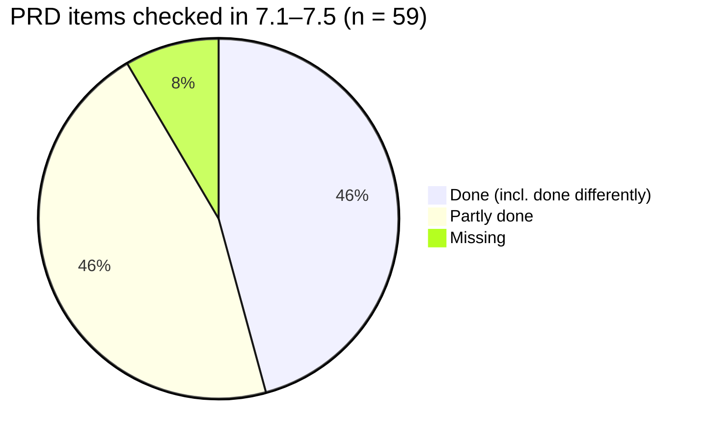

# 7. PRD compliance: requirement by requirement

Legend: ✅ done · 🟡 partly done · ❌ missing · 🔀 done differently on purpose

Sources: **PRD** = `Steward-System-Design.pdf` · **SKILL** = `project-skill.md`

## 7.1 Functional requirements (PRD p.1–2)

| ID | Requirement | Status | Evidence / gap |
|:--|:--|:-:|:--|
| F1 | Scan configured folders continuously and record metadata for every file | 🟡 | Hourly incremental scan works ✅. Deleted files are never removed (#4). No checkpoint resume (#13) |
| F2 | Read PDF, DOCX, XLSX, TXT, MD, code, image metadata; **summarize and tag** | 🟡 | Reading ✅ all formats. *Summaries* are the first 180 raw characters and *tags* are word counts. No LLM summary (#6, #9) |
| F3 | Detect installed software and which apps handle which file types | 🟡 | macOS `Info.plist` / Linux `.desktop` / host JSON ✅. The *default* app per type isn't known, so "Opened with" = first 3 alphabetically (#10) |
| F4 | Watch Downloads in real time and suggest where each new file belongs | 🟡 | Watcher + debounce ✅. The suggestion is a fixed map pointing to your real home dir. Not scanned, no proposal or approval card (#7) |
| F5 | Answer chat questions, citing the file or OKF concept | 🟡 | Works with a tool-capable model (gemma4/qwen3), **3/6 reliable**. Default model fails (#2b). UI "sources" not from the agent (#14) |
| F6 | Organize, archive, delete **only after the user confirms** | 🟡 | State machine, protected paths, recycle, ZIP, undo ✅. Scheduled cleanup self-approves (#1). Chat confirmation can't be completed (#2) |
| F7 | Learn work patterns and recommend actions | 🟡 | 4 rule-based patterns + 5 suggestion types ✅. No "files opened" signal. Counter inflates (#11) |
| F8 | Periodic usage/activity reports in Markdown or HTML | ✅ | Weekly cron, md + html + OKF concept. Plain-language LLM summary not used |

## 7.2 Non-functional requirements (PRD p.2)

| Quality | Target | Status | Notes |
|:--|:--|:-:|:--|
| Safety | No file removed without confirmation; every action logged and undoable | 🟡 | Recycle-first, undo, and logging are great. The *confirmation* is bypassed by the workflow (#1) |
| Privacy | Fully offline with Ollama; nothing leaves the machine unless a cloud model is chosen | 🟡 | Offline ✅, 127.0.0.1 ports ✅, sensitive filter ✅, cloud warning in UI ✅. But raw text is copied into OKF (#6) |
| Background load | Incremental scans; heavy work in low-priority batches | 🟡 | Hashing is incremental ✅. The OKF rebuild re-reads **every** document each hour (#8). No batching or priority |
| Resilience | Restart cleanly; crash mid-scan resumes from checkpoint | 🟡 | Clean SIGTERM shutdown ✅, `restart: unless-stopped` ✅. No resume (#13). No Ollama retry/backoff |
| Portability | Provider, folders, schedules via config | ✅ | `config.yaml` + `.env` overrides + UI settings |
| Maintainability | Python, class-based, 100–200 lines/script, no type hints | 🟡 | Class-based ✅, no type hints ✅. **5 files exceed 200 lines**: main 251, reporter 224, recommender 213, software 206, organizer 204. Several lines over 120 chars were squeezed in to fit the limit |

## 7.3 Components (PRD p.6–8 / SKILL)

| Component | Status | Notes |
|:--|:-:|:--|
| Local chat UI (Streamlit): chat, confirmation cards, reports, settings | 🟡 | All 4 tabs exist. Confirmation cards only for DB `proposed` rows, none for Agno HITL pauses |
| AgentOS API + custom routes `/health /scan /actions /actions/{id}/undo /reports /settings` | ✅ | All present, plus `/chat`, `/approve`, `/reject`, `/recommendations`, `POST /reports` |
| Scheduler (APScheduler): scan / cleanup / report | ✅ | 60 min / 24 h / Sunday 09:00. No run at start-up |
| File watcher (watchdog) | 🟡 | Only created and moved events. Delete and modify aren't handled |
| Orchestrator team | 🟡 | Routes, but sometimes to the wrong agent (Analyzer instead of Chat) |
| ScanWorkflow: scan → **analyze** → RAG → OKF | 🟡 | The "analyze" step (Analyzer agent / summaries) is missing |
| CleanupWorkflow: find → recommend → **wait for confirmation** → act → log | ❌ | No wait or act step. It self-approves (#1) |
| ReportWorkflow: stats → report → OKF concept | ✅ | Collects stats twice (minor) |
| 6 agents (Scanner, Analyzer, Organizer, Recommender, Reporter, Chat) | ✅ | All built with single-purpose tool sets |
| 6 Toolkits with the PRD function names | ✅ | Every function in the PRD's table (p.15) exists. `organize_folder` and `get_recommendations` were added |
| Destructive tools use Agno HITL + dry-run | 🟡 | `requires_confirmation_tools` set ✅, dry-run ✅. HITL is bypassed when tools are called from workflows |
| Agno Knowledge + local vector DB + Ollama embeddings | ✅ | ChromaDB + `nomic-embed-text` (#5 dup bug) |
| Agno SqliteDb for sessions; built-in memory off | ✅ | `update_memory_on_run=False` |
| OKF as single source of long-term memory | ✅ | Agents read/write via OKFTools |
| OKF layout (files, folders, projects, software, topics, memory/…, reports) | ✅ | Exact layout |
| OKF rules: `type` required, `x-steward-` prefix, links = graph, trust signals | 🟡 | All present, but freshness never changes (expiry never scheduled) |
| No secrets or copied sensitive contents in OKF | 🟡 | Regex secret guard ✅. Raw 180-char previews still copied (#6) |
| OKF and RAG separate; chat checks OKF first, then RAG | ✅ | Per instructions and tool order |
| OKFBundle, OKFGraph, MemoryManager, KnowledgeBuilder classes | ✅ | All four |
| MemoryManager *decides what becomes memory, expires stale entries* | 🟡 | Logic exists. Nothing writes **preferences**, and expiry is never run |
| ModelFactory: Ollama default + OpenAI / Anthropic / Gemini | ✅ | Plus API-key checks. No cloud → local fallback (PRD p.18) |
| Docker: Dockerfile + compose, scheduler, UI, mounted folders, mounted `knowledge/` | 🔀 | 3 services, with Ollama native on the host instead of a 4th container (deliberate, commit `2bff203`). The `knowledge/` git repo for history isn't set up |
| Host inventory script | ✅ | `scripts/export_host_inventory.py` → read-only mount |
| Folders read-only by default, read-write only if managed | ✅ | Documents and Desktop `:ro`, Downloads rw |
| Ports bound to 127.0.0.1 | ✅ | `127.0.0.1:7777`, `127.0.0.1:8501` |
| Structured logs; one line per workflow step and action | 🟡 | Logs exist, not structured (JSON). Not one line per step |
| Health route checks DB, vector store, OKF bundle **and the model** | 🟡 | The model / Ollama isn't pinged. The UI shows "starting" only if the API is down |
| UI status panel: last scan time, files indexed, pending actions, errors in last day | 🟡 | Only OKF nodes, edges, pending, model, dry-run |
| Purge recycle area after retention (user-triggered) | 🟡 | `purge_expired(confirmed=True)` exists, but there's no CLI, API, or UI for it |
| Content read from files treated as data, not instructions | 🟡 | Stated in agent instructions only. No delimiting or sanitising of retrieved text |

## 7.4 Error-handling table (PRD p.18)

| Failure | PRD response | Implemented? |
|:--|:--|:-:|
| Unreadable or corrupt file | log, mark `unreadable`, continue | ✅ |
| Ollama not ready | retry with backoff; UI shows "Steward is starting" | ❌ no retry. UI message only when the API itself is down |
| Cloud model error | retry once, then fall back to the local model | ❌ |
| Crash mid-workflow | resume from last checkpoint | ❌ |
| Action fails (file locked or missing) | mark `failed` with reason; nothing else changes | ✅ |
| OKF concept fails validation | skip write, log, keep the old version | ✅ (atomic temp-file swap) |

## 7.5 Phase "done when" checks (PRD p.20)

| Phase | Done when… | Verified? |
|:--|:--|:-:|
| 1 Foundation | test chats with Ollama and one cloud model | 🟡 Ollama yes. Cloud only unit-tested with mocks |
| 2 Scanning | repeat scan of an unchanged folder hashes nothing | ✅ (0 hashed) |
| 3 RAG | a question about a PDF returns the right passage | ✅ |
| 4 OKF | scanned files appear as valid, linked concepts | ✅ |
| 5 Agents | a **scheduled** scan runs end to end and updates OKF | ✅ (`--workflow scan`, worker `run_once` test) |
| 6 Organize | an approved delete lands in recycle and can be undone | ✅ |
| 7 Recommend | a weekly report with at least one suggestion | ✅ (5 suggestions) |
| 8 Chat UI | **a user approves an action from the chat** | ❌ HITL pause can't be confirmed from the UI (#2) |
| 9 Docker | `docker compose up` brings everything up after reboot | 🟡 not run here. The config is valid and `restart: unless-stopped` is set |

## 7.6 Summary

**Most of the PRD is built.** The gaps are almost all **"last-mile wiring"**: connecting the pieces that already exist (the approval round trip, watcher → proposal, analyzer → summaries, expiry → scheduler), not missing subsystems.

➡️ Next: [08-issues-and-risks.md](08-issues-and-risks.md)
