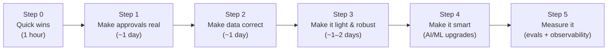
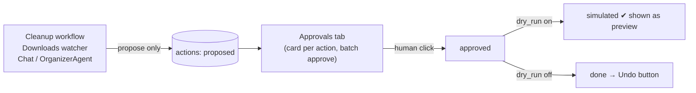

# 9. Improvement roadmap

Ordered so that **each step makes Steward safer or more correct before it gets smarter.** Issue numbers refer to [08-issues-and-risks.md](08-issues-and-risks.md).



---

## Step 0: Quick wins (about 1 hour)

| Do | Why | Issue |
|:--|:--|:-:|
| `config.yaml` → `model_id: "gemma4"`; `.env` / `.env.example` → `STEWARD_MODEL_ID=gemma4` | Agents can't work at all on `gemma3:4b` | 2b |
| Check at start-up that the model supports tools (`ollama show` / `/api/show` → `capabilities`) and fail with a clear message | Prevents a silent, confusing failure | 2b |
| `workflows.py` cleanup step → call `organizer.propose_action` instead of `organizer_tools.delete_files` | Stops self-approval immediately | 1 |
| `api.py` settings → parse `"true"/"false"` strings properly | Typing `"false"` currently turns dry-run *on* | 15 |
| `sqlite3.connect(db, timeout=30)` + `PRAGMA journal_mode=WAL` | Avoids `database is locked` with two processes | 12 |
| Scan job `next_run_time=datetime.now()` | First scan at start-up, not after 60 min | 19 |

## Step 1: Make approvals real (about 1 day)

Goal: **one approval path for everything.** Every risky action becomes a `proposed` row, and only a human click turns it into `approved`.



1. `OrganizerTools.move_file/archive_files/delete_files` → **propose only** and return the proposal id (no `approve_action` inside tools). Keep Agno's `requires_confirmation` as a second gate, or drop it once the tools no longer execute anything. (#1, #2)
2. If you keep HITL in chat, return `run_id` + requirements from `/steward/chat` and add `/steward/chat/{run_id}/confirm` → `team.continue_run(...)`. Add a confirmation card in the UI. (#2)
3. Dedupe open proposals (same type + path), and add a `simulated` status for dry-run approvals. (#3)
4. UI: "Approve all (n)" per group, show the dry-run state on each card, and show read-only folder warnings.
5. Tests: cleanup → only `proposed`; paused chat → confirm → `done`; no duplicate proposals.

## Step 2: Make the data correct (about 1 day)

1. **Ghost files:** mark unseen rows as `missing` after a scan, update rows after move/recycle/undo, and prune the matching RAG chunks and OKF notes. (#4)
2. **RAG duplicates:** keep *one* chunk set per SHA-256, with `paths: [...]` in metadata (dedup + multi-location citations), or a per-path content hash. (#5)
3. **Privacy:** never write raw text into OKF. Use LLM summaries (Step 4) or metadata-only summaries, plus a PII scrub. Add `privacy.exclude_paths`. (#6, #16)
4. **Watcher:** destinations from config, relative to the watched roots. The watcher → scanner upsert → `proposed` move. (#7)
5. **Folder/project slugs:** based on relative path, so `src` in two repos no longer collides. (#10)

## Step 3: Make it light and robust (about 1–2 days)

| Do | Effect | Issue |
|:--|:--|:-:|
| OKF incremental build: skip notes whose `x-steward-sha256` matches; `graph.update_node` instead of `rebuild` | Hourly job goes from "re-read 8,000 files" to "re-read the few that changed" | 8 |
| Per-run cap + `os.nice(10)` in the worker | PRD "low-priority batches" | 8 |
| Single writer (scheduler inside the API, or a job queue to the worker) | No Chroma/SQLite contention | 12 |
| `scan_runs` row at start (`running`) + checkpoint every 500 files + resume | PRD crash-resume | 13 |
| Model calls with retry/backoff; `/health` pings Ollama; cloud → local fallback | PRD error table | 13 |
| In-memory or FTS5 index for OKF search | Fast chat and CLI with 10k+ notes | 18 |
| Schedule `expire_stale_memories` (daily) + a "Purge recycle" button | Memory freshness actually works; disk doesn't fill up | 19 |
| Separate `state-docker/` dir; mount the config file | No mixed paths; settings survive rebuilds | 15, 20 |

## Step 4: Make it smart (AI/ML upgrades)

This is where Steward turns from a "rule-based organiser with a chat box" into a real AI assistant. Each item is self-contained.

### 4.1 Real document understanding (replaces the 180-char preview)

- Add an `analyze_changed` step to ScanWorkflow. For each **changed** file, call the model with an Agno **structured output** schema:

  ```python
  class DocInsight(BaseModel):
      summary: str           # ≤ 2 sentences, no numbers/names/emails
      doc_type: str          # invoice, contract, notes, recipe, code, photo…
      topics: list[str]      # 1–5 normalised topics
      project: str | None    # best guess, may be None
      sensitivity: str       # public / internal / confidential
  ```

  (The no-type-hints rule applies to Steward's own classes. A Pydantic schema needs field types, so keep it in one small `schemas.py`.)
- Cache by SHA-256, so each file is summarised **once per version**.
- Use `sensitivity == confidential` to skip RAG embedding automatically, so the privacy rule is enforced by the model's judgement *and* by filename rules.

### 4.2 Better topics and projects

- **Topics:** normalise LLM topics against existing `topics/*.md` (embedding similarity > 0.85 → reuse the existing topic), so you don't end up with `invoice`, `invoices`, and `billing` as three separate topics.
- **Projects:** cluster documents using *document-level embeddings* (mean of chunk vectors) plus folder, git-root, and co-modification signals (for example HDBSCAN). Name each cluster with one LLM call. That replaces the 326 folder-name "projects".

### 4.3 Smarter search (RAG quality)

- **Hybrid retrieval:** combine keyword search (BM25 / SQLite FTS5) with vector search, then **rerank** the top 20 with a small cross-encoder (or an LLM rerank prompt). This fixes misses on exact names, IDs, and numbers.
- **Graph-aware retrieval (GraphRAG-lite):** after finding an OKF note, pull in its 1-hop neighbours (project, topic, related files) as extra context. The NetworkX graph is already built.
- **Near-duplicate detection:** document-embedding cosine > 0.97 *and* different SHA-256 → "these look like versions of the same document" (for example `report-v1.docx` vs `report-final.docx`). That's a genuinely useful clean-up suggestion that hashing can't find.

### 4.4 Learning from you (real recommendations)

- Every Approve or Reject in the `actions` table is a **training label**. Start simple: a logistic-regression or gradient-boosting ranker over features such as category, age, size, folder, duplicate yes/no, suggestion kind, and the time since you last opened the file. Rank suggestions by *P(you'll approve)*. Hide kinds you always reject.
- Record real **"opened" events** (macOS `kMDItemLastUsedDate` via the host script). They are the strongest signal for *"untouched for months"* and *"opens invoices every Monday"*.
- **Disk-growth anomaly:** keep daily totals per folder and flag a folder whose growth is more than 3 standard deviations above its weekly average.

### 4.5 Agent design

- **Routing:** send Q&A straight to the ChatAgent, or use a deterministic intent classifier (keywords + a small LLM call that returns one label) before the Team. This fixes the 3/6 failures.
- **Model tiers:** a fast small model for routing and summaries, `gemma4` (or a cloud model, opt-in) for final answers.
- **Least privilege:** read-only OKF tools for ChatAgent and AnalyzerAgent (writes go through the workflow), and delimiters around retrieved document text (#17).

## Step 5: Measure it (evals + observability)

You can't improve what you don't measure. Add `tests/eval/`:

| Eval | Dataset | Metric | Target |
|:--|:--|:--|:--|
| Q&A accuracy | 30 question/answer pairs over the sample folder (extend `create_sample_folder.py`) | exact/semantic match | ≥ 90 % |
| Citation correctness | same set, expected file path | cited path ∈ expected | ≥ 95 % |
| Routing | 40 labelled requests → expected agent | accuracy | ≥ 95 % |
| Retrieval | question → expected chunk | recall@3, MRR | ≥ 0.9 |
| Summary safety | 20 docs with planted emails, amounts, IDs | no PII in OKF | 100 % |
| Latency | all of the above | p50 / p95 seconds | p95 < 45 s on gemma4 |

Run it on every model or prompt change, and keep the results in `review-system/`-style Markdown so you can compare runs over time.

**Observability:** log one structured JSON line per workflow step, tool call, and action (`run_id`, `agent`, `tool`, `args_hash`, `duration_ms`, `status`). Show "last scan, files indexed, pending, errors (24 h)" in the UI status panel, as the PRD specifies.

---

## Suggested order as a checklist

- [ ] Step 0 quick wins
- [ ] #1 cleanup proposes only + test
- [ ] #2 chat confirmation round trip (or tools propose only) + UI card + test
- [ ] #3 dedupe + `simulated`
- [ ] #4 ghost pruning (DB, RAG, OKF) + test
- [ ] #5 RAG duplicates + test
- [ ] #6 no raw text in OKF
- [ ] #7 watcher → proposal
- [ ] #8 incremental OKF
- [ ] #12 single writer
- [ ] #13 resume, retry, health ping
- [ ] Step 4.1 LLM DocInsight
- [ ] Step 5 eval harness
- [ ] Steps 4.2–4.5 as time allows

➡️ Next: [10-explain-to-non-tech.md](10-explain-to-non-tech.md)
