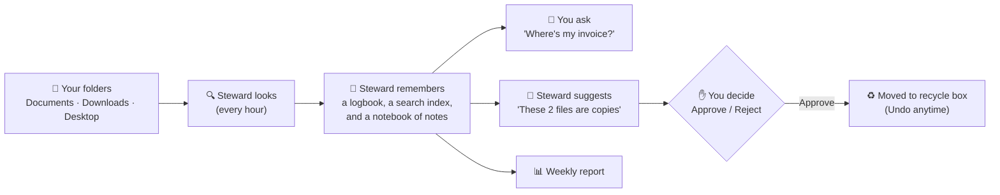

# 10. Explaining Steward to a non-technical person

A ready-to-use talk track, a one-picture overview, a 5-minute live demo, and answers to the questions people usually ask.

---

## 10.1 The 30-second version

> "Steward is like a careful house-keeper for my computer's files. Every hour it walks through my folders, notes what's there, and spots junk: duplicate copies, old files, half-finished downloads. It keeps a notebook of what each document is about, so I can just *ask* it, *'How much is the Acme invoice?'*, and it answers and tells me which file it found that in. It never throws anything away on its own. It asks first, puts things in a recycle box, and I can undo anything. And it all runs **on my own computer**, so my files never go to the internet."

## 10.2 The one picture to show



## 10.3 Analogies that land

| Technical idea | Say this instead |
|:--|:--|
| File scan + SHA-256 hash | "It gives each file a fingerprint, so two identical copies have the same fingerprint." |
| SQLite database | "A logbook listing every file, its size and its age." |
| Embeddings / RAG / ChromaDB | "It cuts documents into index cards and files them by *meaning*, so searching 'money owed' finds 'amount due'." |
| OKF knowledge bundle | "A notebook with one page per document, folder, and project, with links between pages, like a mini Wikipedia about your files." |
| Agents + Team | "A small office: a receptionist who passes your request to the right specialist (the finder, the reader, the organiser, the reporter)." |
| Tools | "The specialists can only act through approved tools. They can't just grab files." |
| Human-in-the-loop | "Anything risky needs your 'yes' first." |
| Dry-run | "Practice mode: it tells you what it *would* do, without doing it." |
| Protected paths | "Rooms it's never allowed to tidy." |
| Ollama / local model | "The brain runs on this laptop, not on someone else's server." |
| Docker | "A box that keeps Steward running in the background and restarts it if the computer reboots." |

## 10.4 A 5-minute live demo (safe, uses fake files)

Run this before the meeting so the models are warm:

```bash
cd ~/project-steward
bash review-system/demo/run_demo.sh
```

Then show, in this order:

| Minute | Show | Say |
|:-:|:--|:--|
| 1 | `review-system/demo/sample_home/` in Finder | "Here's a messy fake home folder: a duplicate invoice, a temp file, an old list, a secret file, a client contract." |
| 2 | Terminal output of steps 3–4 (scan twice) | "First look: it fingerprinted 13 files. Second look: nothing changed, so it did almost no work." |
| 3 | `review-system/demo/knowledge/index.md` → click an invoice note → click *Acme Project* | "This is its notebook. It's plain text, you can read it, and the pages link to each other." |
| 4 | `review-system/demo/reports/*.html` | "Its weekly report: what's using space and what it suggests cleaning." |
| 5 | Step 16 chat answer | "I asked about the invoice in plain English. It answered and named the file." |

Optional "wow" moment: open `review-system/demo/knowledge/` as an **Obsidian** vault and switch to *Graph view* to see the web of linked notes.

Be honest about the current state (from [08](08-issues-and-risks.md)):
> "It's a working prototype. The looking, remembering, and answering parts work. The automatic clean-up still needs fixing before I let it run unattended: right now it marks its own suggestions as approved, so I keep it in practice mode."

## 10.5 Frequently asked questions

**Can it delete my files?**
Not directly. "Delete" always means *move to a recycle folder*, with a note of where the file came from, and you can undo it. Permanent deletion only happens if you explicitly empty the recycle folder. It's also in practice (dry-run) mode by default.

**Does it send my documents to the internet / to an AI company?**
No, not with the default setup. The AI runs on this computer through Ollama. Only if I *choose* a cloud model (OpenAI, Claude, Gemini) would text be sent out, and the app shows a warning when that's switched on.

**Does it read my passwords?**
It skips files that look secret (like `.env`, key files, or anything named *password*, *secret*, *credentials*), and it refuses to write anything that looks like a key into its notebook. (One caveat to fix: the notebook currently copies the first lines of normal documents. See issue #6.)

**What if it makes a mistake?**
Every action is written in a log and in the notebook's "decisions" section, and each one has an **Undo** button. Folders on the protected list can never be touched, even if someone clicks Approve.

**How smart is it really?**
Today: good at finding, fingerprinting, searching, and answering simple questions. Its "learning your habits" part is a handful of simple rules (busiest day, main file type, inactive folders). Making it truly learn from your approvals and rejections is on the roadmap ([09](09-improvement-roadmap.md) §4.4).

**Is it slow?**
Scanning is fast after the first time, because it skips unchanged files. A chat answer takes about 20–35 seconds on the local `gemma4` model. That's the price of keeping everything on the laptop.

**Why not just use Finder or Spotlight?**
Spotlight *finds* files. Steward also *understands* them (which project, which topic), *notices problems* (duplicates, junk, space hogs), *suggests fixes* safely, *remembers* decisions, and *reports* weekly.

**What do I need to run it?**
A Mac with Ollama installed and the `gemma4` and `nomic-embed-text` models downloaded. Docker is optional, if you want it running all the time.
