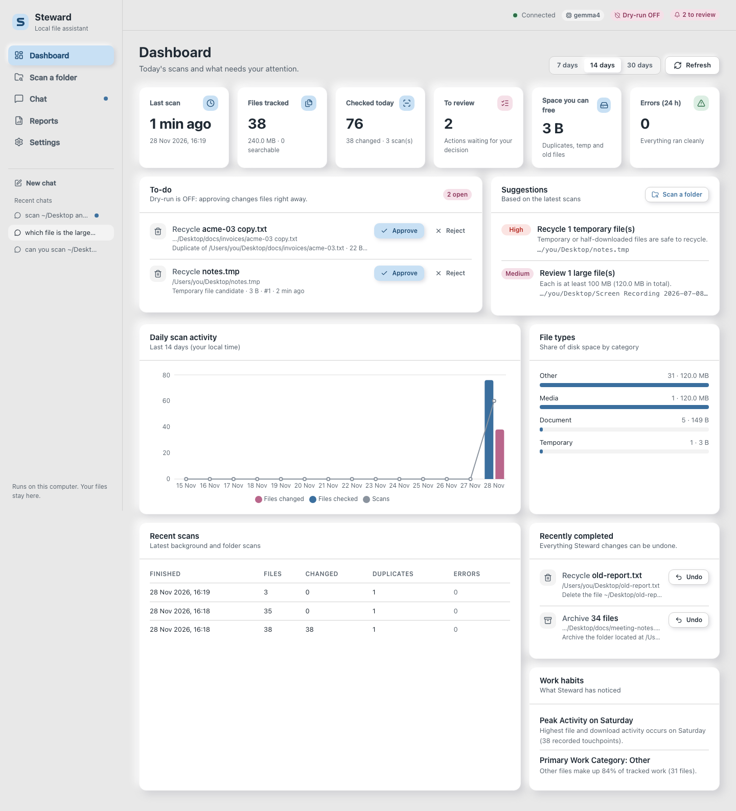

# 11. What's new in Steward 0.10.0

*Written 27 Nov 2026, after the review in this folder. Plain-language summary first, details below.*

## In one paragraph

Steward now has a **proper web app** (Dashboard, Scan a folder, Chat, Reports, Settings) that
runs in Docker at <http://127.0.0.1:8080>. The two most serious problems from the review are fixed:
the scheduled clean-up **no longer approves its own suggestions**, and you can now **approve file
changes right inside the chat**. Chat answers show the files the AI **really** used, and a safety
hole was closed: the AI can no longer switch off practice mode. Settings can be changed safely
from the browser, and reports can be read and downloaded there.

## What changed, issue by issue

| Review issue | Before | Now |
|:--|:--|:--|
| #1 Cleanup approves itself | Daily cleanup marked its own suggestions "approved" and repeated them | Only creates **proposed** to-do items, never twice |
| #2 Chat can't finish approvals | The AI paused and waited forever | **Approval card** with Approve / Reject; the AI then continues |
| #2b Wrong model / wrong agent | Default model couldn't use tools; ~50 % of document questions went to the wrong helper | Routing fixed (7/8 correct, answers in 8–13 s); Settings won't let you pick a no-tools model; default changed to gemma4 |
| #3 Stuck approvals | Approving in practice mode left actions stuck | Listed as **"Approved, waiting to run"** with a **Run now** button |
| #4 Ghost files | Deleted files kept appearing as clean-up candidates | Suggestions and proposals skip files that no longer exist (old database rows still remain, see below) |
| #14 Fake sources | Chat "sources" came from a separate keyword search | **"Looked at"** chips show exactly what the AI opened or searched |
| #15 Settings bugs | Saving wiped `config.yaml` comments; "false" meant true | Saved to a separate override file; strict checks; `.env` values shown as **locked** |
| (new) Safety hole | The AI could ask for `dry_run=False` and override practice mode | **Your setting always wins** (tested: the old code really deleted the file) |
| (new) Privacy | Ollama *cloud* models looked like local ones | Marked **cloud**, with a warning banner while one is active |
| (new) Docker paths | Results showed container paths (`/data/...`) | Your normal Mac paths everywhere, including chat answers |

## Updated scorecard

| Area | Before | Now | Why |
|:--|:-:|:-:|:--|
| Safety (files can't be lost) | 🟡 7 | 🟢 9 | Approvals work end-to-end; dry-run enforced in the tool; no self-approval |
| AI agents & chat | 🟡 5 | 🟢 7 | Approvals in chat, real sources, better routing, honest errors |
| Background automation | 🔴 4 | 🟡 6 | Cleanup proposes only, settings reload before scans; two processes still share the databases |
| User interface | n/a | 🟢 8 | Professional web app, light/dark, tested in a real browser and through Docker |
| Tests | 🟡 6 | 🟢 8 | 37 → 85 Python + 22 frontend tests, including multi-step and safety flows |
| Search (RAG) | 🟡 6 | 🟡 6 | Unchanged: identical files still share one search entry (#5) |
| Knowledge notes (OKF) | 🟡 5 | 🟡 5 | Unchanged: summaries are still raw previews (#6) |

**Overall: about 6/10 → about 7.5/10.** Safe to use day to day with practice mode on; the
remaining work is mostly about knowledge quality and background robustness.

## Still open (next steps)

1. **Clean up ghost entries** for deleted/moved files in the database, search index and notes (#4).
2. **Identical files in search** (#5) and **AI-written summaries instead of raw previews** (#6, #9).
3. **Downloads watcher** should create proposals with sensible destinations (#7).
4. **One writer** for the databases (API vs worker) and crash-resume for scans (#12, #13).
5. **Recycle-bin purge** button and memory expiry on a schedule (#19).

## Where to read more

- **Using it:** [User Guide](../docs/user-guide/README.md) (with screenshots)
- **Changing it:** [Developer Guide](../docs/developer-guide/README.md) (API reference, architecture, testing)
- **Full issue list with status:** [08-issues-and-risks.md](08-issues-and-risks.md)
