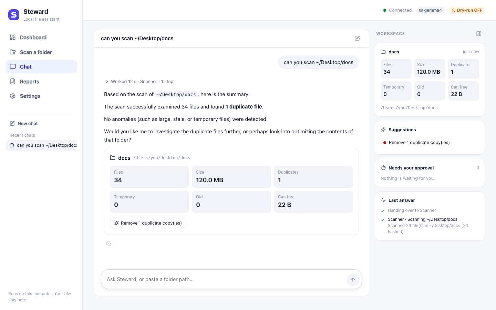
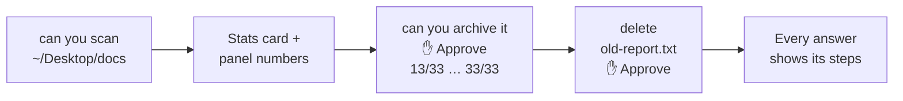

# 12. What's new in Steward 0.11.0

*Written 28 Nov 2026, after hands-on testing of 0.10.0. Plain-language summary first, details below.*

## In one paragraph

Testing 0.10.0 turned up four problems with the chat. It couldn't find folders you named, it
couldn't archive or delete a folder, it lost its answer when you switched tabs, and it felt like a
black box. All four are fixed. The chat now **shows every step while it works** (which helper,
which tool, progress such as "Archiving docs (13/33)"), keeps going while you use other pages,
shows real folder numbers next to the conversation, and only changes your Desktop or Documents if
you switch that on yourself.

## What was broken, and what changed

| Reported problem | Real cause | Now |
|:--|:--|:--|
| "Scan ~/Desktop/docs" found nothing | Steward runs in Docker; the chat tools never translated Mac paths (the Scan page did) and the scanner silently skipped unknown folders, reporting "0 files" | Every chat tool translates paths; unknown folders get a clear message |
| "Archive / delete" did nothing | The tools only accepted single files, and Desktop/Documents are shared read-only | Whole folders work (one **Undo** restores all); write access is **opt-in** per folder in `.env` |
| The AI said "deleted" when nothing was deleted | In practice mode, the small model misreported the tool result | Steward adds its own note from the real result: *"Practice mode is on, so no files were changed"* |
| Asked to approve things that could never work | No check before the approval card | Impossible steps are refused up front, with the reason and the fix |
| Switching tabs lost the answer | The answer lived inside the Chat page | Answers run on the server as jobs; tab switches, reloads and even restarts are handled |
| "Which agent is doing what?" | Nothing was shown while waiting | Live steps in the chat and in a side panel; every answer keeps its step list |

## A safety trap we found on the way

Docker treats **any** value other than `ro` as "writable". So `STEWARD_DESKTOP_ACCESS=yes`, or
even `=false` meant as "off", would have quietly made your Desktop writable. Steward now checks
the switch itself. **Only the exact value `rw` allows changes**; anything else is treated as
read-only, with a message showing the wrong value.

## The scenario test

The exact flow from the bug report, run **3 times from a fresh start** with the real local model:

**3 out of 3 runs passed every step**, checked on disk, not just on screen. Each answer took
2–23 seconds. Steward understood "archive **it**" as the folder it had just scanned every time.

The live tests also caught one problem before release: once, the local model kept handing the
same task back and forth (98 times, 8.5 minutes). Steward now stops after 6 hand-overs and shows
a failed helper as a red step instead of waiting silently.

## Updated scorecard

| Area | 0.10.0 | 0.11.0 | Why |
|:--|:-:|:-:|:--|
| Safety (files can't be lost) | 🟢 9 | 🟢 9 | Same strong rules, plus pre-approval checks, opt-in write access and honest notes |
| AI agents & chat | 🟢 7 | 🟢 8 | Paths and folders work, live steps, loop limits, conversation memory ("archive it") |
| User interface | 🟢 8 | 🟢 9 | Clean chat with a live workspace panel, recent chats, phone layout |
| Background automation | 🟡 6 | 🟡 6 | Unchanged |
| Tests | 🟢 8 | 🟢 9 | 85 → 123 Python + 22 → 35 frontend tests, plus a repeated end-to-end scenario |
| Search (RAG) / Knowledge notes | 🟡 6 / 🟡 5 | 🟡 6 / 🟡 5 | Unchanged (#5, #6) |

**Overall: about 7.5/10 → about 8/10.**

## Still open (next steps)

1. **Smart reorganise by content**: read files, propose new folders, approve, move (planned for 0.12).
2. Ghost entries for deleted files (#4), identical files in search (#5), AI-written summaries (#6, #9).
3. Downloads watcher proposals (#7); one writer for the databases (#12).
4. A recycle-bin **Empty** button.

## Where to read more

- **Using the new chat:** [User Guide, Chat](../docs/user-guide/04-chat.md)
- **The routes and modules:** [API reference](../docs/developer-guide/api-reference.md),
  [Architecture](../docs/developer-guide/architecture.md)
- **Full list of changes:** [CHANGELOG](../CHANGELOG.md)
