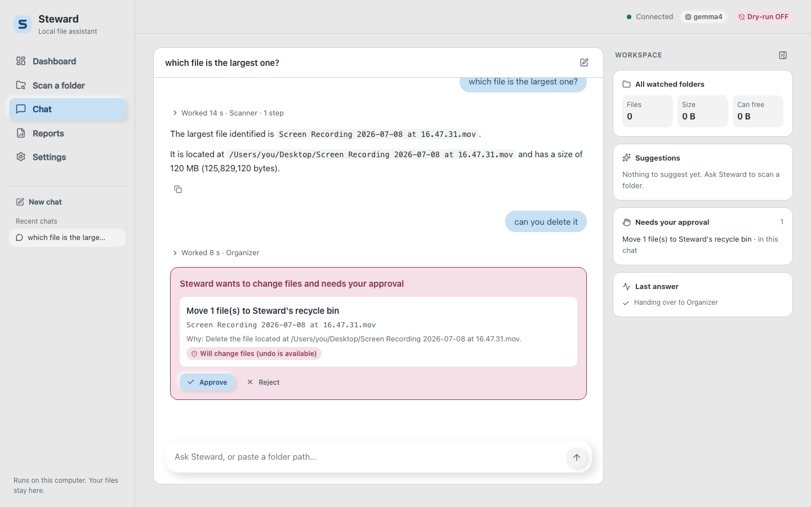

# 13. What's new in Steward 0.12.0

*Written 28 Nov 2026, after hands-on testing of 0.11.0. Plain-language summary first, details below.*

## In one paragraph

Testing 0.11.0 showed that the chat did not always do what it was told. After a **Reject** it still
said "successfully archived" (no zip was ever made, but it claimed one), and "where is the zip"
then hung. It also forgot what "the file" meant one message later. In 0.12.0 you stay in control:
a "no" is honoured and reported truthfully, long answers can be **stopped**, "undo that" and
"can you recover it" work, the chat **remembers** what it talked about, it can **find files by
name**, two chats can answer at once, and Settings can **clear Steward's own data**. The app also
has new soft colours.

## What was wrong, and what changed

| Reported problem | Real cause | Now |
|:--|:--|:--|
| "I rejected it, but it created the zip" | Nothing was zipped (checked in the action log and on disk), but the small model **wrote** "successfully archived" after the rejection | After a rejection Steward writes the answer itself: *"You rejected this, so Steward did not change any files."* If the AI tries again, Steward declines it automatically |
| "Where is the zip?" got stuck | The AI looked for a zip that never existed, and nothing stopped a long answer | Steward's notes tell the AI the change was rejected; a **Stop** button and a 5-minute limit end any long answer |
| "Delete the file" after "which file is largest" asked *which* file | The small model lost track of "the file"; helpers never saw earlier answers | Steward adds short notes on the chat (paths it named, folder scanned, what you approved or rejected, what really changed) to every question |
| "Search for a file" didn't work | There was no tool to find a file by name, and a new user's index was empty | New *find files* and *list folder* tools read the folders directly, so they work before the first scan |
| Wanted "no", "revert", "recover it" to just work | The AI had to understand them | Steward understands them itself: "no" rejects the waiting card; "undo that", "can you recover it" put back the last change from this chat |
| A second chat had to wait | One answer at a time | Two chats answer at the same time; each answer stays in its own chat |
| No way to delete chats or clear old data | Missing | 🗑 on each chat in *Recent chats*; *Settings → Data & cleanup* clears chats, knowledge notes (or topics only) and the recycle bin |

## Clearing data safely

| Button | What it does | Can I get it back? |
|:--|:--|:--|
| **Clear** | Removes it, keeps a backup in `data/backups` | Yes, with **Restore** |
| **Delete for good** | Removes it, no backup. Works only after you type `DELETE` | No |
| **Empty for good** (recycle bin) | Deletes the recycled files. Type `DELETE` | No, and Undo stops working for them |

Only Steward's own data is touched. Files in your folders never are.

## The new-user test

The exact flow from the request, on a fresh Steward that had never scanned, with the real local model:

**All 7 steps passed**, checked on disk and through Steward's own records. The second chat's long
answer took 67 seconds; meanwhile the first chat answered a new question in 29 seconds.

The first run caught two real bugs before release. "Archive it" picked Steward's recycle-bin path
instead of the recovered file. And "which files are in this folder?" had no tool that could answer
it. Both were fixed, and the run was repeated.

## New colours

The app now uses a soft "neumorphism" palette: light grey page, white cards with gentle shadows,
light blue for buttons and your messages, soft pink for approvals. Text on these light colours uses
deeper shades of the same hue, and every text colour was measured to be easy to read (at least
4.5:1 contrast), in light and dark mode.

## Updated scorecard

| Area | 0.11.0 | 0.12.0 | Why |
|:--|:-:|:-:|:--|
| Safety (files can't be lost) | 🟢 9 | 🟢 9 | Same rules; rejections now also honoured in the wording; permanent deletes need `DELETE` typed |
| AI agents & chat | 🟢 8 | 🟢 8.5 | Memory, find/list files, Stop, typed commands, two chats at once |
| User interface | 🟢 9 | 🟢 9 | New palette, Stop button, chat delete, Data & cleanup |
| Background automation | 🟡 6 | 🟡 6 | Unchanged |
| Tests | 🟢 9 | 🟢 9 | 123 → 156 Python + 35 → 40 frontend tests, plus the new-user scenario |
| Search (RAG) / Knowledge notes | 🟡 6 / 🟡 5 | 🟡 6 / 🟡 5 | Unchanged (#5, #6); notes can now be cleared |

**Overall: about 8/10 → about 8.5/10.**

## Still open (next steps)

1. **Smart reorganise by content**: read files, propose new folders, approve, move (planned for 0.13).
2. Ghost entries for deleted files (#4), identical files in search (#5), AI-written summaries (#6, #9).
3. Downloads watcher proposals (#7); one writer for the databases (#12).
4. Chat answers that are running are lost if Steward restarts (the question stays saved).

## Where to read more

- **Using the chat:** [User Guide, Chat](../docs/user-guide/04-chat.md)
- **Clearing data:** [User Guide, Settings](../docs/user-guide/06-settings.md#data--cleanup)
- **The routes and modules:** [API reference](../docs/developer-guide/api-reference.md),
  [Architecture](../docs/developer-guide/architecture.md)
- **Full list of changes:** [CHANGELOG](../CHANGELOG.md)
