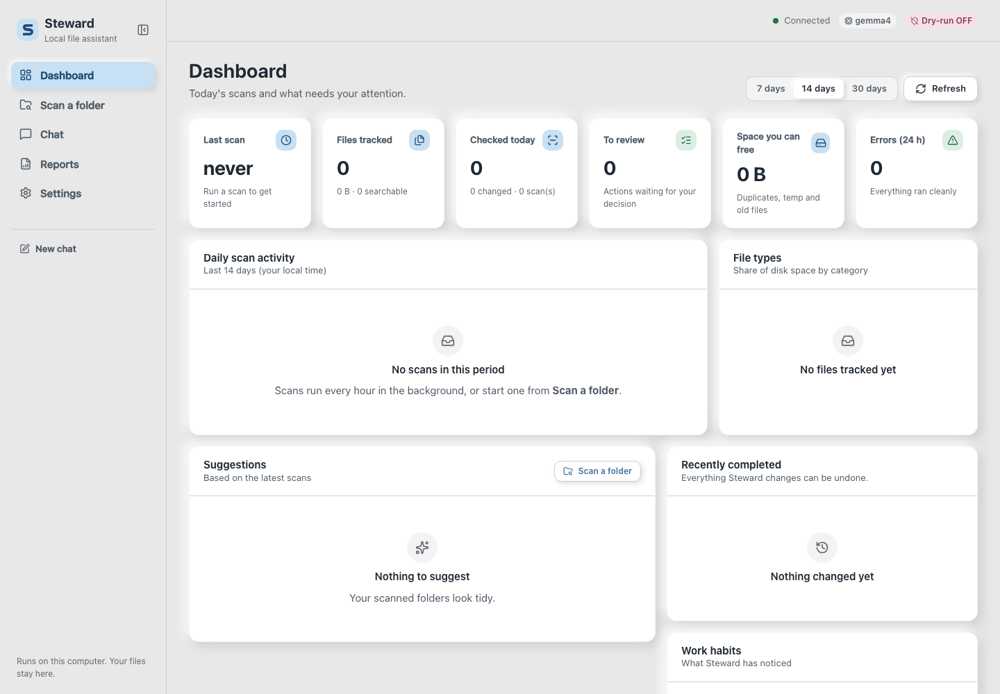

# 14. What's new in Steward 0.13.0

*Written 28 Nov 2026, after hands-on testing of 0.12.0. Plain-language summary first, details below.*

## In one paragraph

In 0.12.0 you could delete chats, knowledge notes and the recycle bin, but the Dashboard stayed full:
the scan history, the file index, the to-do list (340 items in the test) and the reports had no
delete button. 0.13.0 adds them, plus one **Delete everything** button for a complete reset. After it,
the Dashboard, Reports and Chat are really empty, and Steward **starts fresh** with the next scan.
Single reports can be deleted, the sidebar folds into icons, and the Dashboard puts the long to-do
list last, where it can be folded.

## What was missing, and what changed

| Reported | Cause | Now |
|:--|:--|:--|
| "I deleted everything, but the Dashboard is still full" | The Dashboard reads scans, the file index, actions and the search index, which Settings could not delete | Four new items in *Data & cleanup*, and **Delete everything** |
| "There should be an option to delete reports" | Missing | All reports in Settings, or one at a time with 🗑 on the Reports page |
| "A collapse option on the left" | Missing | The **«** button folds the sidebar to icons; remembered per browser |
| "Daily scan activity before the to-dos, to-dos last and collapsible" | The to-do list was the second card | New order; the to-do card shows 10 items, "Show all", and folds; the badge opens it |

## Delete everything, safely

- You type `DELETE` before anything happens; the server checks that too.
- If a chat answer or a folder scan is running, Steward deletes **nothing** and says why.
- The recycle bin and backups are only deleted when you tick them.
- **Archives are never deleted**: they hold your real archived files. The live test made an archive
  from the chat first, and it was still there afterwards.
- "Start fresh" (your choice): Steward keeps scanning your watched folders every hour, so the
  Dashboard fills again with what is in your folders now.

## The test

On a fresh Steward with the real local model: fill it like a long-running install → clear and
restore topics → delete one report → **Delete everything** → everything empty, the "to review" badge
gone without a reload, the archive kept → a new scan fills the Dashboard again → sidebar folded and
to-do folded, in light and dark mode. **Every step passed.** The test caught one bug before release:
after deleting the open report, the Reports page showed nothing instead of the next report.

## Updated scorecard

| Area | 0.12.0 | 0.13.0 | Why |
|:--|:-:|:-:|:--|
| Safety (files can't be lost) | 🟢 9 | 🟢 9 | Delete everything checks running work first, needs `DELETE`, never touches archives |
| AI agents & chat | 🟢 8.5 | 🟢 8.5 | Unchanged |
| User interface | 🟢 9 | 🟢 9 | Collapsible sidebar, calmer Dashboard, report delete |
| Background automation | 🟡 6 | 🟡 6 | Unchanged (start fresh relies on the hourly scan) |
| Tests | 🟢 9 | 🟢 9 | 156 → 166 Python + 40 → 43 frontend tests, plus the reset scenario |
| Data control | 🟡 6 | 🟢 9 | Everything Steward keeps can now be deleted, one by one or at once |

**Overall: about 8.5/10, now with full control over Steward's own data.**

## Still open (next steps)

1. **Smart reorganise by content**: read files, propose new folders, approve, move (planned for 0.14).
2. Ghost entries for deleted files (#4), identical files in search (#5), AI-written summaries (#6, #9).
3. Downloads watcher proposals (#7); one writer for the databases (#12).

## Where to read more

- **Deleting data:** [User Guide, Settings](../docs/user-guide/06-settings.md#data--cleanup)
- **The new Dashboard and sidebar:** [User Guide, Dashboard](../docs/user-guide/02-dashboard.md)
- **Routes and modules:** [API reference](../docs/developer-guide/api-reference.md),
  [Architecture](../docs/developer-guide/architecture.md)
- **Full list of changes:** [CHANGELOG](../CHANGELOG.md)
